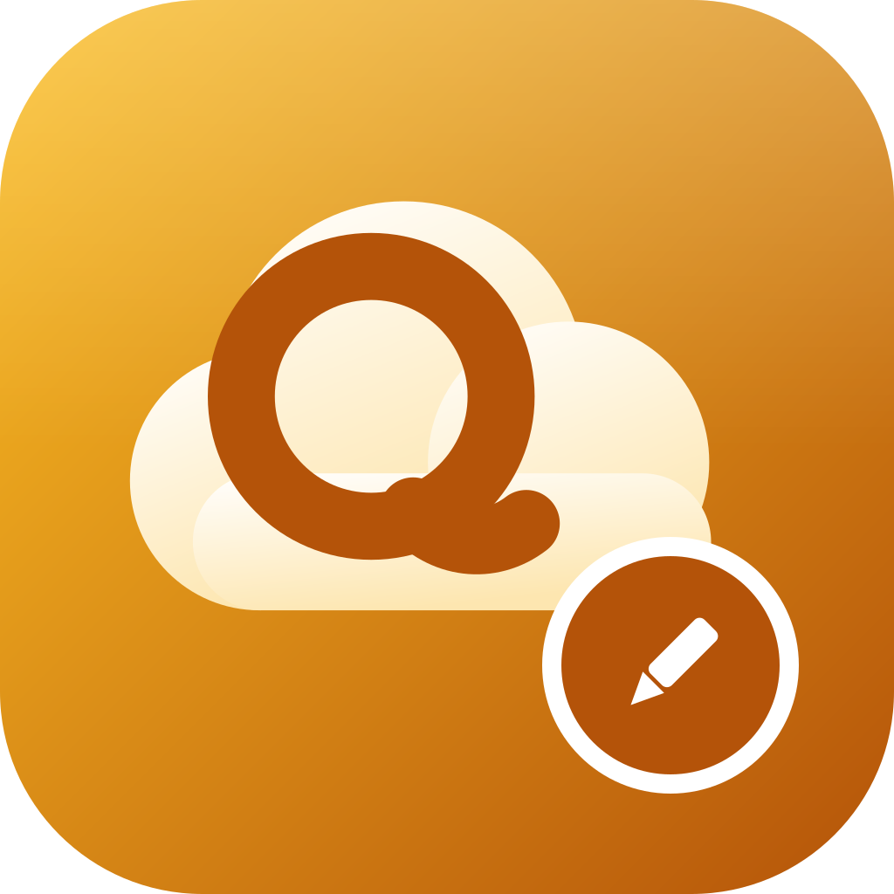

# 青云播放器 qyPlayer

 

[English](./README.en.md) | 中文

青云播放器（英文名 qyPlayer）是一个开源、跨平台、本地优先的“回忆影片”播放器，以及配套的 `.qyp` 影片包格式。效果类似苹果照片 App 的“回忆”：把一组照片和视频，配上音乐，自动编排成带转场和入场动画的影片。

**所有处理都在你的浏览器里完成，文件不会上传到任何服务器。没有账号，没有后端。**

## 在线试用

- 播放器：<https://ricky2022.github.io/qyPlayer/>，打开或拖入 `.qyp` 文件，也可以直接试看内置示例。
- 制作页：<https://ricky2022.github.io/qyPlayer/create.html>，选照片和视频，选模板和配乐，生成 `.qyp` 并下载。

界面有中文和英文两种：默认跟随系统语言，右上角可以切换，选择会被记住。

## 下载 Windows 版

播放器（青云播放器 / qyPlayer）和制作器（青云制作器 / qyMaker）是两个独立的程序，都只在本机运行。需要 Windows 10 / 11（64 位）。

当前版本：[v0.4.0](https://github.com/Ricky2022/qyPlayer/releases/tag/v0.4.0)。上一个正式版是 [v0.2.1](https://github.com/Ricky2022/qyPlayer/releases/tag/v0.2.1)；v0.3.0 只是预览版，没有发布正式 Release，它的内容都包含在 0.4.0 里。

| 程序 | 安装包 | 免安装版 |
| --- | --- | --- |
| 播放器 | [qyPlayer-0.4.0-Setup-x64.exe](https://github.com/Ricky2022/qyPlayer/releases/download/v0.4.0/qyPlayer-0.4.0-Setup-x64.exe) | [qyPlayer-0.4.0-x64-portable.zip](https://github.com/Ricky2022/qyPlayer/releases/download/v0.4.0/qyPlayer-0.4.0-x64-portable.zip) |
| 制作器 | [qyMaker-0.4.0-Setup-x64.exe](https://github.com/Ricky2022/qyPlayer/releases/download/v0.4.0/qyMaker-0.4.0-Setup-x64.exe) | [qyMaker-0.4.0-x64-portable.zip](https://github.com/Ricky2022/qyPlayer/releases/download/v0.4.0/qyMaker-0.4.0-x64-portable.zip) |

所有版本见 [Releases](https://github.com/Ricky2022/qyPlayer/releases)。

- 安装包不需要管理员权限，安装语言跟随系统（中文或英文），可以选择安装目录、是否建桌面快捷方式、装完是否立即运行；重复运行会直接覆盖升级。装好后在资源管理器里双击 `.qyp` 文件就会用播放器打开，文件图标也是青云的。
- 卸载在“设置 > 应用”里，也可以用开始菜单里的“卸载”快捷方式。卸载会清掉快捷方式、注册表和 `.qyp` 关联，勾选“删除应用程序数据”还会删除程序的缓存数据；你自己的 `.qyp` 文件不会被动。
- 播放器不再带内置配乐，体积更小；内置配乐只在制作器里。
- 从 0.1.0 升级：播放器的安装包直接覆盖即可。0.1.0 的制作器叫“qyPlayer 制作器”，新版叫“qyMaker”，不会被识别为升级，请先在“设置 > 应用”里卸载旧版。
- 免安装版解压后直接运行 `qyPlayer.exe` 或 `qyMaker.exe`；需要系统已有 WebView2（Windows 10 / 11 一般自带）。安装包会在缺少时自动安装。
- 程序没有代码签名，第一次运行时 Windows SmartScreen 可能提示“未知发布者”：点“更多信息”，再点“仍要运行”。
- 桌面版就是把网页版装进系统自带的 WebView2 窗口里，功能和限制与网页版一致。

## 当前状态

处于**阶段 0（技术预研）**：做了 Web 版和一个 Windows 桌面壳，用来验证技术路线。macOS、手机端、AI 编排都还没有开始（MP4 导出已包含在 0.3.0 起的版本里）。

### 0.4.0

0.4.0 参照苹果“照片”里的回忆影片优化画面观感和播放体验，同时完成了 0.3.0 预览版遗留的安全收尾和文档，详细方案见 [`docs/dev-0.4.0.md`](./docs/dev-0.4.0.md)。

0.4.0 新增：

- 画面：留空处（照片比例不合、拼图、留边）画一层模糊背景，取自当前素材；拼图改成卡片式，四周留边、间隙加大；单张照片页有缓慢的推拉平移（Ken Burns），拼图页和视频不加。
- 转场：新增“旋转”，制作器的设置里可以单独选择转场（淡入淡出、滑动、缩放、旋转），默认跟随风格模板。
- 滤镜：原片、黑白、暖色、冷色、怀旧五款，整片统一。
- 片头标题：开头淡入淡出的标题和可选的副标题，制作时画成透明图片放进包里，在哪台设备上看都一样；可以关闭。
- 影片时长：长、中、短三档，中、短会先去掉拍摄时间挨得最近的素材（没有拍摄时间的均匀抽取）；没选用的素材不进包，素材面板里变灰。
- 播放器：上一页、下一页按钮（PageUp、PageDown），底部缩略图条，点一下跳到那一页。
- 包格式 0.3：只增加可选字段，0.1、0.2、0.3 的包都能打开；0.3.0 预览版打不开 0.3 格式的包，需要升级。
- 安全与构建：桌面程序启用内容安全策略（CSP）；桌面制作器保存文件时先写临时文件再改名，失败不会留下半成品；Rust 依赖版本由 `Cargo.lock` 固定，CI 用 `--locked` 构建；“关于”页和 `NOTICE` 补上 libheif（LGPL-3.0）、mediabunny（MPL-2.0）等第三方许可说明。

0.3.0 起已有的能力：

- 制作器新界面：菜单栏、三栏布局（手机上是三个标签页）、素材面板、自动更新的预览、撤销和重做、未保存提示、打开已有的 `.qyp` 继续编辑、快捷键、无障碍。
- 包格式 0.2：素材记录 `mimeType` 和转码前的来源，打开时校验实际体积；封面 `cover.jpg`；可以用 `peekPackage` 不解压就读出标题、时长、封面等概要信息。
- 播放器打开时预检素材，本机解不了的素材画占位画面并提示，视频原声每页淡入淡出。
- 制作器：HEIC 照片用内置解码器转成 JPEG；保存时可以把视频裁剪并转成 H.264 + AAC，WAV 转成 AAC（带进度、可取消，失败的素材原样放入并提示）；手机上有素材总量提示和上限。
- 配乐：5 首内置 CC0 曲目（可试听）、导入 MP3、M4A、WAV；导入的音乐保存和导出前要确认使用权。
- 导出 MP4：1920×1080（竖屏 1080×1920）、30 帧每秒、H.264 + AAC，带进度和取消；只在电脑上可用。

待决定与已知问题：

- 转码码率是否不超过源视频码率（目前低码率的源视频转码后可能变大）。
- 导出的 MP4 先整个放在内存里，很长的影片可能内存不足（超过 10 分钟会先提示）；Chrome 的硬件编码器写入的 H.264 级别是 5.0 而不是规格里的 4.0，码流本身没有超出 4.0 的限制。
- 滤镜和模糊背景用到 Canvas 的混合模式，Safari 上的效果以真机为准。

0.2.0 的变化：播放器改成沉浸式界面（控制条自动隐藏、大播放按钮、快捷键）；中英双语界面；新增“关于”页；全新的 Q + 云图标（播放器带播放三角，制作器带铅笔），`.qyp` 文件也有专用图标；Windows 安装包重做（见上）。

已经可用：

- 播放：转场（淡入淡出、滑动、缩放）、1 到 4 张图的版式和依次入场、视频页、背景音乐（以音频为主时钟）、拖动进度、全屏。
- 制作：导入照片和视频，手动调整顺序或删除，选画面比例（横屏 16:9 或竖屏 9:16）、风格模板、标题和配乐，页内预览，“换一版”，下载 `.qyp`。
- `.qyp` 格式：一个 ZIP，内含 `manifest.json` 和素材。打开时严格校验，拒绝越界路径、远程引用、超限体积。规范见 [`spec/manifest.schema.json`](./spec/manifest.schema.json) 和 [PRD 第 7 节](./docs/PRD.md#7-包格式规范v01)。

已知限制：

- 视频：转码开关打开时（电脑上默认），保存时把视频裁剪并转成 H.264 + AAC；关闭时原样放入，包的体积等于原视频大小。手机上不转码。
- 照片：转码打开时重新编码为 JPEG（长边不超过 2560 像素）；浏览器解码不了的格式（例如 Chromium 里的 HEIC）由制作器内置的解码器处理。
- 配乐支持内置 CC0 曲目，或导入 MP3、M4A（AAC）和 WAV。
- 主要在 Chromium 内核浏览器（Chrome、Edge）里实测；Safari 和手机浏览器的真机验收见发布说明。

## 技术栈

TypeScript（严格模式）、React 19、react-jss、Vite、Vitest、pnpm workspace。Canvas 2D 渲染，zip.js 读写包，Ajv 校验清单，music-metadata 检查音视频格式。Windows 桌面版用 Tauri 2（Rust）。

## 目录结构

| 目录 | 内容 |
| --- | --- |
| `packages/core` | 清单类型与校验、时间线引擎 `stateAt`、规则式生成器 |
| `packages/renderer` | 把时间线状态画到 Canvas 2D 的渲染器 |
| `packages/qyp` | `.qyp` 的读写、安全校验、一致性测试包、音视频格式检查 |
| `apps/web` | 网页：播放器（`index.html`）和制作页（`create.html`） |
| `apps/desktop-player`、`apps/desktop-maker` | Windows 桌面版的 Tauri 工程：播放器和制作器，共用 `apps/web` 的构建产物 |
| `apps/desktop-common` | 两个桌面程序共用的 Rust 代码，以及安装包的 NSIS 模板 |
| `assets` | 图标源文件（SVG）和生成脚本、安装向导图片的生成脚本 |
| `spec` | 清单的 JSON Schema 和示例 |
| `fixtures` | 示例素材的来源记录、一致性测试包 |
| `scripts` | 下载示例素材、检查许可、构建示例包 |
| `docs` | [PRD（中文）](./docs/PRD.md)、[PRD (English)](./docs/PRD.en.md)、[阶段 0 报告](./docs/phase0-report.md) |

## 本地运行

需要 Node.js 20 或更新版本（开发时用的是 22）和 pnpm 10。

```bash
pnpm install
pnpm --filter @qyplayer/web dev    # 打开 http://localhost:5173/
pnpm test                          # 单元测试
pnpm typecheck                     # 类型检查
pnpm build                         # 构建网页到 apps/web/dist
```

试看示例和制作页的内置配乐需要示例文件。本地从公开素材重新生成：

```bash
pnpm fixtures:fetch    # 下载 CC0 和公有领域素材到 fixtures/downloads（不入库）
pnpm fixtures:build    # 构建示例包，并复制到 apps/web/public/samples（不入库）
```

线上站点的示例文件放在 GitHub Release `samples-v1` 的附件里，部署时下载到站点中。

Windows 桌面版由 GitHub Actions 构建：推送 `v*` 标签（如 `v0.2.1`，要与两个 `tauri.conf.json` 里的版本号一致）会自动发布 Release；发版时要同时更新两份 README 和 `.github/release-notes.md` 里的版本号和下载链接，`pnpm test` 会检查；也可以在 Actions 页手动运行 “Release Windows apps” 只构建、不发布。本地构建需要 Rust 工具链和 MSVC 生成工具：先 `pnpm --filter @qyplayer/web build:player`，再 `pnpm --filter @qyplayer/desktop-player bundle`；制作器用 `build:maker` 和 `@qyplayer/desktop-maker`（播放器的构建不含内置配乐，制作器的含）。Rust 依赖由根目录的 `Cargo.lock` 固定，测试和构建都加了 `--locked`；改了 Rust 依赖后，手动运行一次 “Release Windows apps”，下载附件 `cargo-lock` 替换它再提交。

## 示例素材与许可

仓库本身使用 [Apache-2.0](./LICENSE)。示例照片、视频和音乐都只收 CC0 或公有领域的作品，每一个的作者、来源和许可见 [`fixtures/SOURCES.md`](./fixtures/SOURCES.md)；`pnpm fixtures:check` 会检查下载目录里没有未记录的文件。

## 参与

欢迎提 Issue 和 PR。较大的改动请先对照 [PRD](./docs/PRD.md) 里的范围和待定项（第 14.2 节）。
