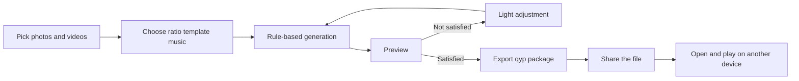
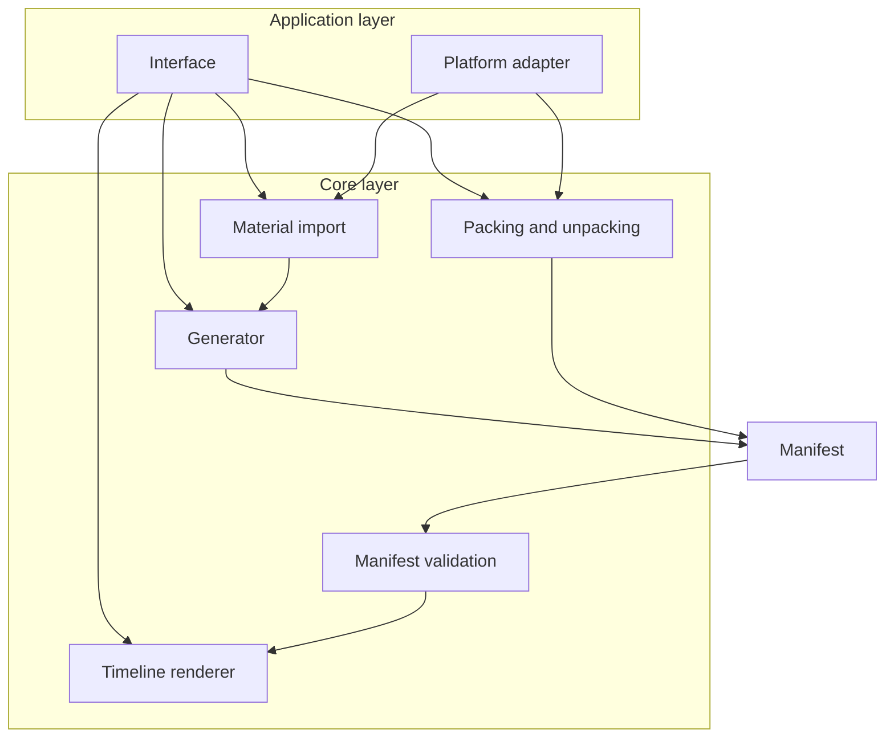

# qyPlayer Product Requirements Document (PRD)

| Item | Value |
| --- | --- |
| Document version | 0.1 (draft) |
| Last updated | 2026-11-18 |
| Status | Pending review |
| Other languages | [简体中文](PRD.md) |

The Chinese version is the primary version of this document, and this English version mirrors it section by section. Where the two differ, the Chinese version prevails.

## 1. Background and goals

### 1.1 Background

People take more photos and videos on their phones every year, but rarely look at them again. The "Memories" films in Apple's Photos app turn a set of photos and videos into a short film with music, transitions and layouts. The experience is good, but it only exists inside the Apple ecosystem, and the result can only be exported as a plain video. It cannot be viewed the same way, or adjusted again, on other platforms.

qyPlayer is an open-source, cross-platform, fully local application of the same kind. The user picks a set of photos and videos, and the app automatically generates a "memory film" with background music. The film can be played directly, or packed into a single file and shared; the recipient opens it with qyPlayer to watch.

### 1.2 Product goals

- **G1 Watch**: Memory films play smoothly on web, desktop and mobile.
- **G2 Make**: Once the user has picked the material, the app generates a film by rules. No editing knowledge is needed.
- **G3 Share**: A film is saved as one `.qyp` package file that opens on any supported platform.
- **G4 Open format**: The package format is published as a standalone public specification, so anyone can write a generator or a player.

### 1.3 Product principles

- **Local first**: No accounts, no server. Material never leaves the device.
- **The format is the contract**: A player renders only from the configuration inside the package and does not depend on the app that produced it.
- **Simple first, richer later**: The first release has few effects that work reliably. Later releases add more.

### 1.4 Non-goals

- No cloud storage, multi-device sync or online sharing links.
- Not a professional editor. No fine-grained timeline editing.
- No content understanding (face recognition, selection, de-duplication) in the first release.

## 2. Target users and scenarios

### 2.1 Target users

| User | Profile | Need |
| --- | --- | --- |
| Everyday user (primary) | No editing experience; material mostly comes from a phone | Pick material and get a watchable film |
| Recipient | Receives a `.qyp` file from someone else | Install the app or open the web page and watch |
| Developer (secondary) | Wants to build a generator or player on the public format | A clear, stable format specification with examples |

### 2.2 Typical scenarios

- **Trip recap**: After a trip, the user picks 40 photos and 5 video clips, chooses a built-in track, generates a landscape film of about two minutes, and plays it full screen on a computer for the family.
- **Share with family**: The user exports the film as a `.qyp` file and sends it to their parents through a chat app or a USB drive. The parents open it on a phone.
- **Keep the original sound**: For a few clips of a child's birthday, the user chooses no background music, and the film uses the sound of the videos.
- **Try another style**: The preview feels too fast, so the user switches template and music and regenerates.

## 3. Glossary

| Term | Meaning |
| --- | --- |
| Film | A memory film played by qyPlayer, made of pages in time order |
| Material | Photo, video and audio files provided by the user |
| Page | A time span of the film that shows 1 video or 1 to 4 photos |
| Layout | The position and size of each item on a page |
| Entrance animation | The animation of a single item as it appears on a page |
| Transition | The effect used to move from one page to the next |
| Template | A set of generation rules: allowed layouts, transitions, entrance animations and pacing parameters |
| Package | A file with the `.qyp` extension that contains material and configuration |
| Manifest | The `manifest.json` inside a package, describing what the film shows at every moment |
| Playback version | A material file inside the package, converted to a widely supported format for playback |
| Original | A material file as provided by the user, not transcoded |
| BGM | Background music |

## 4. First-release scope

### 4.1 Included

- Apps for web, desktop and mobile with the same features.
- Picking photos and videos from local storage, and rule-based automatic generation.
- Light adjustment after generation: remove material, reorder, change template, change music, change aspect ratio, then regenerate.
- Player: play, pause, seek, full screen, volume.
- Visual effects: basic transitions (fade, slide, zoom); pages with 2 to 4 photos, each with its own entrance.
- Aspect ratio: landscape 16:9 or portrait 9:16, chosen at generation time.
- Audio: a small set of built-in CC0 tracks, import of local audio, or no background music with the original sound of the videos.
- Export and opening of `.qyp` packages. Material is transcoded to widely supported formats by default, with an option to keep originals.
- Package format specification v0.1.
- User interface in Chinese and English.

### 4.2 Not included (planned for later)

| Feature | Planned phase |
| --- | --- |
| Slow pan and zoom on single photos (Ken Burns) | Phase 2 |
| Text: opening title, date and place, caption cards | Phase 2 |
| Filters and color grading | Phase 2 |
| Beat sync (transitions aligned to the beat) | Phase 2 |
| MP4 export | Phase 3 |
| Per-page editing (layout, transition and duration of each page) | Phase 4 |
| Advanced transitions and effects (3D, particles, masks) | Phase 4 |
| On-device intelligence (face or subject detection, de-duplication, selection) | Phase 4 |
| Mixing background music with original video sound | Not scheduled |
| The motion part of Live Photos (treated as still photos) | Not scheduled |
| Accounts, cloud storage, online sharing links | Will not do |

## 5. Core user flow



### 5.1 Making a film

1. The user taps "New film" and picks photos and videos from local storage.
2. The app reads the material and checks each file for decodability on this device. Files that cannot be used are listed with the reason.
3. The user chooses aspect ratio, template and music. All have defaults and can be skipped.
4. The app generates the film by rules and opens the preview.
5. If not satisfied, the user opens the adjustment page, makes changes and regenerates.
6. When satisfied, the user exports a `.qyp` package, saves it locally or sends it through the system share sheet.

### 5.2 Watching a film

1. The user opens a `.qyp` package by file picker, drag and drop, double-click, or "Open with qyPlayer".
2. The app validates the package and explains the reason if validation fails.
3. If validation passes, the player opens.

## 6. Functional requirements

Priorities: **P0** is required for the first release; **P1** should be in the first release and may be deferred if time runs out. Values marked "tentative" are collected in [14.1](#141-tentative-values) and referenced as T-xx.

### 6.1 Material import

| ID | Priority | Requirement |
| --- | --- | --- |
| F-IMP-01 | P0 | The user can pick multiple photos and videos at once. Web supports the file picker and drag and drop; desktop supports the file dialog and drag and drop; mobile uses the system photo picker. |
| F-IMP-02 | P0 | Input formats: JPEG, PNG, WebP and HEIC images; H.264 and HEVC video in MP4 and MOV containers. |
| F-IMP-03 | P0 | On import, each file is checked for decodability on this device. Files that cannot be used are listed separately with the reason. The user can skip them and continue. The app must not drop material silently. |
| F-IMP-04 | P0 | The capture time of each file is read: EXIF for photos, container metadata for videos. If neither is available, the file modification time is used. |
| F-IMP-05 | P0 | The number of material files per film is limited (tentatively 100, T-01). When exceeded, the user is asked to reduce the selection. At least 1 file is required. |

### 6.2 Generation options

| ID | Priority | Requirement |
| --- | --- | --- |
| F-OPT-01 | P0 | Aspect ratio is one of landscape 16:9 or portrait 9:16. The default follows the orientation of the majority of the material (tentative, T-16). |
| F-OPT-02 | P0 | One built-in template is selected (tentatively 3 available, T-11). Each template has a name and a short description. |
| F-OPT-03 | P0 | Music is one of: a built-in track, an imported local audio file, or no background music. |

### 6.3 Automatic generation

The generator takes the material list, aspect ratio, template, music and a random seed, and outputs a manifest.

| ID | Priority | Requirement |
| --- | --- | --- |
| F-GEN-01 | P0 | **Ordering**: By capture time ascending by default; by file name when capture times are equal. After the user reorders manually, the manual order is used. |
| F-GEN-02 | P0 | **Paging**: Each video takes a page of its own. Consecutive photos are grouped into pages of 1 to 4 photos following the template rules. Two adjacent pages avoid using the same multi-photo layout where possible. |
| F-GEN-03 | P0 | **Layout matching**: Within a multi-photo page, a photo is placed in a cell of similar orientation (landscape or portrait) where possible. Photos may be rearranged within a page for this purpose, but not moved across pages. |
| F-GEN-04 | P0 | **Cropping**: By default an item fills its cell with a centered crop. When cropping would lose too much of the image (tentatively more than 40%, T-20), the item is shown in full and the empty area is filled with the background color. |
| F-GEN-05 | P0 | **Transitions and entrance animations**: Chosen from the set allowed by the template. On multi-photo pages the photos enter one after another. |
| F-GEN-06 | P0 | **Pacing**: Photo page durations are adjusted to the music length. See [6.3.1](#631-pacing-rules). |
| F-GEN-07 | P0 | **Video clipping**: When a video is longer than the limit, only one segment is used (limit tentatively 8 seconds, T-02; the middle segment, tentative, T-03). |
| F-GEN-08 | P0 | **Determinism**: The same input and seed must produce exactly the same manifest. |
| F-GEN-09 | P0 | **Progress**: Generation shows progress and can be cancelled. |
| F-GEN-10 | P0 | **Title and cover**: The default title is "Memories of" followed by the earliest capture date, and can be edited. The default cover is taken from the first item. In the first release the title is only used in the film list and the file name, and is not shown in the film itself. |

#### 6.3.1 Pacing rules

Let P be the sum of the base durations of photo pages, V the sum of the durations of video pages, and M the music length. Base durations are tentatively 3 seconds for a single-photo page and 4 seconds for a multi-photo page (T-04).

- **No background music**: Photo pages use their base durations. The film length is P + V.
- **With background music**: Compute the scale factor k = (M − V) / P and clamp it to the range 0.7 to 1.6 (tentative, T-04). Each photo page lasts its base duration multiplied by k.
  - k is not clamped: the film length equals the music length, and both end together.
  - k is clamped to 1.6 (music is long): the music fades out when the film ends.
  - k is clamped to 0.7 (music is short): the music loops and fades out when the film ends (tentative, T-17).
- **No photo pages** (P = 0): The film length is V. The music is handled as long or short.

### 6.4 Light adjustment

| ID | Priority | Requirement |
| --- | --- | --- |
| F-ADJ-01 | P0 | Remove material from the film. At least 1 item remains. |
| F-ADJ-02 | P0 | Reorder material by dragging. |
| F-ADJ-03 | P0 | Change the template. |
| F-ADJ-04 | P0 | Change the music, or switch to no background music. |
| F-ADJ-05 | P0 | Change the aspect ratio. |
| F-ADJ-06 | P0 | After any adjustment is confirmed, the whole film is regenerated and the preview opens. The first release does not offer editing of the layout, transition or duration of a single page. |

### 6.5 Player

| ID | Priority | Requirement |
| --- | --- | --- |
| F-PLY-01 | P0 | Play and pause. |
| F-PLY-02 | P0 | The progress bar shows the current time and total duration and can be dragged to any point. After seeking, picture and sound both match that point. |
| F-PLY-03 | P0 | Enter and exit full screen. |
| F-PLY-04 | P0 | Volume control and mute. |
| F-PLY-05 | P0 | Audio and picture stay in sync, with an offset of at most 100 milliseconds (tentative, T-12). |
| F-PLY-06 | P0 | The film keeps its aspect ratio inside the window, with empty areas filled in black. It adapts when the window size or device orientation changes. |
| F-PLY-07 | P0 | All transitions and entrance animations defined by package format v0.1 render correctly. Unknown types are degraded without interrupting playback (see [7.6](#76-versioning-and-compatibility)). |
| F-PLY-08 | P0 | When playback ends, the player stays on the last frame and shows "Replay". |
| F-PLY-09 | P1 | Desktop and web support keyboard control: Space toggles play and pause, Left and Right seek 5 seconds back and forward, F toggles full screen. |
| F-PLY-10 | P1 | On mobile, playback pauses when the app goes to the background. |

### 6.6 Exporting and opening packages

| ID | Priority | Requirement |
| --- | --- | --- |
| F-PKG-01 | P0 | The current film can be exported as one `.qyp` file. Export shows progress and can be cancelled. Cancelling or failing must not leave a corrupted file behind. |
| F-PKG-02 | P0 | By default, export converts material to widely supported formats and limits resolution: images become JPEG (long edge tentatively at most 2560 pixels, T-07); videos become MP4 with H.264 and AAC (tentatively at most 1080p, T-08). Only the segment of a video used by the film is kept. |
| F-PKG-03 | P0 | A "Keep originals" option is provided and is off by default. When on, originals are additionally stored in the `originals/` directory of the package. Playback versions are still generated so the package plays on every platform. An original that already meets the playback version requirements is not stored twice. |
| F-PKG-04 | P0 | Opening a `.qyp` file: all three platforms support picking a file inside the app; web and desktop support drag and drop; desktop and mobile support opening through the system file association. |
| F-PKG-05 | P0 | On opening, the package is validated: the manifest conforms to the format specification, all referenced files exist, and the format version is supported. On failure, the reason is explained in language the user can understand. |
| F-PKG-06 | P0 | Security: packages with escaping paths (such as `../`) or absolute paths are rejected; packages whose manifest references remote addresses are rejected; packages whose total uncompressed size exceeds the limit (tentatively 2 GB, T-09) are rejected. The player never executes any code from a package. |
| F-PKG-07 | P0 | After export, mobile opens the system share sheet; desktop and web save to a location chosen by the user or to the downloads folder. |
| F-PKG-08 | P1 | The exported file name defaults to the film title. |

### 6.7 Background music

| ID | Priority | Requirement |
| --- | --- | --- |
| F-BGM-01 | P0 | The app ships with a small number of tracks (tentatively 5, T-10) that can be auditioned before selection. |
| F-BGM-02 | P0 | Every built-in track must be CC0 or under an equivalent no-restriction license. The source and proof of license of each track are kept in the repository. |
| F-BGM-03 | P0 | The user can import local audio as background music. MP3, M4A (AAC) and WAV are supported. On export the audio is saved in the package; WAV is converted to AAC. |
| F-BGM-04 | P1 | When exporting a package that uses imported audio, the user is reminded to confirm they have the right to use the music. |

### 6.8 Film library

| ID | Priority | Requirement |
| --- | --- | --- |
| F-LIB-01 | P1 | The home screen lists the films on this device (made here or opened before). Each entry shows cover, title, duration and creation date. |
| F-LIB-02 | P1 | Films can be renamed and deleted. Deletion requires confirmation. |
| F-LIB-03 | P1 | Any film in the list can be lightly adjusted again, because the package contains all the material and configuration needed. |

Note: Whether a film library is needed was not settled during requirements discussion. It is added here on the grounds that a standalone app needs a way to find earlier films, and is listed in [14.2](#142-open-questions).

## 7. Package format specification (v0.1)

The package format is the most important external contract of qyPlayer. The specification will be published in the repository as a standalone document with a JSON Schema. This section is the basis of its content.

### 7.1 Container

- A package is a standard ZIP file with the `.qyp` extension.
- No encryption, no multi-volume archives.
- Images, video and audio are already compressed and should be stored without compression.
- `manifest.json` must exist at the root, encoded as UTF-8.

### 7.2 Directory layout

```
example.qyp
├── manifest.json        Manifest (required)
├── cover.jpg            Cover (optional)
├── media/               Playback versions of images and videos
│   ├── m001.jpg
│   ├── m002.jpg
│   ├── m003.jpg
│   ├── m004.mp4
│   ├── m005.jpg
│   ├── m006.jpg
│   └── m007.jpg
├── audio/               Background music
│   └── bgm.m4a
└── originals/           Originals (only when "Keep originals" is on)
    └── IMG_0001.HEIC
```

Directory names are a convention, not a rule. A player follows the paths in the manifest.

### 7.3 Path rules

- All paths in the manifest are relative to the package root and use `/` as the separator.
- `..`, absolute paths and any address with a scheme (such as `http://`) are not allowed.
- Paths are case sensitive. File names inside a package should use ASCII characters only.

### 7.4 Media format requirements

A player must support these playback version formats:

| Type | Formats |
| --- | --- |
| Image | JPEG, PNG, WebP |
| Video | MP4 container, H.264 video, AAC audio |
| Audio | AAC (`.m4a`), MP3 |

Originals in `originals/` may be in any format. A player does not read them.

### 7.5 Manifest fields

#### Top level

| Field | Type | Required | Description |
| --- | --- | --- | --- |
| `formatVersion` | string | Yes | Format version, such as `"0.1"` |
| `id` | string | Yes | Unique identifier of the film (UUID) |
| `title` | string | Yes | Film title |
| `createdAt` | string | Yes | Creation time, ISO 8601 |
| `generator` | object | No | Generator information, used for regeneration |
| `canvas` | object | Yes | Canvas |
| `duration` | number | Yes | Total duration in seconds. Must equal the sum of all page durations |
| `cover` | string | No | Path of the cover image |
| `assets` | array | Yes | Asset list |
| `bgm` | object | No | Background music. When present, all videos are muted; when absent, the original sound of videos plays |
| `pages` | array | Yes | Page list in time order, at least 1 page |

#### generator

| Field | Type | Required | Description |
| --- | --- | --- | --- |
| `name` | string | Yes | Generator name |
| `version` | string | Yes | Generator version |
| `templateId` | string | No | Template used |
| `seed` | integer | No | Random seed |

#### canvas

| Field | Type | Required | Description |
| --- | --- | --- | --- |
| `aspectRatio` | string | Yes | `"16:9"` or `"9:16"` |
| `width` | integer | Yes | Reference width in pixels |
| `height` | integer | Yes | Reference height in pixels |
| `background` | string | Yes | Background color, such as `"#000000"` |

`width` and `height` are the reference resolution for export and rendering (see T-06 for the values qyPlayer generates) and must match `aspectRatio`. Positions on a page use normalized coordinates from 0 to 1 and do not depend on resolution.

#### assets element

| Field | Type | Required | Description |
| --- | --- | --- | --- |
| `id` | string | Yes | Asset identifier, unique within the manifest |
| `type` | string | Yes | `"image"`, `"video"` or `"audio"` |
| `src` | string | Yes | Path of the playback version |
| `width` | integer | For image and video | Width in pixels |
| `height` | integer | For image and video | Height in pixels |
| `duration` | number | For video and audio | Duration in seconds |
| `hasAudio` | boolean | For video | Whether the video has an audio track |
| `capturedAt` | string | No | Capture time, ISO 8601 |
| `original` | string | No | Path of the original |
| `title` | string | No | Track title of an audio asset |
| `license` | string | No | License identifier of an audio asset, such as `"CC0-1.0"` |

#### bgm

| Field | Type | Required | Default | Description |
| --- | --- | --- | --- | --- |
| `assetId` | string | Yes | | Refers to an asset of type `audio` |
| `volume` | number | No | 1 | Volume, 0 to 1 |
| `loop` | boolean | No | false | Whether to loop when the music is shorter than the film |
| `fadeIn` | number | No | 0 | Fade-in duration at the start, in seconds |
| `fadeOut` | number | No | 0 | Fade-out duration at the end, in seconds |

#### pages element

| Field | Type | Required | Description |
| --- | --- | --- | --- |
| `id` | string | Yes | Page identifier, unique within the manifest |
| `start` | number | Yes | Start time in seconds. 0 for the first page; for every later page, the `start` of the previous page plus its `duration` |
| `duration` | number | Yes | Duration in seconds, greater than 0 |
| `transitionIn` | object | No | Transition into this page. Defaults to a direct cut |
| `items` | array | Yes | Items on the page, 1 to 4 |

A transition takes place during the first `transitionIn.duration` seconds of the page. During that time the previous page stays in its final state (a video holds its last frame). The transition of the first page starts from the canvas background color.

#### transitionIn

| Field | Type | Required | Description |
| --- | --- | --- | --- |
| `type` | string | Yes | `"none"`, `"fade"`, `"slide"`, `"zoom"` |
| `direction` | string | For `slide` | `"left"`, `"right"`, `"up"`, `"down"`: the direction in which the new page moves |
| `duration` | number | Yes | Duration in seconds. Must not exceed the page duration |

#### items element

| Field | Type | Required | Default | Description |
| --- | --- | --- | --- | --- |
| `assetId` | string | Yes | | Refers to an asset of type `image` or `video` |
| `frame` | object | Yes | | Position and size: `x`, `y`, `w`, `h`, each from 0 to 1, relative to the canvas |
| `fit` | string | No | `"cover"` | `"cover"` fills the frame with a centered crop; `"contain"` shows the whole item |
| `clipStart` | number | No | 0 | Video only: the second of the asset at which playback starts |
| `enter` | object | No | | Entrance animation. Defaults to none |

A video plays from `clipStart` for the duration of the page. If the asset is not long enough, it holds its last frame.

#### enter

| Field | Type | Required | Default | Description |
| --- | --- | --- | --- | --- |
| `type` | string | Yes | | `"none"`, `"fade"`, `"slide"`, `"scale"` |
| `direction` | string | For `slide` | | `"left"`, `"right"`, `"up"`, `"down"`: the direction in which the item moves |
| `delay` | number | No | 0 | Delay in seconds relative to the page start |
| `duration` | number | Yes | | Duration in seconds |

In v0.1 all animations use the same ease-in-out curve, which is not configurable.

### 7.6 Versioning and compatibility

- `formatVersion` takes the form "major.minor".
- Before 1.0 the format may change incompatibly. A player that meets a version it does not support must say so clearly, and must not crash or show a wrong picture.
- From 1.0 on: the same major version guarantees compatibility; a minor version only adds optional fields and new enum values.
- A player must ignore fields it does not recognize.
- A player treats an unknown `transitionIn.type` as `fade` and an unknown `enter.type` as `none`.

### 7.7 Complete example

The manifest below matches the directory layout in [7.2](#72-directory-layout): a 16:9 film with 4 pages and background music. The music (142.5 seconds) is far longer than the material can fill, so photo pages use the maximum scale factor 1.6 and the music fades out when the film ends.

```json
{
  "formatVersion": "0.1",
  "id": "8d0c6a52-3f0e-4c1b-9a39-5a1d2f7b6c10",
  "title": "Memories of 2026-10-01",
  "createdAt": "2026-10-08T20:30:00+08:00",
  "generator": {
    "name": "qyPlayer",
    "version": "0.1.0",
    "templateId": "clean",
    "seed": 20261008
  },
  "canvas": {
    "aspectRatio": "16:9",
    "width": 1920,
    "height": 1080,
    "background": "#000000"
  },
  "duration": 25.6,
  "cover": "cover.jpg",
  "assets": [
    {
      "id": "m001",
      "type": "image",
      "src": "media/m001.jpg",
      "width": 2560,
      "height": 1707,
      "capturedAt": "2026-10-01T09:12:30+08:00",
      "original": "originals/IMG_0001.HEIC"
    },
    {
      "id": "m002",
      "type": "image",
      "src": "media/m002.jpg",
      "width": 1707,
      "height": 2560,
      "capturedAt": "2026-10-01T10:03:11+08:00"
    },
    {
      "id": "m003",
      "type": "image",
      "src": "media/m003.jpg",
      "width": 1707,
      "height": 2560,
      "capturedAt": "2026-10-01T10:05:42+08:00"
    },
    {
      "id": "m004",
      "type": "video",
      "src": "media/m004.mp4",
      "width": 1920,
      "height": 1080,
      "duration": 8.0,
      "hasAudio": true,
      "capturedAt": "2026-10-01T11:20:05+08:00"
    },
    {
      "id": "m005",
      "type": "image",
      "src": "media/m005.jpg",
      "width": 1707,
      "height": 2560,
      "capturedAt": "2026-10-01T15:40:00+08:00"
    },
    {
      "id": "m006",
      "type": "image",
      "src": "media/m006.jpg",
      "width": 2560,
      "height": 1707,
      "capturedAt": "2026-10-01T15:41:18+08:00"
    },
    {
      "id": "m007",
      "type": "image",
      "src": "media/m007.jpg",
      "width": 2560,
      "height": 1707,
      "capturedAt": "2026-10-01T15:44:52+08:00"
    },
    {
      "id": "a001",
      "type": "audio",
      "src": "audio/bgm.m4a",
      "duration": 142.5,
      "title": "Sample Track",
      "license": "CC0-1.0"
    }
  ],
  "bgm": {
    "assetId": "a001",
    "volume": 1,
    "loop": false,
    "fadeIn": 1,
    "fadeOut": 2
  },
  "pages": [
    {
      "id": "p001",
      "start": 0,
      "duration": 4.8,
      "transitionIn": { "type": "fade", "duration": 0.6 },
      "items": [
        {
          "assetId": "m001",
          "frame": { "x": 0, "y": 0, "w": 1, "h": 1 },
          "fit": "cover"
        }
      ]
    },
    {
      "id": "p002",
      "start": 4.8,
      "duration": 6.4,
      "transitionIn": { "type": "slide", "direction": "left", "duration": 0.6 },
      "items": [
        {
          "assetId": "m002",
          "frame": { "x": 0, "y": 0, "w": 0.4972, "h": 1 },
          "fit": "cover",
          "enter": { "type": "fade", "delay": 0, "duration": 0.5 }
        },
        {
          "assetId": "m003",
          "frame": { "x": 0.5028, "y": 0, "w": 0.4972, "h": 1 },
          "fit": "cover",
          "enter": { "type": "fade", "delay": 0.15, "duration": 0.5 }
        }
      ]
    },
    {
      "id": "p003",
      "start": 11.2,
      "duration": 8.0,
      "transitionIn": { "type": "fade", "duration": 0.6 },
      "items": [
        {
          "assetId": "m004",
          "frame": { "x": 0, "y": 0, "w": 1, "h": 1 },
          "fit": "cover",
          "clipStart": 0
        }
      ]
    },
    {
      "id": "p004",
      "start": 19.2,
      "duration": 6.4,
      "transitionIn": { "type": "zoom", "duration": 0.6 },
      "items": [
        {
          "assetId": "m005",
          "frame": { "x": 0, "y": 0, "w": 0.4972, "h": 1 },
          "fit": "cover",
          "enter": { "type": "slide", "direction": "right", "delay": 0, "duration": 0.5 }
        },
        {
          "assetId": "m006",
          "frame": { "x": 0.5028, "y": 0, "w": 0.4972, "h": 0.495 },
          "fit": "cover",
          "enter": { "type": "scale", "delay": 0.15, "duration": 0.5 }
        },
        {
          "assetId": "m007",
          "frame": { "x": 0.5028, "y": 0.505, "w": 0.4972, "h": 0.495 },
          "fit": "cover",
          "enter": { "type": "scale", "delay": 0.3, "duration": 0.5 }
        }
      ]
    }
  ]
}
```

Points to note in the example:

- `m001` was exported with "Keep originals" on. The original is HEIC and the playback version is JPEG.
- The playback version of `m004` is already trimmed to the 8 seconds used by the film, so `clipStart` is 0.
- Because `bgm` is present, the original sound of `m004` does not play.
- Cells on multi-photo pages are separated by gaps, which show the canvas background color.

## 8. Visual effects

This section lists every effect supported in the first release. All durations are tentative defaults (T-05).

### 8.1 Transitions

| Type | Effect | Default duration |
| --- | --- | --- |
| `none` | Direct cut | 0 |
| `fade` | The previous page fades out while the new page fades in | 0.6 s |
| `slide` | The new page slides in from one side and pushes the previous page out; four directions | 0.6 s |
| `zoom` | The previous page grows and fades out; the new page grows from slightly smaller to normal size and fades in | 0.6 s |

### 8.2 Layouts

The gap between cells is tentatively 1% of the short edge of the canvas (T-15).

| Photos | 16:9 | 9:16 |
| --- | --- | --- |
| 1 | Fills the canvas | Fills the canvas |
| 2 | Side by side, half each | Stacked, half each |
| 3 | One on the left taking half; two stacked on the right | One on top taking half; two side by side below |
| 4 | 2×2 grid | 2×2 grid |

Video pages only use the single-item layout.

### 8.3 Entrance animations

| Type | Effect | Default duration |
| --- | --- | --- |
| `none` | Appears with the page | 0 |
| `fade` | From transparent to opaque | 0.5 s |
| `slide` | Slides into place from outside one side of its cell; four directions | 0.5 s |
| `scale` | Grows from slightly smaller to normal size while fading in | 0.5 s |

On multi-photo pages the entrances are staggered, tentatively by 0.15 seconds (T-05). Entrance delays are counted from the start of the page and run in parallel with the transition, so the first item starts entering while the new page is still coming in.

### 8.4 Built-in templates

The first release tentatively ships 3 templates (T-11). Names and parameters are settled during design:

| Template | Style |
| --- | --- |
| Clean | Mostly fades; a high share of single-photo pages |
| Lively | Mostly slides and zooms; a high share of multi-photo pages |
| Classic | A balanced mix of transitions and layouts |

## 9. Audio rules

| ID | Rule |
| --- | --- |
| A-01 | When the film has background music, all videos are muted. |
| A-02 | When the film has no background music, the original sound of videos plays. Photo pages are silent. |
| A-03 | Background music plays from the start of the film, fading in at the start and out at the end (tentatively 1 second in and 2 seconds out, T-14). |
| A-04 | When the music is longer than the film, it fades out where the film ends. When it is shorter, it loops. |
| A-05 | When original video sound plays, the sound of each clip has a short fade at its start and end to avoid pops. |
| A-06 | When there is background music, audio playback position is the master clock of the film, and the picture follows the audio. |
| A-07 | After seeking, both the background music and the video jump to the matching position. |
| A-08 | Browsers restrict autoplay of content with sound. Playback must be started by a user action. |

## 10. Non-functional requirements

### 10.1 Performance

| ID | Requirement |
| --- | --- |
| N-PERF-01 | On the reference devices, playback runs at no less than 30 frames per second (tentative, T-13). |
| N-PERF-02 | After seeking, the correct picture is shown within 500 milliseconds (tentative, T-19). |
| N-PERF-03 | For a film with 100 material files, generating the manifest takes at most 10 seconds, excluding decoding and transcoding (tentative, T-18). |
| N-PERF-04 | Opening a package does not read the whole package into memory. Material is read on demand. |

The reference device models are to be decided. See [14.2](#142-open-questions).

### 10.2 Compatibility

| Platform | Targets |
| --- | --- |
| Web | Current mainstream versions of Chrome, Edge, Safari and Firefox |
| Desktop | Windows, macOS |
| Mobile | iOS, Android |

The minimum supported version of each platform depends on actual support for capabilities such as WebCodecs, and is decided after measurement in Phase 0. Features should be the same on all three platforms. A feature that truly cannot be implemented on a platform (for example, a video that cannot be transcoded) must be stated clearly in the interface and must not fail silently.

### 10.3 Privacy

| ID | Requirement |
| --- | --- |
| N-PRI-01 | The app does not send user material, manifests or any usage data over the network. |
| N-PRI-02 | The app contains no analytics, telemetry or advertising components. A third-party dependency must be confirmed to be free of telemetry before it is adopted. |
| N-PRI-03 | The web version is a purely static site. After the page has loaded, all features work without a network. |
| N-PRI-04 | Opening a package from someone else triggers no network request. |

### 10.4 Reliability

| ID | Requirement |
| --- | --- |
| N-REL-01 | A corrupted package, a missing file or an unsupported format produces a clear message, and the app does not crash. |
| N-REL-02 | When generation or export is interrupted (cancelled, or the app is closed), existing films are not affected. |

### 10.5 Accessibility

| ID | Requirement |
| --- | --- |
| N-A11Y-01 | All controls can be operated by keyboard and have names that a screen reader can announce. |
| N-A11Y-02 | The contrast between interface text and background meets WCAG 2.1 AA. |

### 10.6 Internationalization

| ID | Requirement |
| --- | --- |
| N-I18N-01 | The interface supports Simplified Chinese and English, follows the system language by default, and can be switched in settings. |
| N-I18N-02 | All interface text comes from language resource files. None is hard-coded. |

### 10.7 Testability

| ID | Requirement |
| --- | --- |
| N-TEST-01 | The generator and manifest validation are pure logic that depends on neither the interface nor the platform, and are covered by unit tests. |
| N-TEST-02 | The repository provides a set of format conformance test packages (valid and invalid samples) that any player implementation can use to test itself. |

## 11. Technical proposal

This section is a proposal, not a decision. Final choices are made after prototype validation in Phase 0.

### 11.1 Scope of verification

The versions, licenses and release dates in the tables below were verified on 2026-11-18 against the npm registry. The descriptions of each project come from its official license file, documentation and README. Capabilities marked "to be verified" have not been tested. Because of GitHub API rate limiting, star counts and issue activity were not obtained, so maintenance status is judged only from the release date of the latest version.

### 11.2 The state of "mature player components"

The requirement asks for a mature open-source player component. After verification, the conclusion is that no single component meets the requirement directly, and the product has to be assembled from mature open-source parts. The reasons follow.

**Traditional player components** play one audio or video source. They cannot compose several images and video clips on a timeline:

| Component | Latest version | Released | License |
| --- | --- | --- | --- |
| Video.js | 10.5.0 | 2026-11-16 | Apache-2.0 |
| Vidstack | 1.15.7 | 2026-10-06 | MIT |
| Plyr | 3.8.5 | 2026-10-06 | MIT |
| xgplayer | 3.0.27 | 2026-10-29 | MIT |
| ArtPlayer | 5.4.0 | 2026-03-12 | MIT |

They can be used to play the finished film once MP4 export exists in Phase 3. Whether their control bar interface can be reused to drive a custom timeline is to be verified.

**Timeline composition engines** fit the capability but each has problems:

| Candidate | Latest version | Released | License | Conclusion |
| --- | --- | --- | --- | --- |
| Remotion | 4.0.544 | 2026-11-16 | Remotion License | Not adopted |
| Revideo | 0.11.0 | 2026-07-10 | MIT | Fallback |
| Motion Canvas | 3.17.2 | 2024-12-14 | MIT | Not recommended |

- **Remotion**: Its maintainers state that it is source-available software, not open-source software. Only individuals, organizations of up to 3 people and non-profits may use it for free; others must buy a license, which would constrain downstream users of qyPlayer. Its browser-side rendering sends telemetry for every render and this cannot be turned off, which conflicts with the local-first principle.
- **Revideo**: MIT licensed, with a React player. It has not reached 1.0. Scenes are written as TypeScript generator functions, so a conversion layer from manifest to scene would be needed. Video export depends on Node and a headless browser and cannot run on mobile. Rendering includes anonymous usage counting, which can be disabled with an environment variable.
- **Motion Canvas**: The latest version was released in December 2024, with no update for nearly two years. It is aimed at explanatory vector animation and does not fit this product.

### 11.3 Proposed approach: a small in-house timeline engine rendering to Canvas

The first release only has basic transitions and multi-photo layouts, so the complexity of writing a manifest-driven renderer is manageable. Its core is a pure function: given a manifest and a time t, draw the picture for that moment.

Reasons for choosing Canvas over DOM with CSS animation:

- Phase 3 exports MP4 on the device. Each frame drawn on a Canvas can go straight to an encoder, so preview and export share one renderer and look the same.
- A DOM approach is faster to build for the first release, but there is no reliable way to turn DOM output into video frame by frame, so the renderer would have to be rewritten later.

The first release uses the native Canvas 2D API as the rendering layer. If the filters of Phase 2 or the advanced effects of Phase 4 need the GPU, it can be replaced with PixiJS (8.23.0, 2026-11-11, MIT).

The risk of this approach is the performance of Canvas 2D when drawing 1080p video on low-end mobile devices. This is validated in Phase 0.

### 11.4 Multi-platform approach

One React + TypeScript code base. It runs directly on the web and is wrapped in a shell for desktop and mobile. The first release ships on all three platforms at once, and sharing one rendering code base is the only realistic way to do that.

| Candidate | Latest version | Released | License | Notes |
| --- | --- | --- | --- | --- |
| Tauri | 2.12.5 | 2026-11-16 | Apache-2.0 or MIT | Officially supports the major desktop and mobile platforms; uses the system WebView; small installers |
| Capacitor | 8.6.2 | 2026-11-12 | MIT | A web shell aimed at mobile |
| Electron | 45.3.4 | 2026-11-17 | MIT | Bundles Chromium; consistent behavior across desktop platforms; large installers; no mobile support |

Tauri is proposed for desktop. For mobile the choice is between Tauri and Capacitor, decided in Phase 0 by a prototype that compares three capabilities: photo library access, file association and system sharing.

Using the system WebView means the browser engine differs by platform (Chromium-based on Windows, WebKit-based on Apple platforms), so WebCodecs and video decoding capabilities will differ. This is a key item to validate in Phase 0.

### 11.5 Other parts

| Purpose | Candidate | Latest version | Released | License | Notes |
| --- | --- | --- | --- | --- | --- |
| ZIP read and write | zip.js | 2.25.0 | 2026-11-12 | BSD-3-Clause | Preferred; on-demand reading of large files to be verified |
| ZIP read and write | fflate | 0.8.3 | 2026-05-16 | MIT | Fallback |
| ZIP read and write | JSZip | 3.10.2 | 2026-09-08 | MIT or GPL-3.0 | Fallback |
| Video transcoding and muxing | Mediabunny | 1.66.0 | 2026-11-13 | MPL-2.0 | Proposed; built on WebCodecs, so available codecs depend on the runtime |
| Video transcoding | ffmpeg.wasm | 0.12.15 | 2025-01-07 | MIT wrapper, GPL-2.0-or-later core | Not recommended: the core is GPL, which conflicts with Apache-2.0 distribution; no update for nearly two years |
| HEIC decoding | heic-to | 1.6.7 | 2026-10-27 | LGPL-3.0 | Candidate; needs an LGPL compliance review |
| HEIC decoding | libheif-js | 1.23.5 | 2026-10-04 | LGPL-3.0 | Candidate; needs an LGPL compliance review |
| HEIC decoding | heic2any | 0.0.4 | 2023-03-29 | MIT | Not recommended: no update for more than three years |
| Reading capture time | ExifReader | 4.54.0 | 2026-11-03 | MPL-2.0 | Proposed |
| Reading capture time | exifr | 7.1.3 | 2021-08-05 | MIT | Not recommended: no update for five years |
| Manifest validation | Ajv | 8.20.0 | 2026-04-24 | MIT | Proposed; uses the public JSON Schema directly |

HEIC and HEVC are handled with the decoding capabilities of the platform first. A third-party decoding library is added only where the platform lacks support.

### 11.6 Module structure



The core layer depends on neither the interface framework nor a specific platform. This makes it easy to unit test and leaves room to publish the player as a component library later. The platform adapter wraps file picking, photo library access, file association and system sharing.

## 12. Roadmap

| Phase | Content | Done when |
| --- | --- | --- |
| Phase 0: Technical spike | Timeline renderer prototype; shell validation on three platforms; feasibility of HEIC decoding and video transcoding on each platform; draft of package format specification v0.1 | The example package plays on all three platforms; every open question in [14.2](#142-open-questions) that depends on the spike has an answer |
| Phase 1: First release | Player on three platforms, rule-based generation, light adjustment, `.qyp` export and opening, built-in CC0 tracks, Chinese and English interface | All P0 acceptance criteria in section 13 pass |
| Phase 2: More effects | Pan and zoom on single photos, text titles, filters, beat sync | The package format is upgraded and remains compatible with older packages |
| Phase 3: Video export | Export the film to MP4 on the device | The exported MP4 matches the picture in the player |
| Phase 4: Editing and intelligence | Per-page editor, advanced effects, on-device selection | Defined separately |

## 13. Acceptance criteria

### 13.1 Functional requirements

| Requirement | Acceptance criteria |
| --- | --- |
| F-IMP-01 | Picking 20 files at once through the entry point of each platform puts all of them in the material list. Dragging the same files in on web and desktop gives the same result. |
| F-IMP-02 | With one sample of each listed input format, every sample imports and shows in the preview on a device that can decode that format. |
| F-IMP-03 | After importing one corrupted file and one file this device cannot decode, both appear in the "cannot be used" list with a reason, and generation can continue with the rest. |
| F-IMP-04 | A photo with EXIF shows the capture time from EXIF. A photo with EXIF removed uses the file modification time. |
| F-IMP-05 | Picking more files than the limit shows a message and blocks continuing. Picking 1 file allows generation. |
| F-OPT-01 | Choosing 16:9 produces a manifest whose `canvas.aspectRatio` is `"16:9"`; choosing 9:16 produces `"9:16"`. When most material is portrait, 9:16 is selected by default. |
| F-OPT-02 | The template list shows the name and description of every built-in template. Different templates produce manifests with different `generator.templateId`. |
| F-OPT-03 | Generating once with each music option: with a built-in track or imported audio the manifest contains `bgm`; with no background music it does not. |
| F-GEN-01 | After importing material with capture times in shuffled order, the generated pages follow ascending capture time. After swapping two items manually and regenerating, the order matches the manual order. |
| F-GEN-02 | In the generated manifest, every page that holds a video has exactly 1 item; every page has 1 to 4 items; no two adjacent pages use the same multi-photo layout when the template offers another. |
| F-GEN-03 | Generating a 16:9 film from 2 portrait and 2 landscape photos, in multi-photo pages that contain portrait cells, the portrait photos sit in the portrait cells. |
| F-GEN-04 | A portrait photo alone on a 16:9 page has `fit` set to `"contain"`. A 3:2 landscape photo alone on a 16:9 page has `fit` set to `"cover"`. |
| F-GEN-05 | Every transition and entrance animation type in the manifest belongs to the set allowed by the chosen template. On multi-photo pages the `enter.delay` of the items increases in order. |
| F-GEN-06 | With one input set for each of the three cases in [6.3.1](#631-pacing-rules): with music of moderate length the film length equals the music length (within 0.1 second); with long music, photo pages last 1.6 times their base duration; with short music they last 0.7 times and `bgm.loop` is true. |
| F-GEN-07 | After importing a 30-second video, the generated page is no longer than the clip limit, and the segment used lies in the middle of the source video. |
| F-GEN-08 | Generating twice with the same material, options and seed gives two manifests with identical content apart from `id` and `createdAt`. |
| F-GEN-09 | Progress is shown during generation. Cancelling returns to the previous step and creates no film. |
| F-GEN-10 | A newly generated film has a title that follows the default rule and a cover taken from the first item. After the title is edited, the list and the export file name change with it. |
| F-ADJ-01 | After removing an item and regenerating, it no longer appears in `assets` or `pages` of the manifest. Removal is unavailable when only 1 item is left. |
| F-ADJ-02 | After reordering by dragging and regenerating, the page order matches the adjusted order. |
| F-ADJ-03 | After changing the template and regenerating, `generator.templateId` is the new template and the set of material is unchanged. |
| F-ADJ-04 | After changing the music, `bgm.assetId` refers to the new audio. After switching to no background music, the manifest has no `bgm` and the original video sound is audible in playback. |
| F-ADJ-05 | After changing the aspect ratio and regenerating, the ratio and size in `canvas` change accordingly, and every `frame` is still within 0 to 1. |
| F-ADJ-06 | The adjustment page has no entry point for editing the layout, transition or duration of a single page. Every confirmed adjustment leads to the preview of the new film. |
| F-PLY-01 | Pressing play starts picture and sound. Pressing pause stops both together. Playing again resumes from the paused position. |
| F-PLY-02 | Dragging the progress bar to 25%, 50% and 75% of the film shows the picture the manifest describes for that time, and sound continues from the matching position. |
| F-PLY-03 | In full screen the film fills the screen and keeps its aspect ratio. Leaving full screen restores the previous layout. |
| F-PLY-04 | Changing the volume changes loudness. Mute silences the sound, and unmute restores the previous volume. |
| F-PLY-05 | Playing a test package with picture flashes and sync beeps, the measured offset between audio and picture does not exceed the value of T-12. |
| F-PLY-06 | A 9:16 film in a landscape window and a 16:9 film in a portrait window are both shown in full without distortion, and remain so after resizing the window or rotating the device. |
| F-PLY-07 | Every transition and entrance animation in the format conformance test packages renders the same as the reference screenshots. A test package with unknown types plays to the end. |
| F-PLY-08 | At the end, playback stays on the last frame and shows "Replay". Pressing it plays from the start. |
| F-PLY-09 | On desktop and web, Space, Left, Right and F behave as described in the requirement. |
| F-PLY-10 | On mobile, sound stops when the app goes to the background during playback. On return the player is paused at the same position. |
| F-PKG-01 | Export produces a `.qyp` file that a general-purpose archive tool can open, showing `manifest.json`. After cancelling midway, no file is left at the destination. |
| F-PKG-02 | After generating and exporting from HEIC photos and HEVC video, all files in `media/` of the package are in formats listed in [7.4](#74-media-format-requirements), within the size limits, and video durations match page durations. |
| F-PKG-03 | A package exported with "Keep originals" off has no `originals/`. A package exported with it on contains the originals, and `original` in the manifest points to them. That package plays normally on another platform. |
| F-PKG-04 | Opening the same package on each platform in each way listed in the requirement leads to the player every time. |
| F-PKG-05 | Opening three test packages, one with an invalid manifest, one missing a referenced file and one with too high a format version, shows the matching explanation for each, and the app does not crash. |
| F-PKG-06 | Opening three test packages, one with a `../` path, one with a remote address and one exceeding the uncompressed size limit, is refused in each case. No file is written outside the package area and no network request is made. |
| F-PKG-07 | After export, mobile shows the system share sheet. On desktop and web the file is saved to the location the user chose or to the downloads folder. |
| F-PKG-08 | The default export file name is the film title plus `.qyp`. Characters in the title that are not valid in file names are replaced. |
| F-BGM-01 | The music list shows every built-in track, and each one can be auditioned and stopped. |
| F-BGM-02 | Every built-in track in the repository has a source link and a license record. The pre-release check script reports an error for a track without a record. |
| F-BGM-03 | MP3, M4A and WAV files can each be imported as background music and played in the preview. The audio in the exported package is MP3 or AAC. |
| F-BGM-04 | The usage rights reminder appears when exporting a package with imported audio, and does not appear with a built-in track. |
| F-LIB-01 | After making one film and opening one external package, both appear in the list on the home screen with correct cover, title, duration and date, and are still there after the app restarts. |
| F-LIB-02 | After renaming, the list shows the new title. Deletion asks for confirmation; once confirmed, the entry disappears and its storage is released. |
| F-LIB-03 | An external film that was opened before can be selected from the list, taken to the adjustment page and regenerated. |

### 13.2 Audio rules

| Rule | Acceptance criteria |
| --- | --- |
| A-01 | Playing a film that has background music and videos with audio tracks, the original video sound is never heard. |
| A-02 | Playing a film without background music, the original sound is heard on video pages and photo pages are silent. |
| A-03 | The volume of the background music at the start and end changes as specified by `fadeIn` and `fadeOut` in the manifest. |
| A-04 | When the music is longer than the film, there is silence as soon as the film ends. When the music is shorter and `loop` is true, the music continues from its start after it finishes. |
| A-05 | With no background music, switching between two consecutive video pages produces no audible pop. |
| A-06 | Playing a film with background music continuously to the end, the offset between picture and music does not exceed the value of T-12. |
| A-07 | After seeking to the middle of a video page, both the video picture and the background music continue from the matching position. |
| A-08 | In each target browser, after a package is opened, pressing play produces sound, with no silence or error caused by autoplay restrictions. |

### 13.3 Non-functional requirements

| Requirement | Acceptance criteria |
| --- | --- |
| N-PERF-01 | Playing the performance test film from the format conformance test packages on the reference devices, the average frame rate is no lower than the value of T-13. |
| N-PERF-02 | Over 20 random seeks on the reference devices, the time to show the correct picture never exceeds the value of T-19. |
| N-PERF-03 | Running the generator on the metadata of 100 material files on the reference devices takes no longer than the value of T-18. |
| N-PERF-04 | Opening a 1 GB package, the increase in memory used by the app is clearly smaller than the size of the package. The exact threshold is set in Phase 0. |
| N-PRI-01 | After a complete make, export and open flow on each platform, a network capture shows no outgoing request (other than the web version loading its own resources). |
| N-PRI-02 | The dependency list contains no analytics, telemetry or advertising dependency. The pre-release check script reports an error when one is added. |
| N-PRI-03 | With the network disconnected after the web version has loaded, making, playing, exporting and opening all work. |
| N-PRI-04 | Opening the same external package online and offline behaves the same, and a network capture shows no request. |
| N-REL-01 | Every invalid sample in the format conformance test packages produces a clear message, and the app does not crash. |
| N-REL-02 | After the app is force-closed once during generation and once during export, existing films are intact on restart. |
| N-A11Y-01 | The whole flow of making and playing can be completed with the keyboard alone. A screen reader announces the name of every control. |
| N-A11Y-02 | A contrast checker run over every screen shows text contrast meeting WCAG 2.1 AA. |
| N-I18N-01 | With the system language set to Chinese or English the interface uses that language; with any other language it uses English. Switching in settings takes effect immediately. |
| N-I18N-02 | The check script finds no hard-coded interface text in the source code. The keys of the Chinese and English resource files are identical. |
| N-TEST-01 | The unit tests of the generator and manifest validation run and pass in an environment without a browser. |
| N-TEST-02 | The format conformance test packages and their documentation exist in the repository, and qyPlayer itself passes all of them. |

## 14. Risks and open items

### 14.1 Tentative values

These values are starting points given so that the document can be discussed. They need tuning with real material during Phase 0 and first-release development.

| ID | Item | Tentative value |
| --- | --- | --- |
| T-01 | Maximum number of material files per film | 100 |
| T-02 | Maximum length of a video clip | 8 seconds |
| T-03 | Position of the video clip | Middle |
| T-04 | Photo page duration | Base: 3 seconds for a single-photo page, 4 seconds for a multi-photo page; scale factor range 0.7 to 1.6 |
| T-05 | Animation durations | Transition 0.6 seconds, entrance animation 0.5 seconds, stagger between photos 0.15 seconds |
| T-06 | Canvas reference resolution | 1920×1080 for 16:9, 1080×1920 for 9:16 |
| T-07 | Images in the package | JPEG, long edge at most 2560 pixels, quality 85 |
| T-08 | Videos in the package | H.264 + AAC, at most 1080p and 30 frames per second, bitrate about 8 Mbps |
| T-09 | Maximum package size | 2 GB |
| T-10 | Number of built-in tracks | 5 |
| T-11 | Number of built-in templates | 3 |
| T-12 | Maximum offset between audio and picture | 100 milliseconds |
| T-13 | Minimum playback frame rate | 30 frames per second |
| T-14 | Background music fades | 1 second in, 2 seconds out |
| T-15 | Gap in multi-photo layouts | 1% of the short edge of the canvas |
| T-16 | Default aspect ratio | The orientation of the majority of the material |
| T-17 | Handling of music shorter than the film | Loop |
| T-18 | Maximum time to generate a manifest | 10 seconds for 100 material files |
| T-19 | Maximum seek response time | 500 milliseconds |
| T-20 | Crop loss threshold for switching to showing the whole item | 40% |

### 14.2 Open questions

| ID | Question | Decided when |
| --- | --- | --- |
| O-01 | Whether the first release includes the film library (6.8). This document includes it as P1 for now. | PRD review |
| O-02 | The meaning of "Keep originals". This document reads it as "originals are additionally stored in the package and playback versions are generated as usual". The other reading is "store originals only, without transcoding", in which case a package may not play on some devices. | PRD review |
| O-03 | Whether the mobile shell is Tauri or Capacitor. | Phase 0 covered Web only (no Rust toolchain, no iOS build on this machine). **Undecided**; decide before Phase 1 (see the [Phase 0 report](./phase0-report.md), in Chinese) |
| O-04 | Minimum supported version of each platform. | Not evaluated in Phase 0; needs a real device list. **Undecided** |
| O-05 | Reference device models for performance acceptance. | Phase 0 measured one desktop machine only (report section 2). Mobile reference devices **undecided** |
| O-06 | Whether desktop supports Linux. | PRD review |
| O-07 | Distribution channels: app stores, direct installer downloads, or both. App stores involve developer account fees and review. | Before Phase 1 starts |
| O-08 | Whether the name qyPlayer clashes with an existing project or trademark. This has not been searched. | Before the public repository is created |
| O-09 | The license of the package format specification document (Apache-2.0 like the code, or a documentation license). | Before the public repository is created |
| O-10 | The actual sources and list of built-in tracks. | Phase 1 |
| O-11 | The actual names and parameters of built-in templates. | Phase 1 design |
| O-12 | Timing of entrance animations versus transitions: 8.3 says entrances start after the transition ends, which in practice leaves multi-image pages empty during the transition (report 5.1). **Decided**: entrance delays are counted from the start of the page and run in parallel with the transition (8.3 updated). | Decided |
| O-13 | HEIC decoding route: Chromium's `ImageDecoder` does not support HEIC (measured in Phase 0). Use a libheif-style library (LGPL, see R-06), or call the platform's native decoder inside the shell. | Before Phase 1 |

### 14.3 Risks

| ID | Risk | Impact | Response |
| --- | --- | --- | --- |
| R-01 | Fully local video transcoding depends on the codecs the runtime provides. Some browsers and system WebViews cannot decode HEVC or cannot encode H.264. | Some video material cannot be used on some devices; capabilities differ across the three platforms | Measure each platform in Phase 0 and build a capability matrix; state clearly when something cannot be processed (F-IMP-03); shell apps can call native transcoding of the platform as a supplement |
| R-02 | No ready-made open-source component can serve directly as the timeline player, so a renderer has to be built in-house. | More development work for the first release | The effect scope of the first release is already narrow; Phase 0 completes a renderer prototype before the first release starts |
| R-03 | Canvas 2D playback performance is insufficient on low-end mobile devices. | The frame rate requirement is not met | Measure on the reference devices in Phase 0; the fallback is GPU rendering with PixiJS |
| R-04 | The first release ships on three platforms at once, and different system WebView engines behave differently. | Heavy testing and adaptation work | Keep core logic decoupled from the platform and covered by unit tests; run the format conformance test packages as regression on all three platforms |
| R-05 | Large packages hit memory or storage limits on web and mobile. | Opening or exporting fails | Read on demand (N-PERF-04); set a size limit (T-09); measure the actual limits of each platform in Phase 0 |
| R-06 | The HEIC decoding libraries are licensed under LGPL-3.0. | Distribution must meet the requirements of the LGPL | Prefer the decoding built into the platform; run a compliance review before adopting one |
| R-07 | Music imported by the user is shared with the package and may be copyrighted. | Legal risk for the user | Remind on export (F-BGM-04); use only CC0 for built-in tracks |
| R-08 | H.264, HEVC and AAC are covered by patents. | Distributing codec implementations may raise patent licensing issues | The app ships no codec implementation and only calls what the runtime provides; have a professional confirm before public release |
| R-09 | Users will open packages of unknown origin. | A malicious package may try to write files outside its area, exhaust storage or track the user | The security requirements of F-PKG-06; strict validation of the manifest against the JSON Schema |
| R-10 | The license or maintenance status of a third-party dependency changes. | The dependency has to be replaced | Wrap third-party libraries thinly in the core layer; check dependency licenses before each release |

## 15. Open-source matters

### 15.1 License

- The code is licensed under Apache-2.0.
- `LICENSE` and `NOTICE` files are provided at the repository root.
- License compatibility is checked when a dependency is added: MIT, BSD and Apache-2.0 can be used directly; MPL-2.0 can be used as a dependency; LGPL needs a separate review; no GPL-licensed dependency is added.
- Release packages include the license notices of all third-party dependencies.

### 15.2 Built-in resources

- Built-in music and the photos and videos in example packages must all be CC0 or under an equivalent license.
- The source link, author and license of every built-in resource are recorded in the repository.
- Contributions of resources of unknown origin are not accepted.

### 15.3 Documentation and contribution

- Documentation is bilingual in Chinese and English. Chinese is the primary version, and English is kept in sync.
- The repository provides `README.md` (with an English version), `CONTRIBUTING.md`, `CHANGELOG.md` and a code of conduct.
- Version numbers follow Semantic Versioning. The app version and the package format version are numbered independently.
- A change to the package format updates the specification document and the JSON Schema first, and the implementation afterwards.
