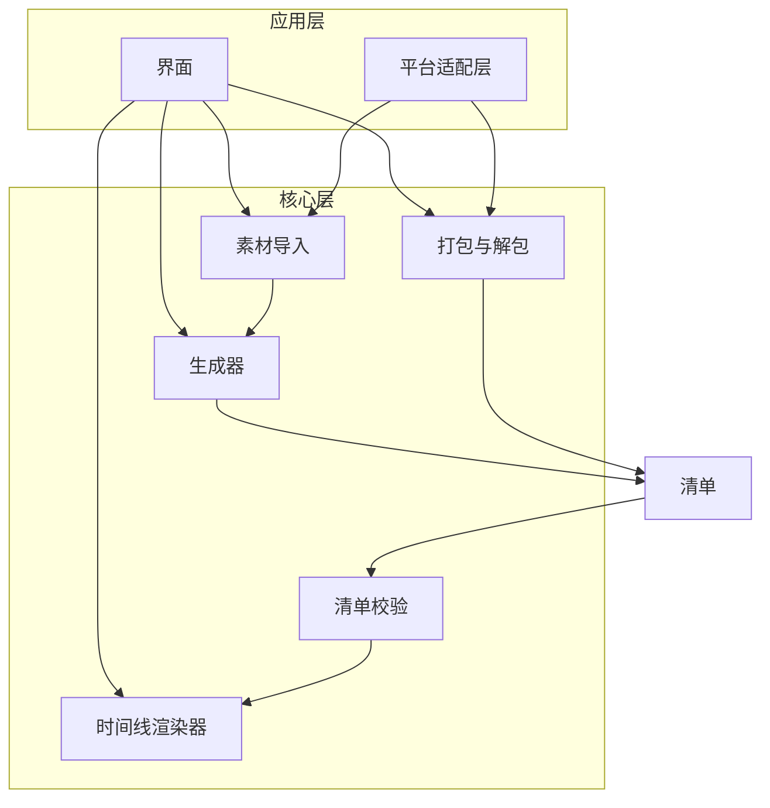

# qyPlayer 产品需求文档（PRD）

| 项目 | 内容 |
| --- | --- |
| 文档版本 | 0.1（草案） |
| 更新日期 | 2026-11-18 |
| 状态 | 待评审 |
| 其他语言 | [English](PRD.en.md) |

本文档以中文版为主版本，英文版逐节对应。两版不一致时以中文版为准。

## 1. 背景与目标

### 1.1 背景

手机里的照片和视频越拍越多，但很少被再次翻看。苹果“照片”应用里的“回忆”影片把一组照片和视频配上音乐、转场和排版，自动变成一段可以观看的短片，体验很好，但它只存在于苹果生态内，成片也只能导出为普通视频，无法在其他平台上以同样的方式查看和再次调整。

qyPlayer 要做一款开源、跨平台、纯本地的同类应用：用户选一批照片和视频，应用自动生成一部带背景音乐的“回忆影片”，可以直接播放，也可以打包成一个文件分享给别人，对方用 qyPlayer 打开即可观看。

### 1.2 产品目标

- **G1 能看**：在 Web、桌面、移动端都能流畅播放回忆影片。
- **G2 能做**：用户选好素材后，不需要任何剪辑知识，应用按规则自动生成一部影片。
- **G3 能传**：影片保存为一个 `.qyp` 包文件，拷给别人就能在任意支持的平台上打开。
- **G4 格式开放**：包格式作为独立的公开规范发布，任何人都可以编写生成器或播放器。

### 1.3 产品原则

- **本地优先**：无账号、无服务端，素材不离开设备。
- **格式即契约**：播放器只按包内配置渲染，不依赖生成它的那个应用。
- **先简单后丰富**：首版效果少而稳，后续版本再增加效果。

### 1.4 非目标

- 不做云端存储、多设备同步、在线分享链接。
- 不做专业剪辑软件，不提供时间线级别的精细编辑。
- 首版不做内容理解（人脸识别、选片、去重等）。

## 2. 目标用户与使用场景

### 2.1 目标用户

| 用户 | 特征 | 诉求 |
| --- | --- | --- |
| 普通用户（主要） | 没有剪辑经验，素材主要来自手机 | 选完素材就能得到一部能看的影片 |
| 接收者 | 收到别人发来的 `.qyp` 文件 | 装好应用或打开网页就能看 |
| 开发者（次要） | 想基于公开格式做自己的生成器或播放器 | 清晰、稳定、有示例的格式规范 |

### 2.2 典型场景

- **旅行回顾**：旅行回来，从相册里选 40 张照片和 5 段视频，选一首内置音乐，生成一部两分钟左右的横屏影片，在电脑上全屏播放给家人看。
- **分享给家人**：把生成的影片导出为 `.qyp` 文件，通过聊天软件或 U 盘发给父母，父母在手机上打开观看。
- **保留原声**：记录孩子生日的几段视频，不选背景音乐，影片直接使用视频原声。
- **换个风格**：看完预览觉得节奏太快，换一个模板、换一首音乐，重新生成。

## 3. 术语表

| 术语 | 含义 |
| --- | --- |
| 影片 | qyPlayer 播放的一部回忆影片，由若干页按时间顺序组成 |
| 素材 | 用户提供的照片、视频和音频文件 |
| 页 | 影片的一个时间段，画面上显示 1 个视频或 1~4 张照片 |
| 版式 | 一页内各素材的位置和大小 |
| 入场动画 | 一页内单个素材出现时的动画 |
| 转场 | 从上一页切换到下一页的过渡效果 |
| 模板 | 一组生成规则：可用的版式、转场、入场动画和节奏参数 |
| 包 | 扩展名为 `.qyp` 的文件，内含素材和配置 |
| 清单 | 包内的 `manifest.json`，描述影片在每个时刻显示什么 |
| 播放版本 | 包内用于播放的、已转成通用格式的素材文件 |
| 原片 | 用户提供的未经转码的原始素材文件 |
| BGM | 背景音乐 |

## 4. 首版范围

### 4.1 包含

- Web、桌面、移动端三端应用，功能一致。
- 从本地选择照片和视频，规则式自动生成影片。
- 生成后的轻量调整：删除素材、调换顺序、换模板、换音乐、改比例，然后重新生成。
- 播放器：播放、暂停、拖动定位、全屏、音量。
- 视觉效果：基础转场（淡入淡出、滑动、缩放），一页 2~4 图拼版，各图可分别入场。
- 画面比例：横屏 16:9 或竖屏 9:16，生成时选择。
- 音频：内置少量 CC0 曲目，支持导入本地音频，也可以不用背景音乐而使用视频原声。
- `.qyp` 包的导出和打开，默认转码为通用格式，可选保留原片。
- 包格式规范 v0.1。
- 界面支持中文和英文。

### 4.2 不包含（列入后续版本）

| 功能 | 计划阶段 |
| --- | --- |
| 单图缓慢推拉平移（Ken Burns） | 阶段 2 |
| 文字：片头标题、日期地点、字幕卡 | 阶段 2 |
| 滤镜与调色 | 阶段 2 |
| 音乐卡点（转场对齐鼓点） | 阶段 2 |
| 导出 MP4 | 阶段 3 |
| 逐页编辑（每页单独改版式、转场、时长） | 阶段 4 |
| 高级转场与特效（3D、粒子、蒙版等） | 阶段 4 |
| 本地智能（人脸或主体检测、去重、选片） | 阶段 4 |
| 背景音乐与视频原声混合播放 | 未排期 |
| 实况照片的动态部分（按静态照片处理） | 未排期 |
| 账号、云端存储、在线分享链接 | 不做 |

## 5. 核心用户流程


### 5.1 制作流程

1. 用户点击“新建影片”，从本地选择照片和视频。
2. 应用读取素材，逐个检查能否在本设备上解码，无法使用的素材列出原因。
3. 用户选择画面比例、模板和音乐（都有默认值，可以直接跳过）。
4. 应用按规则生成影片并进入预览。
5. 用户不满意时进入调整页，修改后重新生成。
6. 用户满意后导出 `.qyp` 包，保存到本地或通过系统分享发出。

### 5.2 观看流程

1. 用户通过文件选择、拖拽、双击文件或“用 qyPlayer 打开”打开一个 `.qyp` 包。
2. 应用校验包，校验失败时说明原因。
3. 校验通过后进入播放器。

## 6. 功能需求

优先级说明：**P0** 为首版必须，**P1** 为首版应有（时间不够时可以推迟）。文中标注“暂定”的数值集中列在 [14.1](#141-暂定数值)，以编号 T-xx 引用。

### 6.1 素材导入

| 编号 | 优先级 | 需求 |
| --- | --- | --- |
| F-IMP-01 | P0 | 用户可以一次选择多个照片和视频。Web 端支持文件选择和拖拽，桌面端支持文件对话框和拖拽，移动端使用系统相册选择器。 |
| F-IMP-02 | P0 | 输入格式：图片支持 JPEG、PNG、WebP、HEIC；视频支持 MP4、MOV 容器内的 H.264、HEVC 编码。 |
| F-IMP-03 | P0 | 导入时逐个检查素材能否在本设备上解码。不能使用的素材单独列出并说明原因，用户可以跳过它们继续，应用不得静默丢弃素材。 |
| F-IMP-04 | P0 | 读取每个素材的拍摄时间：照片取 EXIF，视频取容器元数据；取不到时使用文件修改时间。 |
| F-IMP-05 | P0 | 单部影片的素材数量有上限（暂定 100 个，T-01），超出时提示用户减少素材。至少需要 1 个素材。 |

### 6.2 生成选项

| 编号 | 优先级 | 需求 |
| --- | --- | --- |
| F-OPT-01 | P0 | 画面比例二选一：横屏 16:9 或竖屏 9:16。默认值按素材中占多数的方向决定（暂定，T-16）。 |
| F-OPT-02 | P0 | 从内置模板中选择一个（暂定 3 个，T-11）。每个模板有名称和简短说明。 |
| F-OPT-03 | P0 | 音乐三选一：内置曲目、导入本地音频、不使用背景音乐。 |

### 6.3 自动生成

生成器的输入是素材列表、画面比例、模板、音乐和一个随机种子，输出是一份清单。

| 编号 | 优先级 | 需求 |
| --- | --- | --- |
| F-GEN-01 | P0 | **排序**：默认按拍摄时间升序；拍摄时间相同时按文件名。用户手动调整过顺序后，以手动顺序为准。 |
| F-GEN-02 | P0 | **分页**：每个视频独占一页；连续的照片按模板规则组合为 1~4 图的页。相邻两页尽量不使用同一种多图版式。 |
| F-GEN-03 | P0 | **版式匹配**：多图页内，照片优先放入方向（横或竖）相近的格子。为此可以调整同一页内的照片位置，但不跨页移动。 |
| F-GEN-04 | P0 | **裁切**：素材默认以居中裁切填满格子。当裁切会损失过多画面时（暂定超过 40%，T-20），改为完整显示并用背景色填充空白。 |
| F-GEN-05 | P0 | **转场与入场动画**：从模板允许的集合中选择。多图页内各图依次错开入场。 |
| F-GEN-06 | P0 | **节奏**：按音乐时长调整照片页的时长，规则见 [6.3.1](#631-节奏规则)。 |
| F-GEN-07 | P0 | **视频截取**：视频超过上限时只截取一段（暂定上限 8 秒，T-02；暂定截取居中部分，T-03）。 |
| F-GEN-08 | P0 | **确定性**：相同的输入和种子必须生成完全相同的清单。 |
| F-GEN-09 | P0 | **进度**：生成过程显示进度，可以取消。 |
| F-GEN-10 | P0 | **标题与封面**：标题默认为“最早拍摄日期 + 回忆”，用户可以修改；封面默认取第一个素材的画面。首版标题只用于影片列表和文件名，不显示在影片画面中。 |

#### 6.3.1 节奏规则

记照片页的基准时长之和为 P，视频页时长之和为 V，音乐时长为 M。照片页基准时长暂定为单图页 3 秒、多图页 4 秒（T-04）。

- **没有背景音乐**：照片页使用基准时长，影片总时长为 P + V。
- **有背景音乐**：计算缩放系数 k = (M − V) / P，并限制在 0.7 到 1.6 之间（暂定，T-04）。每个照片页的时长为基准时长乘以 k。
  - k 未被限制：影片总时长等于音乐时长，两者同时结束。
  - k 被限制为 1.6（音乐偏长）：影片结束时音乐淡出。
  - k 被限制为 0.7（音乐偏短）：音乐循环播放，影片结束时淡出（暂定，T-17）。
- **没有照片页**（P = 0）：影片总时长为 V，音乐按偏长或偏短处理。

### 6.4 轻量调整

| 编号 | 优先级 | 需求 |
| --- | --- | --- |
| F-ADJ-01 | P0 | 从影片中删除素材。删除后至少保留 1 个素材。 |
| F-ADJ-02 | P0 | 拖动调换素材顺序。 |
| F-ADJ-03 | P0 | 更换模板。 |
| F-ADJ-04 | P0 | 更换音乐，或切换为不使用背景音乐。 |
| F-ADJ-05 | P0 | 更改画面比例。 |
| F-ADJ-06 | P0 | 任何调整确认后都重新生成整部影片并回到预览。首版不提供对单页版式、转场、时长的编辑。 |

### 6.5 播放器

| 编号 | 优先级 | 需求 |
| --- | --- | --- |
| F-PLY-01 | P0 | 播放和暂停。 |
| F-PLY-02 | P0 | 进度条显示当前时间和总时长，可以拖动到任意时间点，定位后画面和声音都与该时间点一致。 |
| F-PLY-03 | P0 | 全屏和退出全屏。 |
| F-PLY-04 | P0 | 音量调节和静音。 |
| F-PLY-05 | P0 | 音画同步，偏差不超过暂定 100 毫秒（T-12）。 |
| F-PLY-06 | P0 | 影片保持原比例显示在窗口内，空白处以黑色填充。窗口大小或设备方向变化时自动适配。 |
| F-PLY-07 | P0 | 正确渲染包格式 v0.1 定义的全部转场和入场动画。遇到不认识的类型时降级处理，不中断播放（见 [7.6](#76-版本与兼容策略)）。 |
| F-PLY-08 | P0 | 播放结束后停在最后一帧，显示“重播”。 |
| F-PLY-09 | P1 | 桌面端和 Web 端支持键盘操作：空格播放或暂停，左右方向键快退或快进 5 秒，F 键切换全屏。 |
| F-PLY-10 | P1 | 移动端应用切到后台时暂停播放。 |

### 6.6 包的导出与打开

| 编号 | 优先级 | 需求 |
| --- | --- | --- |
| F-PKG-01 | P0 | 把当前影片导出为一个 `.qyp` 文件。导出过程显示进度，可以取消，取消或失败不得留下损坏的文件。 |
| F-PKG-02 | P0 | 导出时默认把素材转为通用格式并限制分辨率：图片为 JPEG（暂定长边不超过 2560 像素，T-07），视频为 H.264 + AAC 的 MP4（暂定不超过 1080p，T-08）。视频只保留影片用到的片段。 |
| F-PKG-03 | P0 | 提供“保留原片”选项，默认关闭。开启后原片额外存入包内 `originals/` 目录，播放版本仍然生成，以保证包在各端都能播放。原片本身已满足播放版本要求时不重复存储。 |
| F-PKG-04 | P0 | 打开 `.qyp` 文件：三端都支持从应用内选择文件；Web 端和桌面端支持拖拽；桌面端和移动端支持通过系统文件关联打开。 |
| F-PKG-05 | P0 | 打开时校验包：清单是否符合格式规范、引用的文件是否都存在、格式版本是否受支持。校验失败时用用户能看懂的语言说明原因。 |
| F-PKG-06 | P0 | 安全：拒绝包含越界路径（如 `../`）或绝对路径的包；拒绝清单中引用远程地址的包；解压后总体积超过上限（暂定 2 GB，T-09）的包拒绝打开。播放器不执行包内任何代码。 |
| F-PKG-07 | P0 | 导出完成后，移动端调起系统分享，桌面端和 Web 端保存到用户指定位置或下载目录。 |
| F-PKG-08 | P1 | 导出的文件名默认使用影片标题。 |

### 6.7 背景音乐

| 编号 | 优先级 | 需求 |
| --- | --- | --- |
| F-BGM-01 | P0 | 应用内置少量曲目（暂定 5 首，T-10），选择前可以试听。 |
| F-BGM-02 | P0 | 所有内置曲目必须是 CC0 或等效的无限制许可，仓库内保存每首曲目的来源和许可证明。 |
| F-BGM-03 | P0 | 用户可以导入本地音频作为背景音乐，支持 MP3、M4A（AAC）、WAV。导出时音频随包保存，WAV 转为 AAC。 |
| F-BGM-04 | P1 | 用户导入音频并导出包时，提示用户自行确认音乐的使用权。 |

### 6.8 影片库

| 编号 | 优先级 | 需求 |
| --- | --- | --- |
| F-LIB-01 | P1 | 应用首页显示本机上的影片列表（自己制作的和打开过的），每项显示封面、标题、时长、创建日期。 |
| F-LIB-02 | P1 | 可以重命名和删除影片。删除前需要确认。 |
| F-LIB-03 | P1 | 可以对列表中任意一部影片再次进行轻量调整，因为包内已包含所需的全部素材和配置。 |

说明：是否需要影片库没有在需求讨论中明确，这里按“独立应用需要能找回之前做的影片”补充，并列入 [14.2](#142-待定项)。

## 7. 包格式规范（v0.1）

包格式是 qyPlayer 最重要的对外契约。规范将在仓库中以独立文档和 JSON Schema 的形式发布，本节是其内容基础。

### 7.1 容器

- 包是一个标准 ZIP 文件，扩展名为 `.qyp`。
- 不加密，不分卷。
- 图片、视频、音频本身已经压缩，写入时应当只存储不压缩。
- 根目录必须有 `manifest.json`，编码为 UTF-8。

### 7.2 目录结构

```
example.qyp
├── manifest.json        清单（必需）
├── cover.jpg            封面（可选）
├── media/               播放版本的图片和视频
│   ├── m001.jpg
│   ├── m002.jpg
│   ├── m003.jpg
│   ├── m004.mp4
│   ├── m005.jpg
│   ├── m006.jpg
│   └── m007.jpg
├── audio/               背景音乐
│   └── bgm.m4a
└── originals/           原片（仅在开启“保留原片”时存在）
    └── IMG_0001.HEIC
```

目录名是约定而不是强制，播放器以清单中的路径为准。

### 7.3 路径规则

- 清单中所有路径都是相对于包根目录的相对路径，使用 `/` 分隔。
- 不允许出现 `..`、绝对路径或任何带协议的地址（如 `http://`）。
- 路径区分大小写。建议包内文件名只使用 ASCII 字符。

### 7.4 媒体格式要求

播放器必须支持以下播放版本格式：

| 类型 | 格式 |
| --- | --- |
| 图片 | JPEG、PNG、WebP |
| 视频 | MP4 容器，H.264 视频，AAC 音频 |
| 音频 | AAC（`.m4a`）、MP3 |

`originals/` 中的原片格式不限，播放器不读取它们。

### 7.5 清单字段

#### 顶层

| 字段 | 类型 | 必需 | 说明 |
| --- | --- | --- | --- |
| `formatVersion` | 字符串 | 是 | 格式版本，形如 `"0.1"` |
| `id` | 字符串 | 是 | 影片的唯一标识（UUID） |
| `title` | 字符串 | 是 | 影片标题 |
| `createdAt` | 字符串 | 是 | 创建时间，ISO 8601 |
| `generator` | 对象 | 否 | 生成器信息，用于重新生成 |
| `canvas` | 对象 | 是 | 画布 |
| `duration` | 数字 | 是 | 总时长（秒），必须等于所有页的时长之和 |
| `cover` | 字符串 | 否 | 封面图片路径 |
| `assets` | 数组 | 是 | 素材列表 |
| `bgm` | 对象 | 否 | 背景音乐。存在时所有视频静音，不存在时播放视频原声 |
| `pages` | 数组 | 是 | 页列表，按时间顺序排列，至少 1 页 |

#### generator

| 字段 | 类型 | 必需 | 说明 |
| --- | --- | --- | --- |
| `name` | 字符串 | 是 | 生成器名称 |
| `version` | 字符串 | 是 | 生成器版本 |
| `templateId` | 字符串 | 否 | 使用的模板 |
| `seed` | 整数 | 否 | 随机种子 |

#### canvas

| 字段 | 类型 | 必需 | 说明 |
| --- | --- | --- | --- |
| `aspectRatio` | 字符串 | 是 | `"16:9"` 或 `"9:16"` |
| `width` | 整数 | 是 | 参考宽度（像素） |
| `height` | 整数 | 是 | 参考高度（像素） |
| `background` | 字符串 | 是 | 背景色，形如 `"#000000"` |

`width` 和 `height` 是导出和渲染的参考分辨率（qyPlayer 生成时的取值见 T-06），必须与 `aspectRatio` 一致。页内位置使用 0 到 1 的归一化坐标，与分辨率无关。

#### assets 元素

| 字段 | 类型 | 必需 | 说明 |
| --- | --- | --- | --- |
| `id` | 字符串 | 是 | 素材标识，在清单内唯一 |
| `type` | 字符串 | 是 | `"image"`、`"video"` 或 `"audio"` |
| `src` | 字符串 | 是 | 播放版本的路径 |
| `width` | 整数 | 图片和视频必需 | 像素宽度 |
| `height` | 整数 | 图片和视频必需 | 像素高度 |
| `duration` | 数字 | 视频和音频必需 | 时长（秒） |
| `hasAudio` | 布尔 | 视频必需 | 视频是否带音轨 |
| `capturedAt` | 字符串 | 否 | 拍摄时间，ISO 8601 |
| `original` | 字符串 | 否 | 原片路径 |
| `title` | 字符串 | 否 | 音频的曲名 |
| `license` | 字符串 | 否 | 音频的许可标识，如 `"CC0-1.0"` |

#### bgm

| 字段 | 类型 | 必需 | 默认值 | 说明 |
| --- | --- | --- | --- | --- |
| `assetId` | 字符串 | 是 | | 指向一个 `audio` 类型的素材 |
| `volume` | 数字 | 否 | 1 | 音量，0 到 1 |
| `loop` | 布尔 | 否 | false | 音乐短于影片时是否循环 |
| `fadeIn` | 数字 | 否 | 0 | 开头淡入时长（秒） |
| `fadeOut` | 数字 | 否 | 0 | 结尾淡出时长（秒） |

#### pages 元素

| 字段 | 类型 | 必需 | 说明 |
| --- | --- | --- | --- |
| `id` | 字符串 | 是 | 页标识，在清单内唯一 |
| `start` | 数字 | 是 | 开始时间（秒）。第一页为 0，之后每页等于上一页的 `start` 加 `duration` |
| `duration` | 数字 | 是 | 时长（秒），大于 0 |
| `transitionIn` | 对象 | 否 | 进入本页的转场，缺省为直接切换 |
| `items` | 数组 | 是 | 页内素材，1 到 4 个 |

转场发生在本页开头的 `transitionIn.duration` 秒内。这段时间里上一页保持在它最后一刻的画面（视频停在最后一帧）。第一页的转场表示从画布背景色过渡进入。

#### transitionIn

| 字段 | 类型 | 必需 | 说明 |
| --- | --- | --- | --- |
| `type` | 字符串 | 是 | `"none"`、`"fade"`、`"slide"`、`"zoom"` |
| `direction` | 字符串 | `slide` 必需 | `"left"`、`"right"`、`"up"`、`"down"`，表示新页面的移动方向 |
| `duration` | 数字 | 是 | 时长（秒），不得超过本页时长 |

#### items 元素

| 字段 | 类型 | 必需 | 默认值 | 说明 |
| --- | --- | --- | --- | --- |
| `assetId` | 字符串 | 是 | | 指向一个 `image` 或 `video` 类型的素材 |
| `frame` | 对象 | 是 | | 位置和大小：`x`、`y`、`w`、`h`，均为 0 到 1，相对于画布 |
| `fit` | 字符串 | 否 | `"cover"` | `"cover"` 居中裁切填满，`"contain"` 完整显示 |
| `clipStart` | 数字 | 否 | 0 | 仅视频：从素材的第几秒开始播放 |
| `enter` | 对象 | 否 | | 入场动画，缺省为无 |

视频从 `clipStart` 开始播放，播放时长等于页时长。素材不够长时停在最后一帧。

#### enter

| 字段 | 类型 | 必需 | 默认值 | 说明 |
| --- | --- | --- | --- | --- |
| `type` | 字符串 | 是 | | `"none"`、`"fade"`、`"slide"`、`"scale"` |
| `direction` | 字符串 | `slide` 必需 | | `"left"`、`"right"`、`"up"`、`"down"`，表示素材的移动方向 |
| `delay` | 数字 | 否 | 0 | 相对于页开始时间的延迟（秒） |
| `duration` | 数字 | 是 | | 时长（秒） |

v0.1 中所有动画使用同一条缓入缓出曲线，不可配置。

### 7.6 版本与兼容策略

- `formatVersion` 采用“主版本.次版本”。
- 1.0 之前格式可能发生不兼容变更。播放器遇到自己不支持的版本时必须明确提示，不得崩溃或显示错误画面。
- 1.0 起：主版本相同即保证兼容；次版本只增加可选字段和新的枚举值。
- 播放器必须忽略不认识的字段。
- 播放器遇到不认识的 `transitionIn.type` 时按 `fade` 处理，遇到不认识的 `enter.type` 时按 `none` 处理。

### 7.7 完整示例

下面的清单对应 [7.2](#72-目录结构) 的目录结构：一部 16:9 的影片，共 4 页，带背景音乐。音乐（142.5 秒）远长于素材能支撑的时长，所以照片页取最大缩放系数 1.6，影片结束时音乐淡出。

```json
{
  "formatVersion": "0.1",
  "id": "8d0c6a52-3f0e-4c1b-9a39-5a1d2f7b6c10",
  "title": "2026-10-01 回忆",
  "createdAt": "2026-10-08T20:30:00+08:00",
  "generator": {
    "name": "qyPlayer",
    "version": "0.1.0",
    "templateId": "clean",
    "seed": 20261008
  },
  "canvas": {
    "aspectRatio": "16:9",
    "width": 1920,
    "height": 1080,
    "background": "#000000"
  },
  "duration": 25.6,
  "cover": "cover.jpg",
  "assets": [
    {
      "id": "m001",
      "type": "image",
      "src": "media/m001.jpg",
      "width": 2560,
      "height": 1707,
      "capturedAt": "2026-10-01T09:12:30+08:00",
      "original": "originals/IMG_0001.HEIC"
    },
    {
      "id": "m002",
      "type": "image",
      "src": "media/m002.jpg",
      "width": 1707,
      "height": 2560,
      "capturedAt": "2026-10-01T10:03:11+08:00"
    },
    {
      "id": "m003",
      "type": "image",
      "src": "media/m003.jpg",
      "width": 1707,
      "height": 2560,
      "capturedAt": "2026-10-01T10:05:42+08:00"
    },
    {
      "id": "m004",
      "type": "video",
      "src": "media/m004.mp4",
      "width": 1920,
      "height": 1080,
      "duration": 8.0,
      "hasAudio": true,
      "capturedAt": "2026-10-01T11:20:05+08:00"
    },
    {
      "id": "m005",
      "type": "image",
      "src": "media/m005.jpg",
      "width": 1707,
      "height": 2560,
      "capturedAt": "2026-10-01T15:40:00+08:00"
    },
    {
      "id": "m006",
      "type": "image",
      "src": "media/m006.jpg",
      "width": 2560,
      "height": 1707,
      "capturedAt": "2026-10-01T15:41:18+08:00"
    },
    {
      "id": "m007",
      "type": "image",
      "src": "media/m007.jpg",
      "width": 2560,
      "height": 1707,
      "capturedAt": "2026-10-01T15:44:52+08:00"
    },
    {
      "id": "a001",
      "type": "audio",
      "src": "audio/bgm.m4a",
      "duration": 142.5,
      "title": "Sample Track",
      "license": "CC0-1.0"
    }
  ],
  "bgm": {
    "assetId": "a001",
    "volume": 1,
    "loop": false,
    "fadeIn": 1,
    "fadeOut": 2
  },
  "pages": [
    {
      "id": "p001",
      "start": 0,
      "duration": 4.8,
      "transitionIn": { "type": "fade", "duration": 0.6 },
      "items": [
        {
          "assetId": "m001",
          "frame": { "x": 0, "y": 0, "w": 1, "h": 1 },
          "fit": "cover"
        }
      ]
    },
    {
      "id": "p002",
      "start": 4.8,
      "duration": 6.4,
      "transitionIn": { "type": "slide", "direction": "left", "duration": 0.6 },
      "items": [
        {
          "assetId": "m002",
          "frame": { "x": 0, "y": 0, "w": 0.4972, "h": 1 },
          "fit": "cover",
          "enter": { "type": "fade", "delay": 0.6, "duration": 0.5 }
        },
        {
          "assetId": "m003",
          "frame": { "x": 0.5028, "y": 0, "w": 0.4972, "h": 1 },
          "fit": "cover",
          "enter": { "type": "fade", "delay": 0.75, "duration": 0.5 }
        }
      ]
    },
    {
      "id": "p003",
      "start": 11.2,
      "duration": 8.0,
      "transitionIn": { "type": "fade", "duration": 0.6 },
      "items": [
        {
          "assetId": "m004",
          "frame": { "x": 0, "y": 0, "w": 1, "h": 1 },
          "fit": "cover",
          "clipStart": 0
        }
      ]
    },
    {
      "id": "p004",
      "start": 19.2,
      "duration": 6.4,
      "transitionIn": { "type": "zoom", "duration": 0.6 },
      "items": [
        {
          "assetId": "m005",
          "frame": { "x": 0, "y": 0, "w": 0.4972, "h": 1 },
          "fit": "cover",
          "enter": { "type": "slide", "direction": "right", "delay": 0.6, "duration": 0.5 }
        },
        {
          "assetId": "m006",
          "frame": { "x": 0.5028, "y": 0, "w": 0.4972, "h": 0.495 },
          "fit": "cover",
          "enter": { "type": "scale", "delay": 0.75, "duration": 0.5 }
        },
        {
          "assetId": "m007",
          "frame": { "x": 0.5028, "y": 0.505, "w": 0.4972, "h": 0.495 },
          "fit": "cover",
          "enter": { "type": "scale", "delay": 0.9, "duration": 0.5 }
        }
      ]
    }
  ]
}
```

示例中的要点：

- `m001` 开启了“保留原片”，原片是 HEIC，播放版本是 JPEG。
- `m004` 的播放版本已经裁剪为影片用到的 8 秒，所以 `clipStart` 为 0。
- 因为存在 `bgm`，`m004` 的原声不播放。
- 多图页的格子之间留有间距，间距处显示画布背景色。

## 8. 视觉效果清单

本节列出首版支持的全部效果。时长均为暂定默认值（T-05）。

### 8.1 转场

| 类型 | 效果 | 默认时长 |
| --- | --- | --- |
| `none` | 直接切换 | 0 |
| `fade` | 上一页淡出的同时新页淡入 | 0.6 秒 |
| `slide` | 新页从一侧滑入，把上一页推出画面，可选四个方向 | 0.6 秒 |
| `zoom` | 上一页放大并淡出，新页从略小的尺寸放大到正常并淡入 | 0.6 秒 |

### 8.2 版式

格子之间的间距暂定为画布短边的 1%（T-15）。

| 图片数 | 16:9 | 9:16 |
| --- | --- | --- |
| 1 | 铺满画布 | 铺满画布 |
| 2 | 左右并排，各占一半 | 上下排列，各占一半 |
| 3 | 左侧一张占一半，右侧上下两张 | 上方一张占一半，下方左右两张 |
| 4 | 2×2 网格 | 2×2 网格 |

视频页只使用单素材版式。

### 8.3 入场动画

| 类型 | 效果 | 默认时长 |
| --- | --- | --- |
| `none` | 随页面直接出现 | 0 |
| `fade` | 由透明变为不透明 | 0.5 秒 |
| `slide` | 从格子外一侧滑入到位，可选四个方向 | 0.5 秒 |
| `scale` | 由略小的尺寸放大到正常，同时淡入 | 0.5 秒 |

多图页内各图的入场依次错开，间隔暂定 0.15 秒（T-05）。入场动画在转场结束后开始。

### 8.4 内置模板

首版内置模板暂定 3 个（T-11），具体名称和参数在设计阶段确定：

| 模板 | 风格 |
| --- | --- |
| 简洁 | 以淡入淡出为主，单图页比例高 |
| 活泼 | 以滑动和缩放为主，多图页比例高 |
| 经典 | 各种转场和版式均衡搭配 |

## 9. 音频规则

| 编号 | 规则 |
| --- | --- |
| A-01 | 影片有背景音乐时，所有视频静音。 |
| A-02 | 影片没有背景音乐时，播放视频原声；照片页没有声音。 |
| A-03 | 背景音乐从影片开头播放，开头淡入、结尾淡出（暂定淡入 1 秒、淡出 2 秒，T-14）。 |
| A-04 | 音乐长于影片时，在影片结束处淡出；音乐短于影片时循环播放。 |
| A-05 | 播放视频原声时，每段视频的声音在开头和结尾做短暂的淡入淡出，避免爆音。 |
| A-06 | 有背景音乐时以音频播放进度作为影片的主时钟，画面跟随音频。 |
| A-07 | 拖动定位后，背景音乐和视频都跳转到对应位置。 |
| A-08 | 浏览器限制自动播放有声内容，播放必须由用户操作触发。 |

## 10. 非功能需求

### 10.1 性能

| 编号 | 需求 |
| --- | --- |
| N-PERF-01 | 在参考设备上播放帧率不低于 30 帧每秒（暂定，T-13）。 |
| N-PERF-02 | 拖动定位后 500 毫秒内显示正确画面（暂定，T-19）。 |
| N-PERF-03 | 100 个素材的影片，生成清单的耗时不超过 10 秒，不含素材解码和转码（暂定，T-18）。 |
| N-PERF-04 | 打开包时不把整个包读入内存，按需读取素材。 |

参考设备的具体型号待定，见 [14.2](#142-待定项)。

### 10.2 兼容性

| 端 | 目标平台 |
| --- | --- |
| Web | Chrome、Edge、Safari、Firefox 的当前主流版本 |
| 桌面 | Windows、macOS |
| 移动 | iOS、Android |

各平台的最低支持版本取决于 WebCodecs 等能力的实际支持情况，在阶段 0 实测后确定。三端功能应当一致；某个平台确实无法实现的功能（例如某种视频无法转码）必须在界面上明确说明，不得静默失败。

### 10.3 隐私

| 编号 | 需求 |
| --- | --- |
| N-PRI-01 | 应用不把用户素材、清单或任何使用数据发送到网络。 |
| N-PRI-02 | 应用不包含统计、遥测或广告组件。引入第三方依赖前必须确认其不含遥测。 |
| N-PRI-03 | Web 版是纯静态站点，页面加载完成后的全部功能不依赖网络。 |
| N-PRI-04 | 打开他人的包不会触发任何网络请求。 |

### 10.4 可靠性

| 编号 | 需求 |
| --- | --- |
| N-REL-01 | 包损坏、文件缺失、格式不支持时给出明确提示，应用不崩溃。 |
| N-REL-02 | 生成和导出过程中断（取消、应用被关闭）后，已有影片不受影响。 |

### 10.5 可访问性

| 编号 | 需求 |
| --- | --- |
| N-A11Y-01 | 所有控件可以通过键盘操作，并带有可被屏幕阅读器读出的名称。 |
| N-A11Y-02 | 界面文字与背景的对比度符合 WCAG 2.1 AA。 |

### 10.6 国际化

| 编号 | 需求 |
| --- | --- |
| N-I18N-01 | 界面支持简体中文和英文，默认跟随系统语言，可以在设置中切换。 |
| N-I18N-02 | 界面文字全部来自语言资源文件，代码中不硬编码。 |

### 10.7 可测试性

| 编号 | 需求 |
| --- | --- |
| N-TEST-01 | 生成器和清单校验是不依赖界面和平台的纯逻辑，有单元测试覆盖。 |
| N-TEST-02 | 仓库提供一组格式一致性测试包（含合法和不合法的样例），任何播放器实现都可以用它们自测。 |

## 11. 技术方案建议

本节是建议而不是定论，最终选型在阶段 0 通过原型验证后确定。

### 11.1 核实范围说明

下表中的版本、许可和发布日期于 2026-11-18 从 npm registry 核实，对各项目的文字说明来自其官方许可文件、文档和 README。标注“待验证”的能力没有实际测试过。受 GitHub API 限流影响，没有取到各仓库的星标数和 issue 活跃度，维护状态只根据最新版本的发布日期判断。

### 11.2 “成熟播放组件”的现状

需求希望使用成熟的开源播放组件。核实后的结论是：没有一个组件能直接满足需求，需要用成熟的开源部件组合。原因如下。

**传统播放器组件**只能播放单个音视频源，不能把多张图片、多段视频按时间线合成：

| 组件 | 最新版本 | 发布日期 | 许可 |
| --- | --- | --- | --- |
| Video.js | 10.5.0 | 2026-11-16 | Apache-2.0 |
| Vidstack | 1.15.7 | 2026-10-06 | MIT |
| Plyr | 3.8.5 | 2026-10-06 | MIT |
| xgplayer | 3.0.27 | 2026-10-29 | MIT |
| ArtPlayer | 5.4.0 | 2026-03-12 | MIT |

它们在阶段 3 导出 MP4 之后可以用来播放成片。是否能复用其控制条界面来驱动自定义时间线，待验证。

**时间线合成引擎**能力贴合，但各有问题：

| 候选 | 最新版本 | 发布日期 | 许可 | 结论 |
| --- | --- | --- | --- | --- |
| Remotion | 4.0.544 | 2026-11-16 | Remotion License | 不采用 |
| Revideo | 0.11.0 | 2026-07-10 | MIT | 备选 |
| Motion Canvas | 3.17.2 | 2024-12-14 | MIT | 不建议 |

- **Remotion**：官方说明它是源码可见的软件，不是开源软件。只有个人、3 人以内的组织和非营利组织可以免费使用，其他使用者需要购买许可，这会约束 qyPlayer 的下游使用者。它的浏览器端渲染会为每次渲染发送遥测且不能关闭，与“纯本地”原则冲突。
- **Revideo**：MIT 许可，提供 React 播放器。但尚未发布 1.0；场景需要用 TypeScript 生成器函数编写，要另做一层从清单到场景的转换；导出视频依赖 Node 和无头浏览器，移动端无法使用；渲染带匿名统计，可通过环境变量关闭。
- **Motion Canvas**：最新版本发布于 2024 年 12 月，近两年没有更新；定位是讲解类矢量动画，与本产品不贴合。

### 11.3 建议方案：自建轻量时间线引擎，Canvas 渲染

首版的效果只有基础转场和拼版，自己实现一个由清单驱动的渲染器，复杂度可控。核心是一个纯函数：给定清单和时间 t，画出这一刻的画面。

选择 Canvas 而不是 DOM 加 CSS 动画的原因：

- 阶段 3 要在设备本地导出 MP4。Canvas 画出的每一帧可以直接送入编码器，预览和导出共用同一个渲染器，效果一致。
- DOM 方案首版开发更快，但没有可靠的办法把 DOM 画面逐帧转成视频，届时需要重写渲染器。

渲染层首版使用浏览器原生的 Canvas 2D。阶段 2 的滤镜和阶段 4 的高级特效如果需要 GPU 能力，可以替换为 PixiJS（8.23.0，2026-11-11，MIT）。

该方案的风险是 Canvas 2D 在低端移动设备上绘制 1080p 视频的性能，需要在阶段 0 验证。

### 11.4 多端方案

一套 React + TypeScript 代码，Web 端直接运行，桌面端和移动端套壳。首版要三端同时上线，只有共用一套渲染代码才现实。

| 候选 | 最新版本 | 发布日期 | 许可 | 说明 |
| --- | --- | --- | --- | --- |
| Tauri | 2.12.5 | 2026-11-16 | Apache-2.0 或 MIT | 官方支持主流桌面和移动平台，使用系统自带的 WebView，安装包小 |
| Capacitor | 8.6.2 | 2026-11-12 | MIT | 面向移动端的 Web 套壳 |
| Electron | 45.3.4 | 2026-11-17 | MIT | 自带 Chromium，各桌面平台行为一致，安装包大，不支持移动端 |

建议桌面端使用 Tauri。移动端在 Tauri 和 Capacitor 之间选择，阶段 0 用原型对比相册访问、文件关联、系统分享这三项能力后确定。

使用系统 WebView 意味着各平台的浏览器内核不同（Windows 是 Chromium 内核，苹果平台是 WebKit 内核），WebCodecs 和视频解码能力会有差异，这是阶段 0 的重点验证项。

### 11.5 其他部件

| 用途 | 候选 | 最新版本 | 发布日期 | 许可 | 说明 |
| --- | --- | --- | --- | --- | --- |
| ZIP 读写 | zip.js | 2.25.0 | 2026-11-12 | BSD-3-Clause | 倾向选用；大文件按需读取能力待验证 |
| ZIP 读写 | fflate | 0.8.3 | 2026-05-16 | MIT | 备选 |
| ZIP 读写 | JSZip | 3.10.2 | 2026-09-08 | MIT 或 GPL-3.0 | 备选 |
| 视频转码与封装 | Mediabunny | 1.66.0 | 2026-11-13 | MPL-2.0 | 建议选用；基于 WebCodecs，可用的编解码器取决于运行环境 |
| 视频转码 | ffmpeg.wasm | 0.12.15 | 2025-01-07 | 外层 MIT，核心 GPL-2.0 或更新 | 不建议：核心是 GPL，与 Apache-2.0 分发冲突；近两年未更新 |
| HEIC 解码 | heic-to | 1.6.7 | 2026-10-27 | LGPL-3.0 | 候选；需做 LGPL 合规评估 |
| HEIC 解码 | libheif-js | 1.23.5 | 2026-10-04 | LGPL-3.0 | 候选；需做 LGPL 合规评估 |
| HEIC 解码 | heic2any | 0.0.4 | 2023-03-29 | MIT | 不建议：三年多未更新 |
| 读取拍摄时间 | ExifReader | 4.54.0 | 2026-11-03 | MPL-2.0 | 建议选用 |
| 读取拍摄时间 | exifr | 7.1.3 | 2021-08-05 | MIT | 不建议：五年未更新 |
| 清单校验 | Ajv | 8.20.0 | 2026-04-24 | MIT | 建议选用；直接使用公开的 JSON Schema |

HEIC 和 HEVC 的处理优先使用平台自带的解码能力，只在平台不支持时才引入第三方解码库。

### 11.6 模块划分



核心层不依赖界面框架和具体平台，便于单元测试，也为以后把播放器单独发布为组件库留出余地。平台适配层封装文件选择、相册访问、文件关联和系统分享。

## 12. 路线图

| 阶段 | 内容 | 完成标志 |
| --- | --- | --- |
| 阶段 0：技术预研 | 时间线渲染器原型；三端套壳验证；HEIC 解码和视频转码在各平台的可行性；发布包格式规范 v0.1 草案 | 示例包能在三端播放；[14.2](#142-待定项) 中依赖预研的待定项全部有结论 |
| 阶段 1：首版 | 三端播放器、规则式自动生成、轻量调整、`.qyp` 导出和打开、内置 CC0 曲目、中英文界面 | 通过第 13 节全部 P0 验收标准 |
| 阶段 2：效果增强 | 单图推拉、文字标题、滤镜、音乐卡点 | 包格式升级并保持对旧包的兼容 |
| 阶段 3：导出视频 | 在设备本地把影片导出为 MP4 | 导出的 MP4 与播放器内的画面一致 |
| 阶段 4：编辑与智能 | 逐页编辑器、高级特效、本地智能选片 | 另行定义 |

## 13. 验收标准

### 13.1 功能需求

| 需求 | 验收标准 |
| --- | --- |
| F-IMP-01 | 在三端各自的入口一次选择 20 个素材，全部出现在素材列表中。Web 端和桌面端拖入同样的素材结果一致。 |
| F-IMP-02 | 列出的每种输入格式各准备一个样例，在支持该格式解码的设备上都能导入并在预览中显示。 |
| F-IMP-03 | 导入一个损坏的文件和一个本设备无法解码的文件，两者都出现在“无法使用”列表中并带有原因；其余素材可以继续生成。 |
| F-IMP-04 | 带 EXIF 的照片显示的拍摄时间与 EXIF 一致；去掉 EXIF 的照片使用文件修改时间。 |
| F-IMP-05 | 选择超过上限的素材时出现提示且不能继续；选择 1 个素材可以生成。 |
| F-OPT-01 | 选择 16:9 生成的清单中 `canvas.aspectRatio` 为 `"16:9"`，选择 9:16 时为 `"9:16"`。竖向素材占多数时默认选中 9:16。 |
| F-OPT-02 | 模板列表显示全部内置模板的名称和说明；选择不同模板生成的清单中 `generator.templateId` 不同。 |
| F-OPT-03 | 三种音乐选项各生成一次：选内置曲目或导入音频时清单包含 `bgm`，选不使用背景音乐时不包含。 |
| F-GEN-01 | 打乱顺序导入一组带拍摄时间的素材，生成的页顺序符合拍摄时间升序。手动调换两个素材后重新生成，顺序与手动顺序一致。 |
| F-GEN-02 | 生成的清单中，每个视频所在的页只有 1 个素材；每页素材数在 1 到 4 之间；不存在相邻两页使用同一种多图版式而模板内有其他版式可选的情况。 |
| F-GEN-03 | 用 2 张竖图和 2 张横图生成 16:9 影片，在含竖向格子的多图页中，竖图位于竖向格子。 |
| F-GEN-04 | 竖图单独出现在 16:9 页面时 `fit` 为 `"contain"`；3:2 的横图单独出现在 16:9 页面时 `fit` 为 `"cover"`。 |
| F-GEN-05 | 清单中出现的转场和入场动画类型都属于所选模板允许的集合；多图页内各素材的 `enter.delay` 依次递增。 |
| F-GEN-06 | 用 [6.3.1](#631-节奏规则) 的三种情况各构造一组输入：音乐时长适中时影片总时长等于音乐时长（误差不超过 0.1 秒）；音乐偏长时照片页时长为基准的 1.6 倍；音乐偏短时为 0.7 倍且 `bgm.loop` 为 true。 |
| F-GEN-07 | 导入一段 30 秒的视频，生成的页时长不超过截取上限，截取的片段位于原视频的中间部分。 |
| F-GEN-08 | 用相同的素材、选项和种子生成两次，两份清单除 `id` 和 `createdAt` 外内容完全相同。 |
| F-GEN-09 | 生成过程中显示进度；点击取消后回到上一步，不产生影片。 |
| F-GEN-10 | 新生成的影片标题符合默认规则，封面是第一个素材的画面；修改标题后列表和导出文件名随之变化。 |
| F-ADJ-01 | 删除一个素材并重新生成后，清单的 `assets` 和 `pages` 中都不再出现它。只剩 1 个素材时删除操作不可用。 |
| F-ADJ-02 | 拖动调换顺序并重新生成后，页的顺序与调整后的顺序一致。 |
| F-ADJ-03 | 更换模板并重新生成后，`generator.templateId` 变为新模板，素材集合不变。 |
| F-ADJ-04 | 更换音乐后 `bgm.assetId` 指向新音频；切换为不使用背景音乐后清单不含 `bgm`，播放时能听到视频原声。 |
| F-ADJ-05 | 更改比例并重新生成后，`canvas` 的比例和尺寸随之变化，所有 `frame` 仍在 0 到 1 范围内。 |
| F-ADJ-06 | 调整页上没有针对单页版式、转场、时长的编辑入口；每次确认调整后都进入新影片的预览。 |
| F-PLY-01 | 点击播放后画面和声音开始，点击暂停后两者同时停止，再次播放从暂停处继续。 |
| F-PLY-02 | 把进度条拖到影片 25%、50%、75% 处，显示的画面与清单在该时间点描述的内容一致，声音从对应位置继续。 |
| F-PLY-03 | 进入全屏后影片占满屏幕并保持比例；退出全屏后恢复原布局。 |
| F-PLY-04 | 调节音量后响度随之变化；静音后无声，取消静音后恢复原音量。 |
| F-PLY-05 | 用带有画面闪烁和同步提示音的测试包播放，测得的音画偏差不超过 T-12 的数值。 |
| F-PLY-06 | 在横屏窗口播放 9:16 影片、在竖屏窗口播放 16:9 影片，影片都完整显示且不变形；改变窗口大小或旋转设备后仍然如此。 |
| F-PLY-07 | 格式一致性测试包中的每种转场和入场动画的渲染结果与参考截图一致。含未知类型的测试包能完整播放。 |
| F-PLY-08 | 播放到结尾后停在最后一帧并显示“重播”，点击后从头播放。 |
| F-PLY-09 | 在桌面端和 Web 端，空格、左右方向键、F 键的行为与需求描述一致。 |
| F-PLY-10 | 移动端播放时切到后台，声音停止；回到应用时处于暂停状态，位置不变。 |
| F-PKG-01 | 导出得到一个 `.qyp` 文件，用通用解压工具可以打开并看到 `manifest.json`。导出中途取消后，目标位置没有残留文件。 |
| F-PKG-02 | 用 HEIC 照片和 HEVC 视频生成并导出，包内 `media/` 中的文件都是 [7.4](#74-媒体格式要求) 列出的格式，尺寸不超过上限，视频时长与页时长一致。 |
| F-PKG-03 | 关闭“保留原片”导出的包不含 `originals/`。开启后导出的包含有原片且清单的 `original` 指向它们；该包在另一平台上可以正常播放。 |
| F-PKG-04 | 在三端分别用需求中列出的每种方式打开同一个包，都进入播放器。 |
| F-PKG-05 | 分别打开清单不合法、缺少被引用文件、格式版本过高的三个测试包，都显示各自对应的错误说明，应用不崩溃。 |
| F-PKG-06 | 分别打开含 `../` 路径、含远程地址、解压后体积超限的三个测试包，都被拒绝，且过程中没有写入包外的文件、没有发出网络请求。 |
| F-PKG-07 | 导出完成后，移动端出现系统分享面板；桌面端和 Web 端文件保存在用户选择的位置或下载目录。 |
| F-PKG-08 | 导出文件的默认文件名是影片标题加 `.qyp`，标题中不能用于文件名的字符被替换。 |
| F-BGM-01 | 音乐列表显示全部内置曲目，每首都可以试听和停止试听。 |
| F-BGM-02 | 仓库中每首内置曲目都有对应的来源链接和许可记录，发布前检查脚本对缺失记录的曲目报错。 |
| F-BGM-03 | 分别导入 MP3、M4A、WAV 作为背景音乐，都可以预览播放；导出的包内音频是 MP3 或 AAC。 |
| F-BGM-04 | 使用导入的音频导出包时出现使用权提示；使用内置曲目时不出现。 |
| F-LIB-01 | 制作一部影片并打开一个外部包后，首页列表中出现这两项，封面、标题、时长、日期正确；重启应用后仍然存在。 |
| F-LIB-02 | 重命名后列表显示新标题；删除需要二次确认，确认后该项消失且占用的存储被释放。 |
| F-LIB-03 | 从列表中选择一部打开过的外部影片，可以进入调整页并重新生成。 |

### 13.2 音频规则

| 规则 | 验收标准 |
| --- | --- |
| A-01 | 播放含背景音乐和带音轨视频的影片，全程听不到视频原声。 |
| A-02 | 播放不含背景音乐的影片，视频页能听到原声，照片页无声。 |
| A-03 | 背景音乐在开头和结尾的音量变化符合清单中的 `fadeIn` 和 `fadeOut`。 |
| A-04 | 音乐长于影片时，影片结束即无声；音乐短于影片且 `loop` 为 true 时，音乐播完后从头继续。 |
| A-05 | 连续两个视频页在没有背景音乐时切换，听不到爆音。 |
| A-06 | 有背景音乐的影片连续播放到结尾，画面和音乐的偏差不超过 T-12 的数值。 |
| A-07 | 拖动定位到一个视频页的中间，视频画面和背景音乐都从对应位置继续。 |
| A-08 | 在各目标浏览器中打开包后，点击播放即可出声，不出现因自动播放限制导致的无声或报错。 |

### 13.3 非功能需求

| 需求 | 验收标准 |
| --- | --- |
| N-PERF-01 | 在参考设备上播放格式一致性测试包中的性能测试影片，平均帧率不低于 T-13 的数值。 |
| N-PERF-02 | 在参考设备上随机定位 20 次，每次显示正确画面的耗时不超过 T-19 的数值。 |
| N-PERF-03 | 在参考设备上用 100 个素材的元数据运行生成器，耗时不超过 T-18 的数值。 |
| N-PERF-04 | 打开一个 1 GB 的包，应用的内存占用增量明显小于包的体积，具体阈值在阶段 0 确定。 |
| N-PRI-01 | 在三端完成一次完整的制作、导出、打开流程，抓包确认没有任何对外的网络请求（Web 版加载应用自身资源除外）。 |
| N-PRI-02 | 依赖清单中没有统计、遥测或广告类依赖，发布前检查脚本对新增的此类依赖报错。 |
| N-PRI-03 | Web 版加载完成后断开网络，制作、播放、导出、打开功能全部可用。 |
| N-PRI-04 | 断网和联网两种状态下打开同一个外部包，行为一致，抓包没有请求。 |
| N-REL-01 | 格式一致性测试包中的全部不合法样例都得到明确提示，应用不崩溃。 |
| N-REL-02 | 在生成中和导出中各强制关闭一次应用，重新启动后已有影片完好。 |
| N-A11Y-01 | 只用键盘可以完成制作和播放的全流程；屏幕阅读器能读出每个控件的名称。 |
| N-A11Y-02 | 用对比度检查工具检查全部界面，文字对比度符合 WCAG 2.1 AA。 |
| N-I18N-01 | 系统语言为中文或英文时界面使用对应语言，其他语言时使用英文；在设置中切换后立即生效。 |
| N-I18N-02 | 检查脚本在源代码中找不到硬编码的界面文字；中英文资源文件的键完全一致。 |
| N-TEST-01 | 生成器和清单校验的单元测试可以在没有浏览器的环境中运行并通过。 |
| N-TEST-02 | 仓库中存在格式一致性测试包及其说明，qyPlayer 自身通过全部测试包。 |

## 14. 风险与待定项

### 14.1 暂定数值

以下数值是为了让文档可以讨论而给出的初值，需要在阶段 0 和首版开发中用真实素材调整。

| 编号 | 项目 | 暂定值 |
| --- | --- | --- |
| T-01 | 单部影片素材数量上限 | 100 个 |
| T-02 | 视频片段截取上限 | 8 秒 |
| T-03 | 视频片段截取位置 | 居中 |
| T-04 | 照片页时长 | 基准：单图页 3 秒，多图页 4 秒；缩放系数范围 0.7 到 1.6 |
| T-05 | 动画时长 | 转场 0.6 秒，入场动画 0.5 秒，多图错开间隔 0.15 秒 |
| T-06 | 画布参考分辨率 | 16:9 为 1920×1080，9:16 为 1080×1920 |
| T-07 | 包内图片 | JPEG，长边不超过 2560 像素，质量 85 |
| T-08 | 包内视频 | H.264 + AAC，不超过 1080p、30 帧每秒，码率约 8 Mbps |
| T-09 | 包体积上限 | 2 GB |
| T-10 | 内置曲目数量 | 5 首 |
| T-11 | 内置模板数量 | 3 个 |
| T-12 | 音画同步偏差上限 | 100 毫秒 |
| T-13 | 播放帧率下限 | 30 帧每秒 |
| T-14 | 背景音乐淡入淡出 | 淡入 1 秒，淡出 2 秒 |
| T-15 | 多图版式间距 | 画布短边的 1% |
| T-16 | 默认画面比例 | 按素材中占多数的方向 |
| T-17 | 音乐短于影片时的处理 | 循环播放 |
| T-18 | 生成清单耗时上限 | 100 个素材 10 秒 |
| T-19 | 拖动定位响应时间上限 | 500 毫秒 |
| T-20 | 改用完整显示的裁切损失阈值 | 40% |

### 14.2 待定项

| 编号 | 问题 | 何时决定 |
| --- | --- | --- |
| O-01 | 首版是否包含影片库（6.8）。本文档暂按 P1 纳入。 | PRD 评审 |
| O-02 | “保留原片”的含义。本文档理解为“原片额外存入包内，播放版本照常生成”；另一种理解是“只存原片、不转码”，那样包在部分设备上可能无法播放。 | PRD 评审 |
| O-03 | 移动端套壳用 Tauri 还是 Capacitor。 | 阶段 0 仅做 Web，本机没有 Rust 工具链且无法构建 iOS，**未决**，阶段 1 前定（见 [阶段 0 报告](./phase0-report.md)） |
| O-04 | 各平台的最低支持版本。 | 阶段 0 未能评估，需要真机清单，**未决** |
| O-05 | 性能验收用的参考设备型号。 | 阶段 0 只测了一台桌面机（见报告第 2 节），移动端参考设备**未决** |
| O-06 | 桌面端是否支持 Linux。 | PRD 评审 |
| O-07 | 发布渠道：应用商店、直接下载安装包，还是两者都有。应用商店上架涉及开发者账号费用和审核。 | 阶段 1 开始前 |
| O-08 | 项目名 qyPlayer 是否与已有项目或商标重名，尚未检索。 | 创建公开仓库前 |
| O-09 | 包格式规范文档使用什么许可（与代码相同的 Apache-2.0，或文档类许可）。 | 创建公开仓库前 |
| O-10 | 内置曲目的具体来源和曲目清单。 | 阶段 1 |
| O-11 | 内置模板的具体名称和参数。 | 阶段 1 设计 |
| O-12 | 入场动画与转场的时序：8.3 规定入场在转场结束后开始，实测导致多图页在转场期间是空画面（[报告 5.1](./phase0-report.md#51-入场动画与转场串行多图页出现空画面需要你决定)）。倾向让入场延迟从页开始计时。 | 阶段 1 开始前 |
| O-13 | HEIC 解码路线：Chromium 的 `ImageDecoder` 不支持 HEIC（阶段 0 实测）。选 libheif 类解码库（LGPL，见 R-06），还是套壳里调用平台原生解码。 | 阶段 1 开始前 |

### 14.3 风险

| 编号 | 风险 | 影响 | 应对 |
| --- | --- | --- | --- |
| R-01 | 纯本地的视频转码依赖运行环境提供的编解码器。部分浏览器和系统 WebView 不能解码 HEVC 或不能编码 H.264。 | 部分设备上无法使用某些视频素材，三端能力不一致 | 阶段 0 做各平台实测并形成能力矩阵；不能处理时明确提示（F-IMP-03）；套壳应用可以调用平台原生的转码能力作为补充 |
| R-02 | 没有现成的开源组件可以直接用作时间线播放器，需要自建渲染器。 | 首版开发量增加 | 首版效果范围已经收窄；阶段 0 先完成渲染器原型再启动首版 |
| R-03 | Canvas 2D 在低端移动设备上的播放性能不足。 | 达不到帧率要求 | 阶段 0 在参考设备上实测；备选方案是换用 PixiJS 的 GPU 渲染 |
| R-04 | 首版三端同时上线，系统 WebView 内核不同导致行为差异。 | 测试和适配工作量大 | 核心逻辑与平台解耦并用单元测试覆盖；用格式一致性测试包在三端回归 |
| R-05 | 大体积包在 Web 端和移动端触及内存或存储限制。 | 打开或导出失败 | 按需读取（N-PERF-04）；设置体积上限（T-09）；阶段 0 实测各端的实际上限 |
| R-06 | HEIC 解码库是 LGPL-3.0 许可。 | 分发时需要满足 LGPL 的要求 | 优先使用平台自带解码；确需引入时先做合规评估 |
| R-07 | 用户导入的音乐随包分享，可能涉及版权。 | 用户的法律风险 | 导出时提示（F-BGM-04）；内置曲目只用 CC0 |
| R-08 | H.264、HEVC、AAC 涉及专利。 | 分发编解码器实现可能带来专利许可问题 | 应用不自带编解码器实现，只调用运行环境提供的能力；公开发布前请专业人士确认 |
| R-09 | 用户会打开来源不明的包。 | 恶意包可能尝试越界写文件、耗尽存储或追踪用户 | F-PKG-06 的安全要求；清单严格按 JSON Schema 校验 |
| R-10 | 第三方依赖的许可或维护状态发生变化。 | 需要更换依赖 | 核心层对第三方库做薄封装；发布前检查依赖许可 |

## 15. 开源相关

### 15.1 许可

- 代码使用 Apache-2.0 许可。
- 仓库根目录提供 `LICENSE` 和 `NOTICE` 文件。
- 引入依赖时检查许可兼容性：MIT、BSD、Apache-2.0 可以直接使用；MPL-2.0 可以作为依赖使用；LGPL 需要单独评估；不引入 GPL 许可的依赖。
- 发布包内附带全部第三方依赖的许可声明。

### 15.2 内置资源

- 内置音乐、示例包中的照片和视频都必须是 CC0 或等效许可。
- 每个内置资源在仓库中记录来源链接、作者和许可。
- 不接受来源不明的资源贡献。

### 15.3 文档与贡献

- 文档中英双语，中文为主版本，英文同步更新。
- 仓库提供 `README.md`（含英文版）、`CONTRIBUTING.md`、`CHANGELOG.md` 和行为准则。
- 版本号遵循语义化版本。应用版本和包格式版本各自独立编号。
- 包格式的变更需要先更新规范文档和 JSON Schema，再修改实现。
