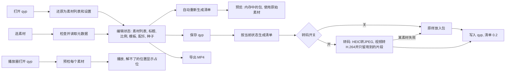

# 青云播放器 0.3.0 开发说明

本文档是 0.3.0 的开发依据：需求、决定、数据格式、行为规则、验收方法都写在这里，开发时不再另行口头约定。文中“必须”是硬性要求，“暂定”的数值集中列在第 12 节。

- 状态：待确认。确认后按第 13 节的顺序开发。界面与交互（3A 节，优先级 1）最先开发。
- 前置：0.2.1（中文安装时协议页显示中文说明、下载文件名带版本号）先按原计划发布，本文档的内容在 0.2.1 之后开发，随 **0.3.0** 发布。
- 对应 [PRD](./PRD.md) 的 6.1 到 6.7、7、13 节，第 14 节列出需要同步修改的位置。
- 术语：“包”指 `.qyp` 文件；“原样”指文件字节不经过任何重新编码；“转码”指重新编码；“播放文件”指包内 `src` 指向的文件。

## 1. 已确认的决定

| 编号 | 决定 |
| --- | --- |
| D-01 | 制作主要在 Web 端（电脑浏览器和桌面制作器）。手机浏览器上选的视频和照片**默认不转码**，原样放进包，手机端以播放为主。 |
| D-02 | 包里必须记录每个素材的“原始类型”。 |
| D-03 | 电脑浏览器和桌面制作器上可以转码，由用户开关，默认值按设备自动决定（见 5.2）。 |
| D-04 | 播放时本机解不了的素材：打开时预检并提示，仍照常播放，时间线不变，该位置显示占位画面。 |
| D-05 | 包格式版本升到 **0.2**，只增加字段，0.1 的包照常能打开。 |
| D-06 | 仓库和两个程序的自有代码继续用 Apache-2.0。HEIC 解码库 libheif（LGPL-3.0）作为独立组件，在 NOTICE 和“关于”页列出许可与源码地址。 |
| D-07 | 导出 MP4 只在电脑浏览器和桌面制作器提供，手机不显示。固定规格：按影片比例 1920×1080 或 1080×1920，30 帧每秒，H.264 + AAC，约 8 Mbps。 |
| D-08 | 手机端制作时素材累计超过 300 MB 提示，超过 600 MB 不允许继续添加。电脑浏览器仍按包体积上限 2 GB。 |
| D-09 | 内置曲目补到 5 首，全部取自 The Open Goldberg Variations（CC0）。 |
| D-10 | 去掉“保留原片”：要原片就不转码，要小包就转码。包里不再写 `originals/`，旧包里的 `original` 字段仍然能读。 |
| D-11 | 范围是上一轮清单的第 1 到 4 批：素材兼容与包体积、导出 MP4、安全与稳定性、阶段 1 小项收尾。 |
| D-12 | 制作器界面重新设计为**编辑器式三栏**：顶部菜单栏、左侧素材面板、中间预览、右侧设置面板；手机上折叠为底部标签。详见 3A 节。 |
| D-13 | 制作器可以**新建**，也可以**打开已有 `.qyp` 继续编辑**。 |
| D-14 | “编辑”的深度是**重新调整**：打开后可增删素材、调顺序、换模板、换配乐、改比例、改标题，然后重新生成整部影片。**不做**单页的版式、转场、时长编辑（仍属 PRD 阶段 4）。 |
| D-15 | 界面与交互这一批需求（3A 节的 U-01 到 U-17）的**优先级为 1（最高）**，开发顺序排在最前：0.2.1 之后、S0 之前。本文档不再用 PRD 的 P0/P1 字样表示这一批的优先级。 |
| D-16 | 改动任何设置后，预览**自动重新生成**，不再有“生成影片”按钮。预览直接使用原始素材；转码只发生在保存时（HEIC 图片例外，见 5.3）。 |

说明：你消息里的“qyd 文件”按 `.qyp` 理解。

## 2. 本文档不做的事

- 手机原生应用、macOS、Linux、代码签名、自动更新、效果增强（推拉、字幕、滤镜、卡点）。
- 单页编辑（改某一页的版式、转场、时长、页内素材位置，D-14）。
- 影片库（首页的影片列表、封面墙、重命名和删除）。“打开已有 `.qyp` 继续编辑”已包含在本版（3A.5），但没有“最近打开”列表。
- 桌面制作器关闭窗口时的未保存提示（3A.12 的已知限制）。
- 播放器不做转码，播放器不引入 HEIC 解码库。本机解不了就占位，不尝试补救。

## 3. 总体方案



要点：

- 生成清单发生在转码之前，用的是原始素材的时长和尺寸，所以“相同输入和种子生成相同清单”（F-GEN-08）不受转码影响。转码之后只改写素材的 `src`、`mimeType`、`duration` 以及视频条目的 `clipStart`（见 5.5）。
- 预览是内存里的包，使用原始素材（HEIC 图片在转码开启时用后台转出的 JPEG，见 5.3），不经过 ZIP，也不等视频转码。保存时才真正转码并写入包，所以预览里本机播不了的素材显示占位画面，保存后的包也一样。
- 导出 MP4 直接解码原始素材渲染，不依赖转码结果（见 10 节）。

## 3A. 制作器界面与交互（优先级 1，最先开发）

本节取代现有制作页的“长表单”布局。网页制作页（`create.html`）和桌面制作器共用同一份代码。本节每条需求的优先级都是 **1（最高）**，先于第 4 节以后的所有内容开发。

### 3A.1 需求清单

| 编号 | 优先级 | 需求 | 详见 |
| --- | --- | --- | --- |
| U-01 | 1 | 顶部菜单栏：文件、编辑、帮助，右侧语言切换和“关于” | 3A.3 |
| U-02 | 1 | 新建 | 3A.4 |
| U-03 | 1 | 打开已有 `.qyp`（菜单、空状态按钮、拖入窗口） | 3A.5 |
| U-04 | 1 | 保存为 `.qyp` | 3A.6 |
| U-05 | 1 | 文件菜单里的“导出 MP4” | 10.1 |
| U-06 | 1 | 电脑布局：三栏（素材、预览、设置） | 3A.2 |
| U-07 | 1 | 手机布局：底部三个标签 | 3A.2 |
| U-08 | 1 | 素材面板：缩略图、拖动排序、删除、添加、无法使用列表 | 3A.7 |
| U-09 | 1 | 预览区：内嵌播放器、状态提示 | 3A.8 |
| U-10 | 1 | 设置面板：标题、比例、模板、配乐、转码、“换一版” | 3A.9 |
| U-11 | 1 | 改动后自动重新生成预览 | 3A.10 |
| U-12 | 1 | 撤销和重做 | 3A.11 |
| U-13 | 1 | 未保存的更改提示 | 3A.12 |
| U-14 | 1 | 空状态 | 3A.13 |
| U-15 | 1 | 键盘快捷键 | 3A.3 |
| U-16 | 1 | 打开已有包后还原为可编辑状态的规则 | 3A.5 |
| U-17 | 1 | 键盘可操作和屏幕阅读器可读 | 3A.14 |

### 3A.2 布局

按窗口宽度分两种布局，分界线 **1000 像素**（CSS 像素，用媒体查询，不按设备类型）。

电脑布局（宽度不小于 1000）：

```
┌────────────────────────────────────────────────────────────────┐
│ 图标  文件 编辑 帮助                          语言  关于        │  顶栏，高 48
├────────────┬──────────────────────────────────┬────────────────┤
│  素材面板   │              预览区               │   设置面板      │
│  宽 300    │         （自适应剩余宽度）          │   宽 340       │
│  可滚动     │                                  │   可滚动        │
└────────────┴──────────────────────────────────┴────────────────┘
```

- 三栏高度占满顶栏以下的窗口，各自独立滚动，预览区不滚动。
- 预览区里的播放器按影片比例缩放到刚好放得下（保持比例，空白处黑色，F-PLY-06）。

手机布局（宽度小于 1000）：

- 顶栏左侧是“菜单”按钮（三条横线），点开后是一个竖向列表，包含文件、编辑、帮助里的全部命令，语言切换和“关于”也在里面；顶栏中间显示当前页标签名。
- 内容区一次只显示一个标签页；底部固定标签栏：**素材 / 预览 / 设置**，每个标签的点击区域不小于 44×44 像素。
- 添加素材后停留在“素材”；打开 `.qyp` 成功后切到“预览”；新建后切到“素材”。
- 素材面板里的拖动排序换成每行的“上移”“下移”按钮（见 3A.7）。

### 3A.3 菜单栏和快捷键

菜单是页面内自绘的（桌面制作器也不使用系统原生菜单，两者一致）。

| 菜单 | 命令 | 快捷键 | 可用条件 |
| --- | --- | --- | --- |
| 文件 | 新建 | 无 | 始终可用 |
| 文件 | 打开… | Ctrl+O | 始终可用（忙碌时不可用，见下） |
| 文件 | 保存… | Ctrl+S | 素材数不少于 1 且不忙碌 |
| 文件 | 导出 MP4… | Ctrl+E | 满足 10.1 的显示条件，素材数不少于 1 且不忙碌；条件不满足时整项隐藏 |
| 编辑 | 撤销 | Ctrl+Z | 撤销栈非空 |
| 编辑 | 重做 | Ctrl+Y 或 Ctrl+Shift+Z | 重做栈非空 |
| 编辑 | 添加素材… | Ctrl+I | 素材数小于 100 |
| 编辑 | 按拍摄时间排序 | 无 | 素材数不少于 2 |
| 帮助 | 关于 | 无 | 始终可用 |

- “忙碌”指正在保存、导出、打开包、导入素材检查中；忙碌时上表中“保存”“导出”“打开”“新建”“添加素材”灰显，撤销和重做也灰显。
- 新建不设快捷键：浏览器里 Ctrl+N 会打开新窗口，无法拦截。
- Mac 上 Ctrl 换成 Command，菜单里显示对应的符号。
- 焦点在文本输入框里时，不拦截 Ctrl+Z、Ctrl+Y（让输入框自己撤销输入）；Ctrl+S、Ctrl+O、Ctrl+E、Ctrl+I 仍然拦截并阻止浏览器默认行为。
- 菜单交互：
  - 点击菜单标题展开；展开后鼠标移到相邻标题自动切换；点击空白处、按 Esc、选中命令后都关闭。
  - 键盘：Alt 或 F10 把焦点移到菜单栏；左右键切换菜单，上下键在命令间移动，Enter 执行，Esc 关闭。
  - 灰显的命令可以被焦点选中但不能执行。
  - 命令的右侧显示快捷键文字。
- 右上角的“语言”和“关于”沿用现有组件。

### 3A.4 新建

- 如果有未保存的更改（见 3A.12），先弹确认框，选“放弃并新建”才继续，选“取消”什么都不变。
- 把编辑状态重置为与首次打开页面时完全相同：素材列表清空，标题留空，比例“自动”，模板为默认模板，配乐为第一首内置曲目（哥德堡变奏曲第 1 变奏），种子重新随机，撤销和重做栈清空，转码缓存释放，`dirty` 为假。
- 转码开关不重置（它是用户偏好，见 5.2）。
- 回到空状态（3A.13）；手机布局切到“素材”标签。

### 3A.5 打开已有 `.qyp` 并还原为可编辑状态

入口三个：文件菜单“打开…”、空状态里的“打开 .qyp 文件”按钮、把 `.qyp` 文件拖进窗口。

- 打开前如果有未保存的更改，先弹确认框（同 3A.4，按钮“放弃并打开”）。
- 文件选择框只列出 `.qyp`；拖入时的规则：
  - 拖入的文件里恰好只有一个 `.qyp` 且没有其他文件：打开它。
  - 拖入的文件里既有 `.qyp` 又有照片或视频：照片和视频照常添加，`.qyp` 忽略，并提示“已忽略 .qyp 文件。要打开影片，请单独拖入。”
  - 同时拖入多个 `.qyp`：不打开，提示“一次只能打开一个 .qyp 文件。”
- 打开过程显示进度（“正在打开……”），期间界面忙碌。
- 用 `openPackage` 打开并完成全部校验（F-PKG-05、F-PKG-06）；失败时弹出错误框（文案沿用现有的包错误说明），**编辑状态保持不变**，不清空。
- 校验通过后，按下面的规则还原编辑状态：

| 项 | 还原规则 |
| --- | --- |
| 素材 | 按“在 `pages` 里首次出现的顺序”（先按页，页内按 `items` 顺序）排列，同一素材只算一次，没有被页引用的素材忽略。每个素材读出文件（`readBlob`），作为一个素材条目，尺寸、时长、是否有音轨、拍摄时间沿用清单里的值。 |
| 素材名称 | 包里不存文件名，条目显示“照片 1”“视频 2”这样的序号名（按类型分别编号，界面语言的文字）。 |
| 素材类型信息 | 0.2 的包：`mimeType` 和 `source` 原样带入条目；0.1 的包：`mimeType` 由路径扩展名推断（`mimeForPath`），`source` 设为 `{ mimeType: 同上, transcoded: false }`。 |
| 是否再转码 | `source.transcoded` 为 `true` 的条目视为最终文件，保存时**不再转码**（避免重复压缩损失画质，且视频已经是裁好的片段）；0.1 的包的条目也视为最终文件（它们本来就是基准格式）；`transcoded` 为 `false` 的条目按转码开关处理。 |
| 标题 | 清单的 `title`。 |
| 画面比例 | 清单的 `canvas.aspectRatio`（选“横屏”或“竖屏”，不选“自动”）。 |
| 模板 | `generator.templateId` 是已知模板就选它，否则用默认模板。 |
| 种子 | `generator.seed` 是整数就用它，否则随机生成。 |
| 配乐 | 清单有 `bgm`：如果对应音频素材的 `license` 为 `CC0-1.0` 且 `title` 与某首内置曲目的中文或英文曲名相同，选中该内置曲目；否则当作“导入音频”，读出文件，曲名和许可沿用清单。没有 `bgm` 则为“不使用”。`volume`、`loop`、`fadeIn`、`fadeOut` 不还原，由生成器按规则重新计算。 |
| 其余 | `pages`（各页的版式、转场、时长）**不还原**，由生成器重新生成。 |

- 还原完成后：撤销和重做栈清空，`dirty` 为假，自动生成预览（3A.10）。手机布局切到“预览”。
- 因为生成器是确定性的（F-GEN-08），同一个由 qyPlayer 生成的包，在素材顺序、模板、种子都未改变时，重新生成的结果与原包一致。
- 如果包不是由 qyPlayer 生成（`generator.name` 不是 `qyPlayer web`，或没有 `generator.seed`），预览区上方显示一条提示：“已根据素材重新生成影片，排版可能与原影片不同。”
- 手机环境打开的包，素材总大小同样受 3A.7 的 300 MB 提示和 600 MB 上限约束：超过 600 MB 的包拒绝打开，错误文案“手机上素材总大小不能超过 600 MB”。

### 3A.6 保存

- “保存…”总是生成一个新文件（网页：浏览器下载；桌面制作器：系统“另存为”对话框），**不覆盖**原来打开的文件。
- 流程：按当前编辑状态生成清单 → 按转码开关转码（5.5，显示进度、可取消）→ 如果配乐是导入的则弹使用权确认（5.6）→ 写入包 → 保存。
- 保存成功后 `dirty` 为假；失败或取消保持 `dirty` 不变。
- 文件名见 5.8。

### 3A.7 素材面板

- 标题行：“素材”和计数 `n / 100`；右侧“添加”按钮（等同 Ctrl+I，打开文件选择框，可多选）。
- 每个素材一行，从上到下就是影片里的播放顺序：

| 区域 | 内容 |
| --- | --- |
| 排序手柄 | 电脑：左侧的拖动手柄；手机：右侧的“上移”“下移”两个按钮 |
| 缩略图 | 72×48 像素，居中裁切。图片取其画面；视频取第 0.5 秒（或时长一半，取较小者）处的帧；本机无法显示时显示一个中性的“无法预览”图标。缩略图在导入后台生成，生成前显示灰色占位。 |
| 名称 | 导入的素材显示原文件名（只在本机显示，不写入包）；从包还原的素材显示序号名（3A.5） |
| 说明行 | 类型图标、尺寸（如 4032×3024）、视频时长、文件大小、拍摄时间（5.3） |
| 状态 | 转码开启时图片在后台处理，行里显示“处理中”小标记，处理完消失；本机无法播放时显示警告图标，悬停或聚焦时提示“本设备无法播放，预览里会显示占位画面” |
| 删除 | 右侧“×”按钮 |

- 拖动排序：电脑上拖动手柄在列表内移动，拖动时显示插入位置的横线；键盘上，焦点在某一行时按 Alt+↑ 或 Alt+↓ 移动该行；每次移动算一步撤销。
- 删除：点击“×”立即删除，一步撤销可恢复；只剩 1 个素材时仍可删除到 0 个（回到空状态），因为现在有“撤销”和“新建”。**与 PRD F-ADJ-01 不同**：PRD 要求至少保留 1 个素材，改为允许删空，PRD 同步修改。
- 添加：新素材追加到列表末尾；检查失败的文件不进列表，而是出现在列表下方的“无法使用”区域（折叠显示“n 个文件无法使用”，展开后每行为“文件名：原因”）。成功导入的素材不会因为其他文件失败而被丢弃（F-IMP-03）。
- 手机上素材累计的 300 MB 提示和 600 MB 上限规则见 5.3；提示条显示在列表上方。
- 菜单“按拍摄时间排序”：按拍摄时间升序重排整个列表，相同时间按名称（沿用现有 `sortByCapturedAt`）；算一步撤销。

### 3A.8 预览区

- 内嵌现有播放器（沉浸式界面，控制条自动隐藏），不再单独弹出。
- 预览区上方一行状态：`N 页 · 时长 m:ss`；本机无法播放的素材数大于 0 时追加 `· k 个素材显示为占位`，点击这一行滚动到素材面板并高亮这些行。
- 正在重新生成时状态行显示“更新中……”。
- 预览与保存的差异：预览使用原始素材，保存时才转码（D-16）。因此预览里本机无法播放的素材，保存后的包里也无法播放，除非转码成功；转码成功与否在保存时才知道，并按 5.5 提示。
- 没有素材时显示空状态（3A.13）。
- 预览的播放位置：每次重新生成后回到 0 秒并暂停。

### 3A.9 设置面板

自上而下的区块：

| 区块 | 内容 |
| --- | --- |
| 标题 | 文本框，占位文字是默认标题（“最早拍摄日期 + 回忆”，随语言）；留空则用默认标题。修改标题**不触发**重新生成，直接更新当前清单里的标题。 |
| 画面比例 | 单选：自动（显示当前判定结果，如“自动（当前：横屏 16:9）”）、横屏 16:9、竖屏 9:16 |
| 风格模板 | 卡片列表，每张显示模板名称和一行说明，单选 |
| 配乐 | 单选：内置曲目、不使用背景音乐、导入音乐。新建时选中第一首内置曲目，预览和保存都会写入 `bgm` 并播放；选“不用配乐”时不写 `bgm`，只留视频原声。每首内置曲目有试听按钮（5.6、第 8 节）；选导入时显示“选择音乐文件”按钮和已选文件名 |
| 转码 | 5.2 的复选框和状态说明 |
| 换一版 | 按钮，随机换一个种子重新生成（沿用现有“换一版”） |

- 手机上这些区块全部放在“设置”标签里，竖向排列。
- 影片没有素材时整个设置面板灰显且不可操作（3A.13）。

### 3A.10 自动重新生成

- 触发条件：素材列表变化（添加、删除、移动、排序）、画面比例、模板、配乐、种子（“换一版”）、转码开关由关变开时图片的后台处理完成。**标题变化不触发**。
- 去抖：最后一次触发后 300 毫秒才开始生成；生成进行中又有新触发，则取消当前生成并按最新状态重新开始。
- 生成使用 `core` 的 `generateManifest`（纯计算，耗时在毫秒级，见阶段 0 报告），不涉及转码。
- 预览包是内存里的 `OpenedPackage`：`manifest` 是刚生成的清单，`readBlob(path)` 直接返回对应条目的 Blob（原始素材，或 HEIC 的后台转码结果），**不经过 ZIP 打包**。预览播放器打开它的方式与打开真实包相同，因此 6.1 的预检、6.2 的占位同样生效。
- 预览包使用的路径、`mimeType` 和 `source` 规则与保存的包一致，使得同一份清单两边通用。
- 生成出错（例如没有可用素材）：预览区显示错误提示，不影响编辑状态。
- 没有素材时不生成，显示空状态。

### 3A.11 撤销和重做

- 编辑状态的快照包含：素材列表（条目引用及其顺序）、标题、画面比例选择（自动/横/竖）、模板、配乐选择（含已选的内置曲目或导入的文件）、种子。**不含**转码开关（它是偏好）。
- 产生一步历史的操作：添加素材（一次选择的多个文件算一步）、删除、移动、按拍摄时间排序、改比例、改模板、改配乐、“换一版”、标题修改（连续输入在停顿 1 秒后合并为一步）。
- 撤销栈和重做栈各最多保留 50 步，超出时丢弃最旧的步并释放只被它引用的素材数据。
- 执行新操作时清空重做栈。
- 新建和打开会清空两个栈。
- 撤销或重做后触发自动重新生成（标题除外）。
- 被删除的素材在撤销栈里仍引用其 Blob，不会被释放，这样撤销能恢复。
- `dirty` 的计算：记录“上次保存或打开时的历史位置”，当前位置与它不同则为真。因此撤销回到上次保存的状态时，`dirty` 变回假。

### 3A.12 未保存提示

- `dirty` 为真时：
  - 新建、打开（3A.4、3A.5）弹确认框；
  - 网页版关闭或刷新页面时注册 `beforeunload`，由浏览器弹出标准确认。
- **已知限制**：桌面制作器关闭窗口时本版不提示（Tauri 的窗口关闭事件需要额外的权限和依赖，不在本版范围）。发布说明里写明。
- 确认框文案：“有未保存的更改，确定放弃吗？”按钮“放弃并继续”“取消”，默认焦点在“取消”。

### 3A.13 空状态

- 条件：素材数为 0。
- 电脑布局：中间预览区显示两个大按钮“添加照片和视频”“打开 .qyp 文件”，下面一行小字“也可以把文件拖进窗口”；素材面板显示“还没有素材”；设置面板灰显。
- 手机布局：“素材”标签显示同样的两个按钮；“预览”和“设置”标签显示“先添加素材”。
- 拖入窗口的任何位置都有效；拖入时整个窗口显示一层半透明的“松开以添加”提示。

### 3A.14 无障碍

- 所有按钮、菜单、列表行、开关都能只用键盘到达和操作；焦点顺序是菜单栏、素材面板、预览区、设置面板。
- 菜单使用 `role="menubar"`、`menu`、`menuitem`、`aria-disabled`、`aria-expanded`；素材列表使用 `role="list"`，每行有包含名称和说明的 `aria-label`；排序操作有 `aria-keyshortcuts`。
- 对话框（确认框、错误框、使用权确认、关于）使用 `role="dialog"` 和 `aria-modal`，打开时焦点进入对话框并限制在其中，关闭后焦点回到触发它的元素；Esc 关闭（确认类对话框 Esc 等同“取消”）。
- 重新生成、导入完成、保存完成等状态变化通过一个 `aria-live="polite"` 区域播报。
- 文字对比度符合 WCAG 2.1 AA（沿用现有主题色，新增的颜色按此检查）。

### 3A.15 文案

所有新增文字进 `apps/web/src/i18n/messages.ts` 的中英文两份，键一致。新增的键至少包括：菜单名和命令名、快捷键提示、空状态文案、确认框、各类提示条（手机限制、已忽略 .qyp、排版可能不同）、素材行状态、标签页名称、占位和 aria 文案。英文文案要写完整，不留中文。

## 4. 包格式 0.2

### 4.1 版本策略

- 写入端：新生成的包 `formatVersion` 为 `"0.2"`。
- 读取端：接受 `"0.1"` 和 `"0.2"`；其他版本给出 `unsupported-version`（与现在一致）。
- `core` 里的 `SUPPORTED_FORMAT_VERSION` 常量（现在是单个字符串，比较用全等）改为 `SUPPORTED_FORMAT_VERSIONS = ["0.1", "0.2"]`。
- 对 0.1 的包：播放文件的类型仍由路径扩展名推断（`mimeForPath`），不预检。这也是旧包的行为。

### 4.2 素材新增字段

每个 `assets` 元素（图片、视频、音频）在 0.2 中新增两个**必需**字段：

| 字段 | 类型 | 说明 |
| --- | --- | --- |
| `mimeType` | 字符串 | 播放文件（`src`）的类型。格式见 4.3。 |
| `source` | 对象 | 用户当初选的原始文件的类型。 |

`source` 的字段：

| 字段 | 类型 | 说明 |
| --- | --- | --- |
| `mimeType` | 字符串 | 原始文件的类型，格式同 4.3。 |
| `transcoded` | 布尔 | 播放文件是否由原始文件转码得到。`false` 表示 `src` 就是原始文件的原样字节。 |

规则：

- 不记录原始文件名。理由：文件名常含人名、地点、日期，写进可分享的包是隐私风险；`source` 只需要“类型”。
- `transcoded` 为 `false` 时，`source.mimeType` 必须与 `mimeType` 完全相同；为 `true` 时可以相同（例如 JPEG 缩小后仍是 JPEG），也可以不同。
- 图片和视频的 `width`、`height` 是**显示尺寸**：已按 EXIF 方向或视频旋转信息转正后的尺寸。
- 旧字段 `original` 保留在 schema 里，0.2 的写入端不再写，读取端照常接受。

### 4.3 `mimeType` 的写法

- 语法：`类型/子类型`，可以带一个 `codecs` 参数，全部小写。正则：

```
^(image|video|audio)/[a-z0-9.+-]+(; ?codecs="[a-z0-9.,+ -]+")?$
```

- 长度不超过 200 个字符。
- 顶层类型必须与素材的 `type` 一致：图片素材只能是 `image/…`，视频素材只能是 `video/…`，音频素材只能是 `audio/…`。`source.mimeType` 同样检查。
- 视频和音频的 `codecs` 参数能取得时必须写，取不到时才省略（见 5.4 的探测规则）。图片不写 `codecs`。
- 常见取值：

| 内容 | `mimeType` 示例 | 包内扩展名 |
| --- | --- | --- |
| JPEG / PNG / WebP | `image/jpeg`、`image/png`、`image/webp` | `.jpg`、`.png`、`.webp` |
| HEIC / HEIF | `image/heic`、`image/heif` | `.heic`、`.heif` |
| AVIF | `image/avif` | `.avif` |
| MP4 视频 | `video/mp4; codecs="avc1.640028, mp4a.40.2"` | `.mp4` |
| iPhone 的 MOV | `video/quicktime; codecs="hvc1.2.4.l120.b0, mp4a.40.2"` | `.mov` |
| MP3 | `audio/mpeg` | `.mp3` |
| AAC（M4A） | `audio/mp4; codecs="mp4a.40.2"` | `.m4a` |
| WAV | `audio/wav` | `.wav` |

- 扩展名只是约定，播放器以 `mimeType` 为准。写入端必须按上表取扩展名；表里没有的类型，制作器在导入时就拒绝（见 5.3）。

### 4.4 校验

- JSON Schema（[spec/manifest.schema.json](../spec/manifest.schema.json)）：
  - `asset` 增加可选属性 `mimeType`、`source`，并给出上面的正则和 `source` 的结构（`required: ["mimeType", "transcoded"]`）。
  - 顶层加条件：`formatVersion` 为 `"0.2"` 时，`assets` 的每个元素必须有 `mimeType` 和 `source`。
- 语义校验（`core` 的 `validateManifest`），仅对 0.2：
  - `mime-type-mismatch`：`mimeType` 或 `source.mimeType` 的顶层类型与素材 `type` 不一致。
  - `source-not-transcoded-mismatch`：`source.transcoded` 为 `false` 但两个 `mimeType` 不同。
- 打开包（`qyp` 的 `openPackage`）新增实际体积断言，见 7.1。
- 校验失败时按原有分类归入 `invalid-manifest`，界面文案不新增类别。
- 更新 [spec](../spec) 下的示例清单为 0.2，并保留一份 0.1 的示例用于兼容测试。

### 4.5 一致性测试包

在 `fixtures/conformance` 新增，`expected.json` 同步记录结果。素材内容用占位字节（现有做法，没有可再分发的 HEIC 和 HEVC 样本）：

| 包 | 预期 |
| --- | --- |
| 0.2 合法，含 `image/heic` 图片和 `video/quicktime` 视频，`transcoded` 为 `false` | 能打开 |
| 0.2 合法，素材 `transcoded` 为 `true` 且两个 `mimeType` 不同 | 能打开 |
| 0.2 缺少 `mimeType` | `invalid-manifest` |
| 0.2 缺少 `source` | `invalid-manifest` |
| 0.2 `mimeType` 顶层类型与 `type` 不符 | `invalid-manifest` |
| 0.2 `mimeType` 含非法字符 | `invalid-manifest` |
| 0.2 `transcoded` 为 `false` 但两个 `mimeType` 不同 | `invalid-manifest` |
| 0.1 的现有全部合法包 | 仍能打开 |
| 声明体积与实际不符（见 7.1） | 新错误 `size-mismatch` |
| `formatVersion` 为 `"0.3"` | `unsupported-version` |

说明：`size-mismatch` 依赖 7.1 的实际体积断言，对应的包随 S2 加入；其余用例在 S1 完成，包名以 `valid-v02-`、`invalid-v02-` 开头，原有的 0.1 用例保持不变。写入端（生成器）在 S4、S5 接入 `mimeType` 和 `source` 后再改为写 0.2。

## 5. 制作器（网页制作页和桌面制作器共用同一份代码）

### 5.1 环境判断

- **手机浏览器**：满足任一即是。
  - `navigator.userAgentData?.mobile === true`；
  - 用户代理含 `Android`、`iPhone`、`iPad`、`iPod`；
  - `navigator.platform === "MacIntel"` 且 `navigator.maxTouchPoints > 1`（新 iPad 伪装成 Mac）。
- **电脑**：其余情况，包括桌面制作器。
- **转码能力**（启动时探测一次，缓存）：
  - `videoEncode`：`VideoEncoder.isConfigSupported({ codec: "avc1.640028", width: 1920, height: 1080, bitrate: 8_000_000, framerate: 30 })` 为真。
  - `audioEncode`：`AudioEncoder.isConfigSupported({ codec: "mp4a.40.2", sampleRate: 48000, numberOfChannels: 2, bitrate: 192_000 })` 为真。
  - 没有 `VideoEncoder`（例如旧 Safari）时两项都是假。

### 5.2 转码开关

- 位置：设置面板（3A.9）里的“转码”区块，一个复选框，文字“转码以获得最佳兼容性（包更小，各设备都能播放；耗时较长）”。下方一行小字说明当前状态。
- 默认值：

| 环境 | 默认 | 说明文字 |
| --- | --- | --- |
| 电脑且 `videoEncode` 为真 | 开 | 无 |
| 手机 | 关 | “手机上不转码，素材原样放进影片，文件会较大，部分设备可能无法播放。” |
| `videoEncode` 为假 | 关且不可点击 | “当前浏览器不支持转码。” |

- 用户改动后写入 `localStorage` 键 `qy.transcode`（`"on"` 或 `"off"`），之后优先于默认值；但 `videoEncode` 为假时仍强制关。
- 开关只影响“保存”时是否转码，以及图片是否在后台转成 JPEG（见 5.3）；视频不在预览里转码，所以切换开关不会让预览重新生成。由关变开时，已导入的图片在后台补做转码，完成后触发一次自动重新生成（3A.10）。
- 开关的状态不进入撤销栈，也不影响“是否有未保存的更改”。
- `audioEncode` 为假时开关仍可开，只是 WAV 配乐无法转成 AAC，退回原样（见 5.6）。

### 5.3 导入

导入阶段**不重新编码视频**，只做检查和读取元数据，保留用户的原始 `File`，并在后台生成缩略图（3A.7）。图片的后台处理有两种情况，处理期间素材行显示“处理中”，不阻塞列表和其他操作：

- 转码开关为开：HEIC、HEIF 用 libheif 解码，其他格式用浏览器解码，统一转成 JPEG（规格见 5.5），结果缓存；预览和保存都使用这个结果。
- 转码开关为关：HEIC、HEIF、AVIF 不处理，原样使用；GIF、BMP 无论开关都转成 JPEG（见下表）。

接受的输入：

| 类别 | 接受 | 其他情况 |
| --- | --- | --- |
| 图片 | JPEG、PNG、WebP、HEIC、HEIF、AVIF，原样可放入包 | GIF、BMP：用浏览器解码后一律转成 JPEG（无论开关），解码失败报 `decode` |
| 视频 | 容器为 MP4、M4V、MOV，任意视频编码 | 其他容器（WebM、MKV、AVI 等）报 `video-format` |
| 配乐 | MP3、M4A（AAC）、WAV | 其他音频格式报 `audio-format` |

读取的元数据：

- **尺寸**：
  - 图片：先用 `createImageBitmap` 取（默认已按 EXIF 方向转正）；失败（HEIC 在 Chrome 里）则解析文件头取尺寸（给 `apps/web` 新增依赖 `image-size`，MIT，它支持 HEIC，EXIF 方向要自己处理：方向为 5 到 8 时对调宽高）；仍失败则报 `decode`。
  - 视频：容器里的编码尺寸，按旋转信息（0、90、180、270 度）转成显示尺寸。
- **时长**：视频和音频，秒；读不到或不大于 0 报 `no-duration`。
- **是否有音轨**：视频。
- **类型**：容器和编码，写成 4.3 的 `mimeType`。编码字符串取自容器，取不到时省略 `codecs` 参数。
- **拍摄时间**：
  - 照片：EXIF `DateTimeOriginal`，其次 `CreateDate`；有 `OffsetTimeOriginal` 就用它，没有则按制作设备的本地时区解释。读取使用 `exifr`（MIT，支持 JPEG、HEIC、PNG）。
  - 视频：容器的创建时间（按 UTC）。
  - 都取不到时用文件修改时间（现有做法）。
  - 统一写成 UTC 的 ISO 8601，形如 `2026-05-01T08:30:00Z`。
- 素材列表每一行在文件名下面显示拍摄时间（用界面语言的本地日期时间格式），读不到 EXIF 时显示修改时间，并加“修改时间”字样区分（F-IMP-04）。

数量和体积上限：

- 数量：100 个（T-01），不变。
- 手机：累计原始文件大小超过 300 MB 时，素材区显示一条黄色提示“素材较大，在手机上制作可能失败，建议换电脑制作”；超过 600 MB 时，之后的文件不再添加，并在“无法使用”列表里给出原因 `mobile-limit`，文案“手机上素材总大小不能超过 600 MB”。按选择顺序依次累计，第一个让总量超过 600 MB 的文件及其后的文件被拒绝。
- 电脑：不单独限制素材总量，打包时按包体积上限 2 GB（T-09）；超过则报 `too-large`（已有）。

### 5.4 编码字符串的探测规则

- 用 mediabunny（见 9.1）读取轨道，取得完整的 RFC 6381 编码字符串（例如 `avc1.640028`、`hvc1.2.4.L120.B0`）。字符串一律转成小写后写入。
- 音频编码：AAC-LC 写 `mp4a.40.2`；MP3 和 WAV 不写 `codecs`。
- 容器：`ftyp` 品牌为 `qt  ` 的写 `video/quicktime`，其余 MP4 系列写 `video/mp4`。

### 5.5 转码

**转码开关为开时**，转码在**保存**时执行：先按当前编辑状态生成清单，再转码，最后写入包。预览不做视频转码（D-16）；图片已在导入后台处理过（5.3），保存时直接使用缓存。

| 素材 | 操作 |
| --- | --- |
| 图片 | 解码后缩放到长边不超过 2560 像素，编码为 JPEG，质量 85（T-07）。HEIC/HEIF 用 libheif 解码（见 9.2），其他格式用浏览器解码。 |
| 视频 | 只保留影片用到的片段：区间为 `[clipStart, clipStart + 页时长]`；重新编码为 H.264 + AAC 的 MP4，不超过 1080p、30 帧每秒、约 8 Mbps（T-08）。没有音轨的视频不加音轨。转码后素材的 `duration` 等于片段时长，对应条目的 `clipStart` 改为 0。 |
| 配乐 | WAV 转 AAC（`audio/mp4; codecs="mp4a.40.2"`，192 kbps）。MP3 和 M4A 不动。 |

- 视频**一律**重新编码，即使源文件已经是 H.264：因为需要裁剪出片段，不能无损裁剪。
- 每个素材转码成功后，`mimeType` 改为新文件的类型，`source.transcoded` 为 `true`，`source.mimeType` 保持原始类型。
- **失败回退**：某个素材转码失败（本机缺少对应解码器、解码或编码报错）时，该素材退回原样放入，`transcoded` 为 `false`，并在保存完成后的提示里按文件名列出：“以下 N 个素材无法转码，已原样放入，可能在部分设备上无法播放：……”。**不得静默回退**，也不得因为一个素材失败就让整次生成失败。
- **缓存**：转码结果按“素材 + 参数”缓存在内存里，参数是图片的缩放目标，视频的片段起点和时长。同一次编辑中多次保存、“换一版”后视频片段不变的素材，都不重复转码。素材被删除（且不在撤销栈里）或开关关闭时丢弃对应缓存。
- **已转码的素材不再转码**：从包还原且 `source.transcoded` 为 `true` 的条目，以及从 0.1 的包还原的条目，视为最终文件，保存时跳过转码（见 3A.5）。
- **进度与取消**：
  - 进度条显示“正在处理 第 i / n 个素材”和百分比，页面上的“取消”按钮可随时点击。
  - 取消后回到取消前的界面状态，素材列表不变，不产生新影片，不触发保存。
  - 实现上全程传递 `AbortSignal`，取消时释放编码器、解码器和已缓存的未完成数据。

**转码开关为关时**：播放文件就是原始文件的原样字节，包内路径按 4.3 的扩展名表命名，`source.transcoded` 为 `false`。

特例：GIF 和 BMP 无论开关都转成 JPEG（见 5.3），此时 `transcoded` 为 `true`。

### 5.6 配乐

- 来源三选一不变：内置曲目、导入音频、不使用。
- 内置曲目：5 首，见第 8 节。选择前可以试听和停止试听，每首显示曲名、风格标签、时长。选择后仍在制作页内试听。
- 导入音频：接受 MP3、M4A（AAC）、WAV。转码开关为开且 `audioEncode` 为真时 WAV 转 AAC；否则原样放入。
- 使用权提示（F-BGM-04）：
  - 当配乐来自“导入音频”，用户点击“保存…”时，在保存之前弹出确认框：“你导入的音乐可能受版权保护。分享这部影片前，请确认你有权使用这首音乐。”按钮“继续保存”和“取消”。
  - 选“取消”则不保存，回到制作页。
  - 内置曲目不弹出。导出 MP4 同样适用此规则。
  - 每次保存都弹，不记忆“不再提示”。

### 5.7 封面（F-GEN-10）

- 保存包时写入 `cover.jpg`，清单的 `cover` 指向它。
- 内容是第一页第一个素材的画面：
  - 图片：取播放文件解码后的画面；
  - 视频：取 `clipStart` 处的帧。
- 缩放到长边不超过 640 像素，JPEG 质量 80。
- 取不到画面（本机解不了且没有转码）时不写 `cover` 字段，不报错。
- 封面目前只写进包里，界面上还没有地方显示，影片库做的时候再用。

### 5.8 保存和导出的文件名

### 10.7 实现说明与验证记录（S7）

- 代码在 `apps/web/src/create/export/`：`spec.ts`（规格常量和纯计算）、`plan.ts`（前置检查）、`frames.ts`（逐帧取素材）、`audio.ts`（混音）、`run.ts`（编码主循环）。入口是 `CreatorApp` 的 `exportMovie`，用当前编辑内容重新生成与预览相同的清单，不依赖预览是否刚刚更新完。
- 前置检查先做 6.1 的播放预检，再对视频问一次 WebCodecs 的 `canDecode()`。背景音乐和视频的列表名称取自编辑器里的文件名。
- 取帧：先按 `stateAt` 算出每个视频素材要取的全部时间点，再让 mediabunny 的 `canvasesAtTimestamps` 从头到尾顺序解码，不反复定位。素材只在用到的页里保持打开，页过去就释放；视频帧缩到长边 1920 以内。
- 混音：按 10 秒一段分别用 `OfflineAudioContext` 渲染，渲染完交给编码器就释放。增益曲线是分段线性的，直接用 `bgmGainAt`、`videoAudioGain` 的折点交给 `linearRampToValueAtTime`，两条渐变重叠时按 0.05 秒采样。视频的音轨解不了时按静音处理（预览里这样的视频也没有声音）。
- 视频和音频两路同时编码，互相等对方跟上，否则 mediabunny 的写入端会因为另一路没有数据而一直等待。
- 超过 10 分钟的影片，导出前弹确认框（文件较大、占内存多），确认后照常导出，不设硬上限。导出结果先全部放在内存里，更彻底的办法是流式写盘，留待以后。
- 桌面制作器的“另存为”按文件扩展名选类型过滤（`.mp4` 或 `.qyp`）。
- 编码器写入的 H.264 Level 由编码器决定：Chrome 的硬件编码器写 5.0（`avc1.640032`），软件编码器写 4.0。码流本身不超过 Level 4.0 的限制（1080p、30 帧、约 8 Mbps），任何支持 4.0 的解码器都能播放。我们没有强制软件编码，因为那会明显变慢。
- 验证记录（真实 Chrome，临时页已删除）：
  - V3-09：示例包导出 1920×1080（竖屏示例 1080×1920）、30 帧每秒（750 个包，25 秒）、AAC-LC 48 kHz 立体声、顶层盒顺序 `ftyp, moov, mdat`（faststart）、时长与清单一致（相差不到一帧）；首帧、中间帧、末帧与直接用 `renderFrame` 画出的画面平均绝对差最大 2.1/255（要求小于 8）；Chrome 的 `<video>` 能播放。Windows 自带播放器仍待你确认。
  - V3-10：导出到 1.5 秒时取消，抛出 `AbortError`，没有产生结果；界面里取消不下载文件。
  - V3-11：用 440 Hz 的视频原声和 880 Hz 的配乐生成测试影片。有配乐时视频页内只有 880 Hz（440 Hz 的能量低于万分之二）；没有配乐时只有 440 Hz；无配乐时页尾 0.1 秒的音量明显低于页中间（淡出生效）。
  - V3-32：电脑环境里“导出 MP4…”出现；把用户代理改成手机后整项隐藏。
  - 界面：3 张照片从菜单导出，进度框显示百分比和剩余时间，完成后下载 `2026-11-18 Memories.mp4`（284 KB）。
  - 速度：25 到 40 秒、1080p 的影片，在本机 5 到 7 秒完成。

- 保存包：`safeFileName(标题)` 加 `.qyp`（已有，不改）。
- 导出 MP4：同一函数，扩展名 `.mp4`。该函数把 `\ / : * ? " < > |` 和控制字符替换成下划线，去掉首尾空白，最长 80 个字符，空白结果用默认标题的词。

## 6. 播放器（网页播放器和桌面播放器）

### 6.1 打开时预检

只对 `formatVersion` 为 `"0.2"` 的包执行；0.1 的包不预检，行为不变。

| 素材 | 预检方法 |
| --- | --- |
| 图片，`mimeType` 为 `image/jpeg`、`image/png`、`image/webp` | 视为支持，不检查 |
| 其他图片（HEIC、HEIF、AVIF 等） | 读出文件，调用一次 `createImageBitmap`，成功即支持，抛错即不支持，随后关闭位图。一次最多并行 2 个。 |
| 视频 | 调用 `HTMLVideoElement.canPlayType`，参数是把 `video/quicktime` 换成 `video/mp4` 后的 `mimeType`（保留 `codecs` 参数）。返回空字符串为不支持，`maybe` 或 `probably` 为支持。 |
| 音频 | 同视频，用 `HTMLAudioElement.canPlayType`；`audio/wav`、`audio/mpeg` 视为支持，不检查。 |

- 视频换成 `video/mp4` 的理由：Chrome 对 `video/quicktime` 的 `canPlayType` 返回空字符串，但实际能播放内容为 H.264 的 MOV；两者容器结构相同，用 `video/mp4` 查询才能得到正确结果。
- 创建视频的 Blob 时也把类型设为 `video/mp4`（`readBlob` 的调用方负责）。
- 如果有素材需要“读出文件并解码”的预检，打开过程中显示“正在检查素材……”，完成后再进入播放界面。没有这类素材时不显示，保持现在的打开速度。

### 6.2 不支持素材的处理

- 打开包后显示一条提示：“有 N 个素材在本设备上无法播放（第 a、b、c 页），这些位置会显示占位画面。”页码来自 `pages` 中引用了这些素材的页，从 1 开始，去重，最多列 10 个，更多则显示“等”。
- 照常进入播放。时间线、时长、转场、入场动画都不变。
- 占位画面：该素材所在的格子，填充 `#2a2a2a`，中央显示文字“本设备无法播放”（英文界面“Can't play on this device”），颜色 `#9aa0a6`，字号为格子短边的 8%，居中；文字过宽时自动缩小到能放下，最小字号 12 像素。
- 不支持的视频：不创建 `<video>` 元素，也不发出声音。
- 渲染器改动：`renderFrame` 的素材参数里，允许某个素材的 `source` 缺省并带上 `placeholder` 标记，渲染器据此画占位画面；占位文字由调用方通过参数传入（渲染器不带语言）。
- 提示使用现有的 `PlayerWarning` 机制，新增警告码 `assets-unsupported`，参数为页码列表。

### 6.3 视频原声的淡入淡出（A-05）

- 范围：影片**没有背景音乐**，且用户没有静音时，视频页的原声。
- 增益函数放在 `core`，预览和导出共用：

```
videoAudioGain(localTime, pageDuration) =
  min(1, localTime / FADE) × min(1, (pageDuration − localTime) / FADE)
```

其中 `FADE` 为 0.1 秒（T-21），`localTime` 是相对该页开始的秒数，结果限制在 0 到 1 之间。

- 播放时视频元素的音量 = 用户音量 × `videoAudioGain`；拖动定位到页中间时直接按函数取值，不产生跳变。
- 验收：连续两个视频页在无配乐时切换，在两页边界前后各 0.1 秒内音量连续变化，没有从非零直接跳到零。
- 实现说明（S3）：预检在 `apps/web/src/player/preflight.ts`，由 `PlaybackController.create` 调用；背景音乐无法播放时沿用原有的 `bgm-decode` 提示，不计入 `assets-unsupported` 的个数和页码；预检读取素材失败（包损坏）直接报错，只有解码失败才算“本设备不支持”。
- 验证记录（S3）：本机 Chrome 的 `canPlayType('video/mp4; codecs="hvc1…"')` 为空，HEIC 无法解码，V3-05、V3-06 的占位画面和提示均出现，播放不中断，时间线不变；V3-07 用两个连续视频页（无配乐）逐帧采样，边界处音量 1 → 0.47 → 0.03 → 0.53 → 1，连续。真机 iPhone 素材仍待 S8 验收。

### 6.4 读取包内文件

- 对未压缩（ZIP 存储方式 0）的条目，`readBlob` 不再解压到内存，而是按条目在源文件里的位置直接切片：
  - 位置 = 条目的本地文件头偏移 + 30 + 文件名长度 + 额外字段长度（从本地文件头里读出，不用中央目录的值）。
  - 长度 = 中央目录里的 `uncompressedSize`，同时要求与本地文件头里的大小一致，不一致报 `size-mismatch`。
  - 切片得到的 Blob 由浏览器按需读文件，不占用同样大小的内存。
- 对压缩的条目（只可能是 `manifest.json` 和旧包），仍然用 `getData` 解压。
- 切片读取不重新计算 CRC32，其余条目仍然检查签名。这一点是有意的取舍：对几百 MB 的视频逐字节算 CRC 会在手机上卡很久。
- 包里的视频、音频和图片都使用 `store` 方式写入（7.1 已规定），所以实际上所有素材都走切片。

### 6.4A 快速读取概要信息（peekPackage）

用途：影片库列表、打开前预览、拖入文件时的卡片，只需要标题、时长、封面这类信息，不需要播放。

- 接口：`peekPackage(blob)`（`packages/qyp/src/open.ts`），返回 `PackageSummary`：`title`、`duration`、`createdAt`、`aspectRatio`、`pageCount`、`photoCount`、`videoCount`、`hasMusic`、`formatVersion`、`totalBytes`、`cover?`。
- 不需要解压，也不需要读完整个文件。包内素材都是存储方式 0 的条目，ZIP 目录在文件尾，`manifest.json` 写在最前，`cover.jpg` 写在最后。`peekPackage` 只读三小段：文件尾的中央目录、`manifest.json`、封面，用 `Blob.slice` 取出，不读素材。
- 不改包格式，不加冗余字段（zip 注释摘要、缩略图副本）。理由：场景只有本机文件，上述三次小读取在本机是毫秒级；冗余字段会让摘要和清单可能不一致。所有字段都从清单现算：`photoCount`、`videoCount` 按素材类型统计（不含音频），`hasMusic` 是清单有 `bgm`。
- 不做完整校验：不检查素材是否缺失、大小是否一致，不算 CRC。清单本身仍要通过校验；不是 ZIP 或清单无效时抛 `QypError`，类别同 `openPackage`。因此能 `peekPackage` 成功的包，不保证能 `openPackage` 成功。
- 封面：清单没有声明 `cover`（例如 0.1 的旧包），或包里读不出封面时，`cover` 为 `undefined`，由调用方显示默认占位图。不做取素材第一张图或视频帧的兜底，保证读取量固定。

### 6.5 手机播放

- 手机播放使用同一个网页播放器，不转码，不做任何额外处理。
- 手机上解不了的素材同 6.2。

## 7. 安全与稳定性

### 7.1 实际体积断言

- `openPackage` 的体积上限检查现在用的是 ZIP 目录里“声明”的大小，声明可以被伪造。
- 新增：每次读取一个条目后，实际得到的字节数必须等于声明的 `uncompressedSize`，否则抛出 `QypError("size-mismatch")`。
- 新错误码 `size-mismatch`：界面文案“文件已损坏或被篡改（素材大小与记录不符）”/“The file is damaged or has been tampered with (a media file does not match its recorded size)”。
- 切片读取（6.4）的大小一致性检查走同一个错误码。

### 7.2 清单校验预编译

- 现状：[packages/core/src/validate.ts](../packages/core/src/validate.ts) 在运行时用 Ajv 编译 schema，Ajv 内部用 `new Function` 生成代码，在禁止 `unsafe-eval` 的内容安全策略下会失败。
- 改法：用 Ajv 的 standalone 模式在构建前把校验函数生成为一个静态文件，运行时只加载这个文件。
  - 新增脚本 `scripts/build-validator.ts`：读取 `spec/manifest.schema.json`，用 `ajv/dist/standalone` 生成 `packages/core/src/schemaValidator.generated.js`（CommonJS 转 ESM 的细节由脚本处理）。
  - 生成文件提交进仓库；新增测试：重新生成并与已提交的文件逐字节比较，不一致则失败（防止改了 schema 忘记重新生成）。
  - `ajv` 和 `ajv-formats` 从 `packages/core` 的运行时依赖移到开发依赖。
  - `pnpm` 脚本：`schema:build`；在 `lint` 之前运行不要求，由测试保证。
  - 现有校验的全部单元测试和一致性测试包必须原样通过。
  - 实现说明（S2）：生成脚本拆成 `scripts/validator/generate.ts` 和 `scripts/build-validator.ts`；`date-time` 格式和字符串长度函数放在 `packages/core/src/schemaRuntime.ts`，生成的校验函数从那里引用，因此运行时不依赖 `ajv` 和 `ajv-formats`（它们只留在 `packages/core` 的开发依赖里，用于生成和对照测试）。

### 7.3 内容安全策略

两个 `tauri.conf.json` 的 `app.security.csp` 从 `null` 改为下面的值（先写入，再用第 11 节的方法验证，必要时微调，**不得加入 `unsafe-eval`**）：

播放器：

```
default-src 'self'; script-src 'self'; style-src 'self' 'unsafe-inline'; img-src 'self' blob: data:; media-src 'self' blob:; connect-src 'self' ipc: http://ipc.localhost blob:; worker-src 'self' blob:
```

制作器：在播放器的基础上，`script-src` 改为 `'self' 'wasm-unsafe-eval'`（libheif 的 WebAssembly 需要），`connect-src` 不变。

- `'unsafe-inline'` 只用于样式：react-jss 在运行时往页面里插 `<style>`。
- 验证标准：在两个程序里完整走一遍主要流程，控制台没有任何 CSP 违规。

### 7.4 可复现的 Rust 构建

- `Cargo.lock` 没有包含新增的两个 crate 和 `tauri-plugin-opener`，CI 每次重新解析依赖。
- 做法：
  1. 在 `release.yml` 里加一步，仅在手动触发时把 `Cargo.lock` 作为附件上传。
  2. 运行一次，下载后提交进仓库。
  3. 之后所有 `cargo` 命令加 `--locked`（`cargo test` 和 `tauri build` 的参数）。
- 验收：CI 在 `--locked` 下构建通过。

### 7.5 其他

- 保存包到磁盘（桌面制作器）：[apps/desktop-maker/src-tauri/src/main.rs](../apps/desktop-maker/src-tauri/src/main.rs) 的 `save_file` 必须先写到同目录的临时文件，写完后改名为目标文件名；写入失败或被取消时删除临时文件，目标位置不留半成品（F-PKG-01）。
- 网页版保存：保存前包已经完整在内存里，取消不会留下文件。

## 8. 内置曲目

- 来源：Internet Archive 的 `OpenGoldbergVariations`（<https://archive.org/details/OpenGoldbergVariations>），作曲 J.S. Bach（公有领域），录音 Kimiko Ishizaka，CC0 1.0。
- 5 首：

| 文件 | 曲目 | 风格标签（中文 / 英文） |
| --- | --- | --- |
| `bgm-goldberg-var1.mp3`（已有） | Variatio 1 | 轻快 / Lively |
| `bgm-goldberg-aria.mp3` | Aria | 宁静 / Serene |
| `bgm-goldberg-var3.mp3` | Variatio 3 Canone all'Unisono | 明亮 / Bright |
| `bgm-goldberg-var7.mp3` | Variatio 7 al tempo di Giga | 欢快 / Joyful |
| `bgm-goldberg-var13.mp3` | Variatio 13 | 抒情 / Lyrical |

- 选择规则：每首文件大小不超过 6 MB；如果 Aria 超过，改选 Variatio 15。该规则在下载后判断，改选后更新本表和 `fixtures/SOURCES.md`。
- 格式：MP3。如果归档里只有 FLAC 或 WAV，需要转成 128 kbps 的 MP3，转换工具只在开发机上使用，不进入仓库构建。
- 登记：每首写入 `fixtures/SOURCES.md`（作者、来源链接、许可、时长）；`pnpm fixtures:check` 对缺记录的曲目报错（F-BGM-02）。
- 分发：新增文件作为附件上传到 GitHub Release `samples-v1`（现有工作流用 `--pattern "*.mp3"` 下载，不用改）。
- 代码：[apps/web/src/create/builtinMusicInfo.ts](../apps/web/src/create/builtinMusicInfo.ts) 现在是单曲常量，改为曲目数组：`{ id, file, title, titleEn, mood, moodEn, license: "CC0-1.0" }`；`builtinMusic.ts` 按 `id` 取文件；“关于”页的配乐出处列出全部 5 首。

## 9. 依赖与许可

| 依赖 | 用途 | 许可 | 加载方式 |
| --- | --- | --- | --- |
| mediabunny | 读取视频和音频的元数据与编码字符串；视频转码；导出 MP4 的解码、编码和封装 | MPL-2.0（S0 已确认，1.66.0，见 [s0-report.md](s0-report.md)） | 制作器按需动态加载；播放器不加载 |
| libheif-js | HEIC/HEIF 解码 | LGPL-3.0 | 制作器在第一次遇到 HEIC 且转码开启时动态加载，WebAssembly 文件单独输出 |
| exifr | 读取 EXIF 拍摄时间 | MIT | 制作器 |

### 9.1 开发第一步：技术验证（S0）

在写任何功能代码之前，用一个临时页面验证 mediabunny 能满足下面全部条件。**需要你提供样本文件**（见第 11 节）。

1. 读取 iPhone 的 MOV（HEVC）：容器、视频编码字符串、音频编码、显示尺寸（含旋转）、时长、创建时间。
2. 把一段视频裁出 `[a, b]` 区间并转成 H.264 + AAC 的 MP4，在 Chrome 里能正常播放。
3. 可以逐帧取得解码后的视频画面（`CanvasImageSource`）以及解码后的音频采样，用于导出 MP4。
4. 可以用 `CanvasImageSource` 帧和 `AudioBuffer` 编码并封装为 MP4。
5. 取消（`AbortSignal`）能中止并释放资源。
6. 许可证确认为 MPL-2.0 或更宽松。

判定：全部满足则采用。有任一项不满足，改用 `mp4box.js`（BSD-3-Clause，读取）+ `mp4-muxer`（MIT，封装）+ WebCodecs 自行组装，对应改写 5.4、5.5 和第 10 节的实现，本文档的行为规则不变。

### 9.2 libheif 的合规做法

- 作为独立的 `.wasm` 和 JS 文件输出，不与应用代码合并；用户可以替换这些文件。
- 在 [NOTICE](../NOTICE) 里列出：名称、版本、LGPL-3.0、源码地址、本项目使用的是未修改的发布版本。
- “关于”页（制作器）列出“第三方组件”一节，显示同样的信息和链接。
- 如果需要修改 libheif 源码，必须公开修改。目前不修改。
- 随安装包分发时附带 LGPL-3.0 许可文本（放在 `licenses/` 目录并随资源打包）。

## 10. 导出 MP4

### 10.1 入口

- 位置：文件菜单里的“导出 MP4…”（3A.3，快捷键 Ctrl+E）。
- 显示条件：非手机环境，且 `videoEncode` 和 `audioEncode` 都为真。否则不显示按钮。
- 对象：当前预览的影片（与保存包用的是同一个包）。

### 10.2 前置检查

- 导出直接解码原始素材（图片用已处理好的结果），不依赖保存时的转码，也不要求先保存。
- 如果当前影片里有任何素材在本机无法解码（判断方法同 6.1，对预览包执行），**拒绝导出**，对话框列出这些素材的名称，文案“以下素材在本机无法解码，无法导出 MP4：……。请移除这些素材；HEIC 照片可以打开转码开关，由内置解码器处理。”
- 导出前不弹出使用权确认以外的其他对话框。

### 10.3 输出规格

| 项 | 值 |
| --- | --- |
| 分辨率 | 横屏 1920×1080，竖屏 1080×1920 |
| 帧率 | 30 帧每秒，恒定帧率 |
| 视频编码 | H.264 High Profile，Level 4.0（`avc1.640028`），约 8 Mbps，每 2 秒一个关键帧 |
| 音频编码 | AAC-LC，48 kHz，立体声，192 kbps |
| 容器 | MP4，`faststart`（元数据在文件开头，便于边下边播） |
| 时长 | 等于清单的 `duration`，误差不超过一帧（1/30 秒） |
| 文件名 | `safeFileName(标题, 默认词, ".mp4")` |

### 10.4 渲染方式

- 对帧序号 `i = 0 … ceil(duration × 30) − 1`，时间 `t = i / 30`：
  1. `stateAt(manifest, t)` 得到当前帧状态（预览用的同一个函数）。
  2. 为每个可见的视频层取得时间 `clipStart + (t − 页内相对时间起点)` 对应的解码帧；图片层使用已解码的位图。
  3. 用 `renderFrame` 画到 1920×1080（或 1080×1920）的 `OffscreenCanvas`（渲染器已接受 `CanvasImageSource`）。
  4. 把画布作为一帧送入编码器，时间戳 `i / 30` 秒。
- 预览和导出共用同一个渲染器和状态函数，效果一致（PRD 11.3）。

### 10.5 音频混合

- 用 `OfflineAudioContext`（48 kHz，立体声，长度等于 `duration`）混合：
  - **有背景音乐**：只混背景音乐；音量为 `bgm.volume × bgmGainAt(t)`，`bgm.loop` 为真且音乐较短时循环；视频不进入混音（与播放一致）。
  - **没有背景音乐**：混入每个视频页的原声，位置按页时间，增益为 `videoAudioGain`（6.3）。没有音轨的视频不贡献声音。
- 混合结果编码为 AAC，与视频一起封装。

### 10.6 进度、取消、失败

- 进度条显示百分比（已渲染帧数 ÷ 总帧数）和预计剩余时间。
- 提供“取消”。取消后不产生文件，回到预览。
- 编码器报错或内存不足：弹出错误，文案“导出失败：……”，不留下文件。
- 完成后，网页版触发浏览器下载；桌面制作器弹出系统“另存为”，写入规则同 7.5。
- 导出期间预览暂停，不能同时再次导出。

## 11. 测试与验收

### 11.1 自动测试（`pnpm test` 必须通过）

| 范围 | 内容 |
| --- | --- |
| `core` 校验 | 4.4 的全部规则；0.1 和 0.2 都接受；`0.3` 拒绝；每条语义校验的正反例 |
| 一致性测试包 | 4.5 的全部包，`expected.json` 与实际一致 |
| `qyp` | `size-mismatch`：构造声明体积与实际不符的 ZIP（测试里直接改写中央目录字节）；切片读取与解压读取得到的内容一致；本地文件头与中央目录大小不一致时报错 |
| 预检 | 把 `canPlayType`、`createImageBitmap` 注入为桩函数，覆盖各素材类型的支持和不支持分支；MOV 转 MP4 查询 |
| 增益函数 | `videoAudioGain` 在 0、`FADE/2`、`FADE`、中段、`duration − FADE/2`、`duration` 的数值 |
| 制作器逻辑 | 环境判断（各用户代理）；开关默认值表；300 MB 提示和 600 MB 拒绝的边界（刚好 300 MB、刚好 600 MB、超 1 字节）；`mimeType` 生成与扩展名表；`source.transcoded` 的取值；转码失败回退；缓存命中；`safeFileName` 的边界；EXIF 时间解释规则 |
| 编辑状态（3A 节） | 纯函数状态模型的单元测试：添加、删除、移动、排序、改设置；撤销和重做（含 50 步上限、执行新操作清空重做栈）；`dirty` 的计算（撤销回到保存点后变回假）；标题连续输入合并为一步；新建的重置结果与初始状态相等；转码开关不进入历史 |
| 还原规则（3A.5） | 用 0.1 和 0.2 的清单构造输入，检查素材顺序（按页内首次出现）、序号命名、`source` 带入或推断、`transcoded` 为真的条目标记为最终文件、标题、比例、模板、种子、配乐（内置曲目识别、导入、没有）的还原；由 qyPlayer 生成的包重新生成后，除 `id` 和 `createdAt` 外清单与原包相同 |
| 拖入文件分类（3A.5） | 只有一个 `.qyp`、`.qyp` 加媒体、多个 `.qyp`、只有媒体的四种输入对应的动作 |
| 菜单可用状态（3A.3） | 给定“素材数、是否忙碌、撤销栈和重做栈是否为空、是否满足导出条件”，每个命令的可用、灰显、隐藏结果 |
| 布局判断 | 1000 像素分界的两侧各取边界值（999、1000） |
| 构建产物 | 重新生成预编译校验函数并与已提交文件逐字节相同 |
| `fixtures:check` | 5 首内置曲目都有记录，缺记录报错 |

### 11.2 浏览器验收（用 IDE 内置浏览器或 CDP 自动化，不能自动化的由你确认）

下面每一项都要实际运行，结果写进 `docs/dev-0.3.0-report.md`，没验证的明确标“未测”：

| 编号 | 内容 | 方法 |
| --- | --- | --- |
| V3-01 | 选 HEIC、HEVC 的 MOV、普通 JPEG 和 MP4 各一个，转码关，生成并保存，包内路径和 `mimeType` 正确，`source.transcoded` 全为 `false` | 样本文件 |
| V3-02 | 同样素材转码开：HEIC 变 JPEG，视频只留片段并变为 H.264，`transcoded` 为 `true`，包体积明显小于关闭时 | 样本文件 |
| V3-03 | 转码中点击取消，回到原界面，素材列表不变，没有产生新影片 | 手动 |
| V3-04 | 把某个素材的转码强制失败（用不可解码的文件），该素材原样放入并出现在提示列表中，其余素材正常 | 手动 |
| V3-05 | 打开含 HEIC 的 0.2 包：在不支持 HEIC 的环境里出现占位画面和提示，时间线不变，播放不中断 | Chrome 打开 V3-01 的包 |
| V3-06 | 打开含 HEVC 的 0.2 包：同上（取决于本机是否支持 HEVC，记录实际结果） | 同上 |
| V3-07 | 无配乐、连续两个视频页，边界处音量连续（6.3） | 波形或音量日志 |
| V3-08 | 用 iPhone Safari 或手机模拟器打开制作页：开关默认关、300/600 MB 限制生效、菜单里没有“导出 MP4” | 手机 |
| V3-09 | 导出 MP4：尺寸、帧率、时长、编码符合 10.3；在 Chrome 和 Windows 自带播放器里能播放；首帧、中间帧、末帧与预览画面的平均绝对差小于 8/255 | 自动 + 手动 |
| V3-10 | 导出中取消，没有文件 | 手动 |
| V3-11 | 有背景音乐时导出的 MP4 只含背景音乐；无背景音乐时含视频原声 | 手动听 |
| V3-12 | 导入的音乐保存时出现使用权确认，内置曲目不出现；选“取消”不保存 | 手动 |
| V3-13 | 5 首内置曲目都能试听、选择、生成 | 手动 |
| V3-14 | 保存的包里有 `cover.jpg`，内容是第一个素材的画面 | 手动 |
| V3-15 | 两个桌面程序在新 CSP 下完整走主要流程，控制台没有 CSP 违规 | CDP |
| V3-16 | `Cargo.lock` 提交后，CI 在 `--locked` 下构建通过 | CI |
| V3-17 | 现有的 0.1 示例包和你桌面上的“回忆.qyp”仍能正常打开播放 | 手动 |
| V3-18 | 菜单栏：每个命令的可用和灰显条件符合 3A.3；鼠标和键盘（Alt、F10、方向键、Enter、Esc）都能操作；Ctrl+O、Ctrl+S、Ctrl+E、Ctrl+I、Ctrl+Z、Ctrl+Y 生效，焦点在标题输入框时 Ctrl+Z 撤销的是输入 | CDP + 手动 |
| V3-19 | 新建：有更改时弹确认，“取消”后状态不变，“放弃并新建”后回到空状态；没有更改时直接新建 | CDP |
| V3-20 | 用 qyPlayer 生成的包，经菜单、空状态按钮、拖入三种方式打开：素材顺序、标题、比例、模板、种子、配乐都还原；重新生成的清单除 `id`、`createdAt` 外与原包一致 | CDP |
| V3-21 | 打开 0.1 示例包和不是 qyPlayer 生成的包：能还原，出现“排版可能与原影片不同”的提示 | CDP |
| V3-22 | 打开损坏包和版本过高的包：出现对应错误框，当前编辑状态不变 | CDP |
| V3-23 | 拖入规则：单个 `.qyp` 打开；`.qyp` 加照片视频时只添加照片视频并提示；多个 `.qyp` 不打开并提示 | CDP |
| V3-24 | 电脑布局（宽度 1000 及以上）是三栏，手机布局（小于 1000）是底部三个标签，标签点击区域不小于 44×44；添加素材后停在“素材”，打开包后切到“预览” | CDP 调整窗口宽度 + 手机 |
| V3-25 | 素材面板：缩略图生成；拖动排序和 Alt+↑↓ 排序；删除到 0 个回到空状态；失败文件进入“无法使用”区域而不影响成功的文件；手机上上移和下移按钮可用 | CDP + 手动 |
| V3-26 | 自动重新生成：改比例、模板、配乐、“换一版”、增删和移动素材后预览自动更新（100 个素材时不超过 1 秒开始更新）；改标题不触发重新生成；连续快速操作只生成最后一次 | CDP |
| V3-27 | 撤销和重做覆盖所有会产生历史的操作；撤销回到保存点后“未保存”状态消失；打开和新建后栈为空 | CDP |
| V3-28 | 有未保存更改时刷新页面出现浏览器确认；保存后不再出现；桌面制作器关闭窗口不提示（已知限制，发布说明已写明） | 手动 |
| V3-29 | 空状态：两个大按钮可用，拖入文件时出现“松开以添加”遮罩，设置面板灰显 | CDP |
| V3-30 | 只用键盘完成“添加素材、排序、改设置、保存”；辅助功能树里每个控件都有名称；对话框焦点进入和返回正确 | CDP 读取辅助功能树 + 手动 |
| V3-31 | 在桌面制作器里重复 V3-18 到 V3-29 的主要项，保存走系统“另存为”对话框 | CDP + 手动 |
| V3-32 | 文件菜单里“导出 MP4…”的显示条件：电脑且支持编码时出现，手机和不支持编码时整项隐藏 | CDP + 手机 |

### 11.3 需要你提供的样本

开发到 S0 之前请准备（放哪里都可以，告诉我路径；不会提交进仓库）：

1. 一张 iPhone 拍的 HEIC 照片（竖拍，最好带 EXIF 时间）。
2. 一段 iPhone 拍的 HEVC 的 MOV 视频（竖拍，带声音，几秒到十几秒）。
3. 一段普通 H.264 的 MP4 视频。
4. 一个 WAV 音频。
5. 如有，一张 Android 手机拍的 JPEG。

## 12. 暂定数值

沿用 PRD 14.1 的编号，新增或变化如下：

| 编号 | 项目 | 值 |
| --- | --- | --- |
| T-07 | 包内图片（转码开时） | JPEG，长边不超过 2560 像素，质量 85（不变） |
| T-08 | 包内视频（转码开时） | H.264 + AAC，不超过 1080p、30 帧每秒，约 8 Mbps（不变） |
| T-21 | 视频原声淡入淡出时长 | 0.1 秒 |
| T-22 | 手机素材累计提示线 | 300 MB |
| T-23 | 手机素材累计上限 | 600 MB |
| T-24 | 导出 MP4 规格 | 见 10.3 |
| T-25 | 封面尺寸和质量 | 长边不超过 640 像素，JPEG 质量 80 |
| T-26 | 占位画面 | 底色 `#2a2a2a`，文字色 `#9aa0a6`，字号为格子短边的 8%，最小 12 像素 |
| T-27 | 打开时图片预检并行数 | 2 |
| T-28 | 转码用音频 | AAC-LC，48 kHz，立体声，192 kbps |

## 13. 开发顺序与发布

先按原计划完成并发布 0.2.1，再开始下面的步骤。**界面与交互（优先级 1）排在最前**：先做 U1、U2，再做 S0 到 S8。每一步结束都要 `pnpm lint`、`pnpm typecheck`、`pnpm test` 全部通过，并在一个提交里；不通过不进入下一步。

| 步骤 | 内容 | 完成标志 |
| --- | --- | --- |
| U1 | 编辑状态模型：素材列表、设置、历史（撤销重做）、`dirty`、新建重置、从包还原（3A.5、3A.11、3A.12 的规则）、内存预览包（3A.10）；全部是纯逻辑，带单元测试，不改界面 | 11.1 中“编辑状态”“还原规则”“拖入文件分类”“菜单可用状态”“布局判断”测试通过 |
| U2 | 新界面：菜单栏、三栏和手机布局、素材面板、预览区、设置面板、空状态、新建、打开、保存、快捷键、未保存提示、无障碍、文案；先基于现有的导入和打包能力（转码和 0.2 格式在后面步骤接入） | V3-18 到 V3-31（其中依赖转码、0.2 格式的细节在后续步骤补测） |
| S0 | 技术验证（9.1），需要样本 | 6 项全部结论明确，写入报告，确定用 mediabunny 还是备选 |
| S1 | 包格式 0.2：schema、`core` 校验、`SUPPORTED_FORMAT_VERSIONS`、示例、一致性测试包（4 节） | 4.5 全部测试通过 |
| S2 | 安全：实际体积断言、切片读取、校验预编译（7.1、7.2、6.4） | 11.1 对应测试通过 |
| S3 | 播放器：预检、占位画面、提示、视频原声淡入淡出（6 节）和相关文案 | 11.1 预检和增益测试通过；V3-05 到 V3-07 |
| S4 | 制作器导入：不转码的原样流程、元数据、拍摄时间、环境判断、开关、手机限制（5.1 到 5.4） | V3-01、V3-08 |
| S5 | 转码：图片、视频、WAV；缓存；进度与取消；失败回退（5.5） | V3-02 到 V3-04 |
| S6 | 封面、配乐 5 首、WAV 导入、使用权提示（5.6、5.7、8 节） | V3-12 到 V3-14 |
| S7 | 导出 MP4（10 节） | V3-09 到 V3-11 |
| S8 | CSP 与 `Cargo.lock`（7.3、7.4、7.5）；PRD、README、spec、NOTICE、“关于”页同步；全部验收；发布 | V3-15 到 V3-17、V3-32；0.3.0 的 Release 和下载链接核对通过 |

发布规则：
- 应用版本改为 0.3.0（8 处，位置同 0.2.1 计划的版本号清单），包格式版本为 0.2。
- 清单里的 `generator.version` 改为应用版本，不再写 `0.0.0`。
- 下载文件名带版本号（0.2.1 已规定）。
- 发布说明中英双语，写明：新增转码开关和导出 MP4；手机上不转码；包格式升到 0.2（旧版播放器打不开 0.2 的包，会提示版本不受支持）。
- 已知影响：0.2.x 的播放器遇到 0.2 格式的包会显示“不支持的格式版本”，因为它只认 0.1。需要升级到 0.3.0。

## 14. 需要同步修改的文档

开发 S8 时同步修改，中英文 PRD 一起改：

| 位置 | 修改 |
| --- | --- |
| PRD 4.1、4.2 | 范围里加入“转码可选”“导出 MP4 提前到本版”；4.2 里去掉“导出 MP4 | 阶段 3” |
| F-IMP-02、F-IMP-04 | 输入格式与拍摄时间读取方式，对应 5.3 |
| F-GEN-09、F-PKG-01 | 进度和取消的范围，对应 5.5、10.6；生成本身是毫秒级的自动重新生成（3A.10），进度和取消只用于导入、转码、保存和导出 |
| F-ADJ-01 到 F-ADJ-06 | 对打开的已有包同样适用（3A.5）；F-ADJ-01 改为允许删空；F-ADJ-06 改为“修改设置后自动重新生成并更新预览”，仍不提供单页编辑 |
| F-LIB-03 | 其“可以对影片再次轻量调整”的能力提前由“打开已有 `.qyp`”（3A.5）提供，影片库本身仍在后续 |
| 5.1、5.2 | 制作流程改为：新建或打开 → 添加和调整（预览自动更新）→ 保存或导出 MP4 |
| 新增 | 6.11 制作器界面与交互（对应 3A 节，编号 U-01 到 U-17，优先级 1） |
| F-PKG-02 | 改为“转码开启时”的规格；转码关闭时原样放入 |
| F-PKG-03 | 删除（D-10），编号保留并标注“已取消” |
| F-BGM-01、F-BGM-03、F-BGM-04 | 对应第 8 节、5.6 |
| F-GEN-10 | 封面写入规则，对应 5.7 |
| 7.2、7.4、7.5、7.6 | 目录结构去掉 `originals/` 的说明；媒体格式要求改为“播放器必须支持基准格式；其他格式由设备决定”；`assets` 增加 `mimeType`、`source`；版本策略 |
| 新增 | 6.9 导出 MP4；6.10 转码开关 |
| 10.2、10.3 | 兼容性和隐私：增加 HEIC 解码库的说明 |
| 12 路线图 | 阶段 3 的“导出 MP4”提前到阶段 1；阶段 1 标注当前完成度 |
| 13 验收 | 加入 V3-01 到 V3-32 对应的验收项，调整 F-PKG-02、F-PKG-03、F-IMP-02 的表述 |
| 14.2 | O-02、O-13 标为“已决定”；O-10 标为“已决定”；新增“手机不转码”的决定记录 |
| 14.3 | R-01、R-06、R-08 更新（见第 15 节） |
| README 两份 | 功能说明加入转码开关、导出 MP4、手机限制；下载链接带版本（0.2.1 已做） |
| NOTICE、关于页 | libheif 和 mediabunny 的许可信息（9.2） |

## 15. 风险与降级规则

| 编号 | 风险 | 应对 |
| --- | --- | --- |
| R-A | HEIC 解码库带来 HEVC 专利问题。PRD 的 R-08 原本写“应用不自带编解码器实现”，引入 libheif（内含 HEVC 解码）后不再成立。 | 只在制作器内、转码开启且遇到 HEIC 时才加载；播放器不含；公开发布前请专业人士确认；如需回避，可改为“仅解析 HEIC 但不解码，原样放入”（本版不做）。**需要你知悉并确认。** |
| R-B | 手机浏览器内存不足，大素材制作崩溃 | 300/600 MB 的提示和上限（D-08）；包体积上限 2 GB 不变 |
| R-C | 播放设备不支持某种编码 | 预检并占位（D-04），不静默失败 |
| R-D | 转码在某些设备上不可用或失败 | 能力探测禁用开关；单个素材失败回退并明确提示 |
| R-E | CSP 过严导致功能失效 | 7.3 的验收标准；允许微调但不得加 `unsafe-eval` |
| R-F | 导出 MP4 在低端电脑上很慢或内存不足 | 进度、取消、失败提示；不设时长上限，超过 10 分钟导出前提示文件较大、占内存多；导出时间长是预期 |
| R-G | 0.2 包在 0.2.x 播放器上打不开 | 发布说明写明；这是 0.x 阶段的预期不兼容（PRD 7.6） |
| R-H | 没有可再分发的 HEIC、HEVC 样本，不能把它们放进仓库做自动测试 | 自动测试用占位字节和桩函数；真实样本只用于手动验收（11.2、11.3） |
