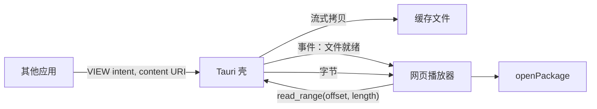

# 青云播放器 0.5.0 开发说明

0.5.0 用 **Tauri 2 做 Android 播放器**（Android 10 及以上、只打 arm64、APK 直接分发），并把“壳打开文件”从整包读进内存改成**按需读取**，Windows 版共用同一条路。Android 制作器、Linux 桌面版排到后面的版本。清单格式仍是 0.3，包格式不变。

## 1. 已确认的决定

| 编号 | 决定 |
| --- | --- |
| A-01 | 版本 0.5.0，在 `release/0.5.0` 分支上开发（从 `main` 的 0.4.1 合并点切出）；发布前只推该分支，用户确认后才合并 `main` 并打标签。 |
| A-02 | 范围：这一轮只做 Android **播放器**。Android 制作器、Linux 桌面版写进 PRD 路线图，排在后面。 |
| A-03 | 构建只在 CI 上做：本机没有 Rust 和 Android 工具链，不装。Android 工程（Gradle 项目）由 CI 生成后作为附件下载回来，提交进仓库。 |
| A-04 | 设备：Android 10 及以上（`minSdkVersion` 29）的真机，只打 `arm64-v8a`。 |
| A-05 | 套壳：Tauri 2，与桌面版一致（PRD 的 O-03 定案）。 |
| A-06 | 签名：用本机 JDK 1.8 的 `keytool` 生成一把固定密钥，写进 GitHub Secrets；备份放在仓库之外的 `C:\Users\wangruibao\.qyplayer-signing\`。调试包和正式包用同一把密钥，可以互相覆盖安装。 |
| A-07 | 打开入口：应用内选文件，加“用其他应用打开”。注册范围放宽：未知二进制、ZIP、`.qyp` 自己的类型都接；不是 `.qyp` 时给“无法打开”的提示。 |
| A-08 | 读取：从其他应用打开的包按**需**读取，不整包进内存；Windows 版改用同一条路（A-025）。 |
| A-09 | 播放行为：方向跟随手机旋转；返回键逐级返回（全屏 → 播放中 → 首页）；播放时屏幕常亮；全屏隐藏系统栏。 |
| A-10 | 发布：功能全部通过即可发布，性能不达标写进已知问题；版本号 0.5.0；APK 与 Windows 文件同一个标签、同一个 Release，任一平台构建失败就不发布。 |

## 2. 从其他应用打开的数据流



要点：

- 壳只认“系统交给它的那一个文件”。网页拿不到路径，只能按偏移读这一份文件，所以不能借命令读任意文件。
- 网页打开包时照旧只读 ZIP 中央目录和 `manifest.json`，素材在要显示时才读（N-PERF-04）。
- 启动时清掉上次留下的缓存文件，避免越积越多。

## 3. Android 工程与构建

- 工作流 `.github/workflows/android.yml`：可手动触发，也被 `release.yml` 调用。Ubuntu、JDK 17、Rust 的 `aarch64-linux-android` 目标、`pnpm --filter @qyplayer/web build:player`、`tauri android build --apk --target aarch64`。手动触发时带 `--debug`，这样可以接桌面 Chrome 的 `chrome://inspect` 调试。
- `apps/desktop-player/src-tauri/gen/android` 由 `tauri android init` 生成后提交进仓库；`.gitignore` 放开这一条。之后改清单、改 Gradle 都在仓库里改，CI 不再重新生成。
- 生成出来的工程额外加了一个 `buildSrc/settings.gradle.kts`：buildSrc 是独立的 Gradle 构建，根目录 `settings.gradle` 里的仓库配置对它不生效，而 `kotlin-dsl` 插件要从 Maven Central 拉 kotlin-stdlib，默认只有插件门户能查，CI 上会直接失败。
- `tauri.conf.json` 增加 `bundle.android.minSdkVersion: 29`，应用名与图标见下一节。
- 签名：CI 从 Secrets 写出 `keystore.properties`，`gen/android/app/build.gradle.kts` 读它。调试和正式两种构建都用这把密钥，保证两种包可以互相覆盖。

## 4. 按需读取（Windows 与 Android 共用）

`packages/qyp` 的 `openPackage`、`peekPackage` 的来源类型从 `Blob` 扩展为 `Blob | ByteSource`：

```ts
/** 可以按偏移读取的来源：壳里的文件不必整个读进内存 */
export interface ByteSource {
  readonly size: number;
  read(offset: number, length: number): Promise<Uint8Array>;
}
```

- 内部把 `Blob` 和 `ByteSource` 都包成一个“按偏移取 `Uint8Array`”的读取器，ZIP 的读取、切片、解压路径全部走它。
- 壳的命令：`initial_file` 改为返回文件名和大小（不再返回路径），新增 `read_range(offset, length)`，删除按路径读整个文件的 `read_file`。
- 网页侧 `apps/web/src/desktop.ts` 的 `readInitialFile` 改为返回基于这两个命令的 `ByteSource`；`App.tsx` 与 `PlaybackController` 的调用处跟着改。
- 测试：同一个包分别以 `Blob` 和 `ByteSource` 打开，清单和素材内容一致；越界读取被拒绝。Rust 侧的 `read_range` 单元测试在 CI 上跑。

## 5. 用其他应用打开

- `gen/android/app/src/main/AndroidManifest.xml`：给主界面加 VIEW 的 intent-filter，`content` 和 `file` 两种地址，类型 `application/x-qyp`、`application/octet-stream`、`application/zip`；`launchMode` 是 `singleTask`（生成时就是），应用已打开时再点一个文件也由同一个界面接收。
- **接收方式没有用 `RunEvent::Opened`**：查了 tauri 2.12 的文档，`RunEvent` 只有 `Exit`、`ExitRequested`、`WindowEvent`、`WebviewEvent`、`Ready`、`Resumed`、`MainEventsCleared`、`MenuEvent`、`TrayIconEvent`，没有打开文件的变体（那是 Tauri 1 / macOS 的接口）。所以直接走计划里的退路：
  - `MainActivity.kt` 在 `onCreate` 和 `onNewIntent` 里读 intent 的 `content:// 或 file://` 地址，用 `contentResolver.openInputStream` 把文件拷进缓存目录 `received/`，再把路径写进 `received/pending.txt`；`onCreate` 里先清掉上次留下的缓存。
  - 壳在 `setup` 里起一个后台线程，每 0.5 秒看一眼 `pending.txt`；读到新路径就换掉当前文件并发出事件 `qyp-file-received`（载荷是文件名和字节数）。网页收到事件后按 A3 的方式打开。
  - 冷启动的竞态：`initial_file` 命令自己也会取一次 `pending.txt`，所以网页即使比后台线程先问，也能拿到刚交来的文件；同一个路径只处理一次。
- 网页侧用 `@tauri-apps/api/event` 的 `listen` 订阅这个事件；启动参数和事件指向同一个文件时只打开一次。

## 6. 手机上的播放行为

- **返回键**：`@tauri-apps/api/app` 的 `onBackButtonPress` 在已安装的 2.12.5 里有，注册处理者后壳不再自己后退或退出，所以这一版直接用它（比 `popstate` 更可控）：播放界面登记一级返回，先退出全屏，再退出播放界面；都在首页时退出应用。只在 Android 壳里启用，网页版和 Windows 版不变。
- **屏幕常亮**：播放时申请网页的 Wake Lock，暂停和结束时释放，切到后台由浏览器自动释放、回到前台再申请一次。接口不存在或被拒绝时什么也不做。真机上如果没用，退路是在 `MainActivity.kt` 里给窗口设常亮标志。
- **文件选择器**：`App.tsx` 的 `accept=".qyp,application/zip"` 在 Android 上会让 `.qyp` 显示成不可选（系统不认识这个后缀），Android 壳里去掉这个限制，选错文件由现有的校验提示兜住。

## 7. 密钥与 Secrets

| 名称 | 内容 |
| --- | --- |
| `ANDROID_KEY_BASE64` | 密钥库文件（`.jks`）的 Base64 |
| `ANDROID_KEY_ALIAS` | 别名 |
| `ANDROID_KEY_PASSWORD` | 密钥库与密钥的同一个密码 |

- 密钥库备份在 `C:\Users\wangruibao\.qyplayer-signing\`（仓库之外，可自行改位置或换新密钥）。
- 换了密钥以后，旧的安装包不能覆盖升级，只能卸载重装。

## 8. 验收清单

**我（开发侧）能验的**：单元测试、类型检查、CI 上两个平台的构建是否通过、APK 是否生成并正确签名、Windows 安装包能否生成。

**要你在真机上验的**：

验收点 1（A2 结束时）：

1. 安装调试 APK，能启动，首页显示正常。
2. 应用内“打开文件”选一个 `.qyp`，能播放。
3. 全屏正常，旋转后画面跟着转。
4. 切到后台，声音停止；回到应用是暂停状态、位置不变。
5. 桌面 Chrome 的 `chrome://inspect` 能连上 WebView。

验收点 2（A5 结束时）：

1. 从文件管理器打开 `.qyp`（应用未启动、已启动各一次），都能进播放器。
2. 从微信打开 `.qyp`，同上。
3. 打开一个几百 MB 的包，能正常播放且不卡死。
4. 返回键三级：全屏 → 播放中 → 首页；首页再按退出应用。
5. 播放时屏幕不自动熄灭；暂停后恢复系统行为。
6. 全屏时系统栏隐藏。
7. 选一个非 `.qyp` 的文件，给出“无法打开”的提示，不崩溃。
8. 顺带记录 1080p 影片的帧率。

Windows 回归（A6 结束时）：装 CI 出的安装包，双击 `.qyp` 能打开并播放。

## 9. 步骤

每一步结束 `pnpm lint`、`pnpm typecheck`、`pnpm test` 通过，一步一个提交；分支 `release/0.5.0`，发布前只推这个分支。

| 步骤 | 内容 |
| --- | --- |
| A0 | 本文档与 PRD 决定项（O-03、O-04、O-06、O-07、10.2） |
| A1 | 播放器工程改成库形式：`lib.rs` 放逻辑，`main.rs` 只调用 `run()`，桌面专用部分条件编译 |
| A2 | `android.yml`、`gen/android`、`minSdk 29`、签名、图标和应用名；出第一个调试 APK，请用户做验收点 1 |
| A3 | `ByteSource`、`initial_file` + `read_range`、`desktop.ts` 与 `App.tsx`，补测试 |
| A4 | intent-filter、单任务、收到文件拷进缓存并通知网页、启动时清缓存 |
| A5 | 返回键、播放常亮、文件选择器；出 APK，请用户做验收点 2 |
| A6 | `release.yml` 拆分、版本 0.5.0、`release-check`、README、发布说明、PRD；Windows 回归后请用户确认，再合并 `main` 并打标签 |

## 10. 走了以后才知道的假设与退路

| 假设 | 不成立时的退路 |
| --- | --- |
| `tauri android init` 和构建在 CI 的 Ubuntu 机器上不需要额外的系统依赖 | 按报错补装 NDK 或 SDK 组件；APK 输出路径以实际为准。**已遇到一处**：buildSrc 的仓库解析失败，加了 `gen/android/buildSrc/settings.gradle.kts` 解决 |
| Tauri 有 `RunEvent::Opened` 用来接收别的应用发来的文件 | **不成立**：2.12 的 `RunEvent` 没有这个变体，已改为 `MainActivity` 读 intent + `pending.txt` + 后台线程通知网页 |
| `tauri-plugin-fs` 能从 Rust 一侧读 `content://` | 没有用：`content://` 由 Kotlin 的 `contentResolver` 读，Rust 只读缓存里的普通文件 |
| Android WebView 支持 Wake Lock 与网页全屏接口 | 全屏不支持时改为在壳里控制系统栏；Wake Lock 不支持时在 `MainActivity.kt` 里设窗口常亮标志 |
| 微信等应用用 VIEW intent 交来文件 | 如果实测用的是分享（`ACTION_SEND` + `EXTRA_STREAM`），在清单里再加 SEND 的 intent-filter，并在 `MainActivity` 里读 `EXTRA_STREAM` |

## 11. 风险

- Android WebView 的 Canvas 2D 性能是这一版最大的未知：1080p 影片可能到不了 30 帧。达不到就如实写进发布说明的已知问题。
- 只打 arm64，32 位设备装不上；这是有意的取舍。
- 微信等应用分享进来的文件可能是临时缓存，拷贝完成前对方进程结束会导致读取失败，界面按“无法读取该文件”提示。
- 首次安装需要允许“安装未知来源应用”，README 里写明。
